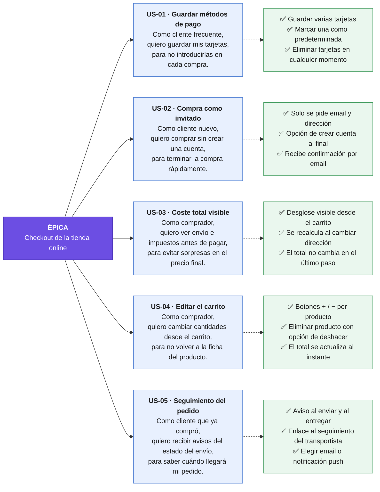

En UX (y en metodologías ágiles en general), una **user story** o **historia de usuario** es una descripción breve, escrita en lenguaje sencillo, de una funcionalidad contada desde la perspectiva de la persona que la va a usar. Su objetivo es que el equipo no pierda de vista _quién_ necesita algo, _qué_ necesita y _por qué_, en lugar de centrarse solo en especificaciones técnicas.

El formato clásico es:

> **Como** [tipo de usuario], **quiero** [acción u objetivo], **para** [beneficio o motivación].

Por ejemplo: _"Como cliente frecuente de una tienda online, quiero guardar mis métodos de pago, para no tener que introducirlos cada vez que compro."_

La parte del "para" es la más valiosa desde el punto de vista de UX, porque expresa la necesidad real detrás de la petición. Eso permite al diseñador explorar distintas soluciones: quizá el problema de fondo es que el checkout es lento, y hay más formas de resolverlo que guardar tarjetas.

Las historias suelen acompañarse de **criterios de aceptación**, que definen cuándo se considera cumplida. Siguiendo el ejemplo, podrían ser que el usuario pueda guardar varias tarjetas, elegir una como predeterminada y eliminarlas cuando quiera.

En el trabajo de UX cumplen varias funciones: traducen la investigación con usuarios (entrevistas, personas, journey maps) en requisitos concretos, sirven de lenguaje común entre diseño, desarrollo y producto, y ayudan a priorizar el trabajo en un backlog. Un criterio muy usado para escribir buenas historias es **INVEST**: que sean independientes, negociables, valiosas, estimables, pequeñas (_small_) y verificables (_testable_).

Conviene distinguirlas de conceptos cercanos: las **personas** describen _quién_ es el usuario, los **casos de uso** detallan paso a paso la interacción con el sistema, y los **job stories** (una alternativa) se centran en la situación en vez del rol, con el formato _"Cuando [situación], quiero [motivación], para [resultado]"_.

Ejemplo:

