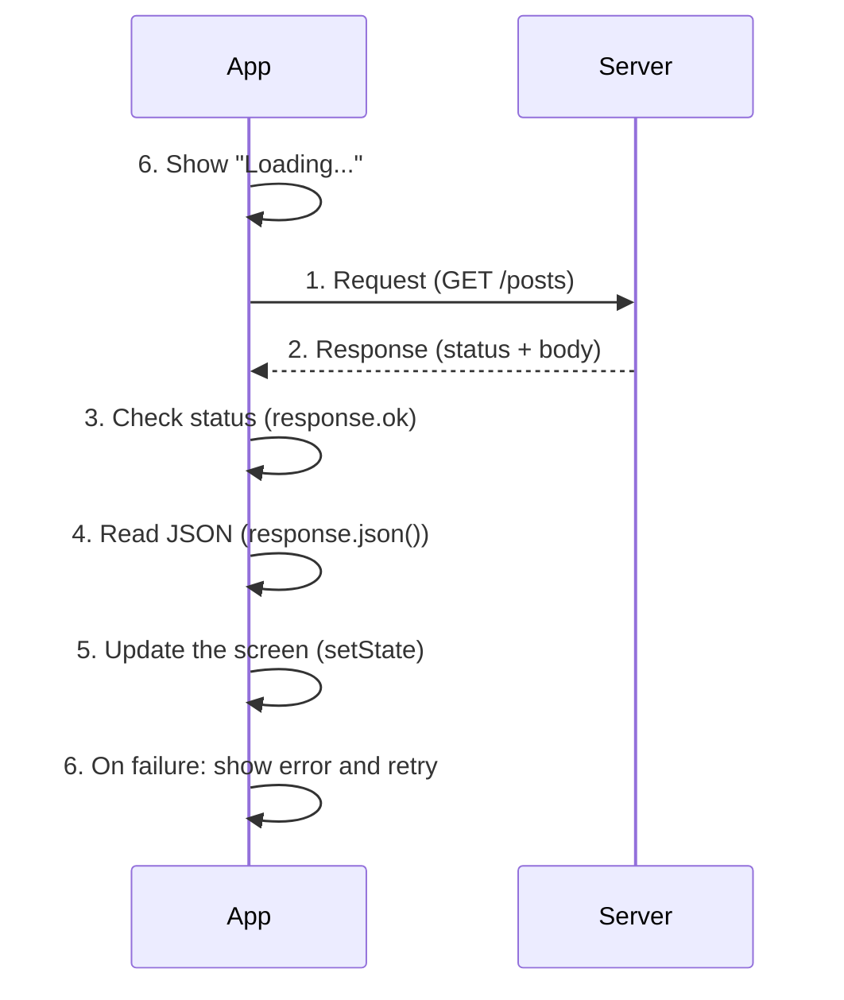
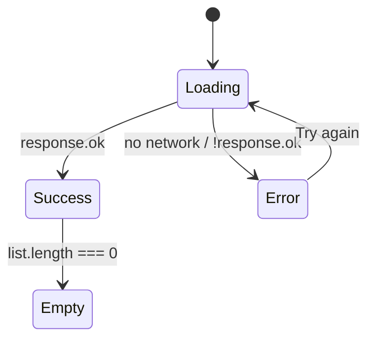
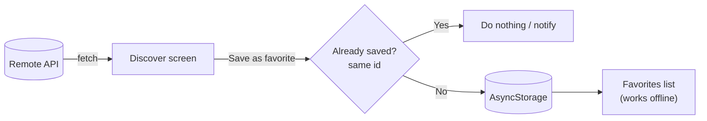

---
tags:
  - programacion-multiplataforma
  - DAM2
unidad: 2
bloque: 3
tema: Peticiones HTTP/HTTPS con fetch, consumo de API REST y estados de carga
---
# Unidad 2. HTTP y API REST

> [!summary] Ideas clave
> - HTTP es el protocolo de petición y respuesta entre un cliente (la aplicación) y un servidor; HTTPS es su versión cifrada.
> - Una API REST expone recursos en URL concretas (*endpoints*) y se maneja con métodos HTTP como `GET` o `POST`.
> - `fetch` devuelve primero una **respuesta HTTP**; los **datos** se obtienen después con `response.json()`.
> - `fetch` no falla con un 404 o un 500: hay que comprobar `response.ok` y lanzar el error a mano.
> - Toda consulta remota tiene tres estados: cargando, correcto y error; además se contempla la respuesta vacía.
> - Los datos remotos se consultan por HTTP; los locales se guardan en el dispositivo, y pueden combinarse (favoritos).
> - Al guardar datos remotos en local se evitan duplicados comparando el identificador.
> - Nunca se incluyen claves privadas de API en el código de la aplicación.

Hasta ahora todos los datos de MyPlaces proceden de la propia aplicación: el archivo inicial y el almacenamiento local (véase el bloque [[02.2 - Persistencia local|Persistencia local]]). Este bloque incorpora **datos remotos**: información que vive en un servidor y que la aplicación consulta a través de internet.

---

## 1. Conceptos básicos

### 1.1. Cliente, servidor y HTTP

> [!note] Definición: cliente y servidor
> El **cliente** es el programa que solicita información (la aplicación móvil); el **servidor** es el equipo que la almacena y la entrega bajo petición.

> [!note] Definición: HTTP
> *Hypertext Transfer Protocol* (protocolo de transferencia de hipertexto): conjunto de reglas con las que un cliente envía una **petición** (*request*) a un servidor y este devuelve una **respuesta** (*response*).

> [!note] Definición: HTTPS
> HTTP sobre una conexión cifrada (TLS). Impide que terceros lean o modifiquen los datos en tránsito. Es el estándar en aplicaciones reales.

> [!warning] HTTP sin cifrar en Android
> Desde Android 9, las aplicaciones bloquean por defecto las conexiones HTTP sin cifrar (*cleartext traffic*). Durante el desarrollo puede funcionar, porque las versiones de depuración suelen permitirlo, lo que oculta el problema hasta generar la versión final. Se deben usar siempre direcciones `https://`.

### 1.2. API REST

> [!note] Definición: API
> *Application Programming Interface* (interfaz de programación de aplicaciones): conjunto de puntos de acceso que un sistema ofrece para que otros programas usen sus datos o funciones.

> [!note] Definición: API REST
> API que organiza la información en **recursos** (publicaciones, usuarios, lugares), cada uno accesible en una URL llamada ***endpoint*** (punto de acceso), y que usa los métodos HTTP para indicar la operación. Normalmente intercambia datos en JSON.

```
https://jsonplaceholder.typicode.com/posts      ← all posts
https://jsonplaceholder.typicode.com/posts/1    ← post with id 1
```

| Método | Operación | Ejemplo |
|---|---|---|
| `GET` | Leer | Obtener la lista de lugares |
| `POST` | Crear | Añadir un lugar |
| `PUT` / `PATCH` | Modificar (completo / parcial) | Cambiar la descripción |
| `DELETE` | Borrar | Eliminar un lugar |

### 1.3. Códigos de estado

Cada respuesta incluye un **código de estado** que indica el resultado de la petición.

| Rango | Significado | Ejemplos frecuentes |
|---|---|---|
| 2xx | Éxito | `200 OK`, `201 Created` |
| 3xx | Redirección | `301 Moved Permanently` |
| 4xx | Error del cliente | `400 Bad Request`, `401 Unauthorized`, `404 Not Found` |
| 5xx | Error del servidor | `500 Internal Server Error`, `503 Service Unavailable` |

---

## 2. El ciclo de una petición

El material describe seis pasos, desde la petición hasta la interfaz:



> [!important]
> El paso 6 no es un añadido: la espera y los errores forman parte de cualquier consulta remota, porque la red es lenta e imprevisible.

---

## 3. `fetch`: la primera petición

> [!note] Definición: `fetch`
> Función de JavaScript, disponible en React Native sin instalar nada, que envía una petición HTTP y devuelve una promesa con la respuesta.

```ts
const response = await fetch("https://jsonplaceholder.typicode.com/posts/1");
if (!response.ok) throw new Error(`HTTP error ${response.status}`);
const data = await response.json();
console.log(data.title);
```

```
// texto de ejemplo
sunt aut facere repellat provident occaecati excepturi optio reprehenderit
```

### 3.1. Respuesta HTTP frente a datos

| Elemento | Qué contiene |
|---|---|
| `response` | La respuesta HTTP: estado, cabeceras y un cuerpo todavía sin leer |
| `response.status` | Código de estado numérico (`200`, `404`…) |
| `response.ok` | `true` si el estado está entre 200 y 299 |
| `await response.json()` | Los **datos**: el cuerpo convertido de JSON a objeto |

> [!danger] `fetch` no falla con los errores HTTP
> La promesa de `fetch` solo se rechaza si no se pudo conectar (sin red, dominio inexistente). Con un `404` o un `500` se resuelve con normalidad y `response.ok` vale `false`. Si no se comprueba, se intentan leer datos que no existen.

> [!warning] `response.json()` también es asíncrono
> Leer el cuerpo requiere otro `await`. Sin él, `data` es una promesa y `data.title` vale `undefined`.

### 3.2. Tipar la respuesta

`response.json()` devuelve un valor sin tipo. En TypeScript se indica la forma esperada de los datos:

```ts
type Post = { id: number; title: string; body: string };

const posts: Post[] = await response.json();
```

> [!info]
> El tipo es una promesa del programador, no una comprobación: si la API devuelve otra forma, TypeScript no lo detecta durante la ejecución.

### 3.3. Enviar datos (`POST`)

Para crear un recurso se indican el método, el tipo de contenido y el cuerpo en JSON:

```ts
const response = await fetch("https://jsonplaceholder.typicode.com/posts", {
  method: "POST",
  headers: { "Content-Type": "application/json" },
  body: JSON.stringify({ title: "New place", body: "Description" }),
});
console.log(response.status);
```

```
201
```

> [!danger] Claves privadas en el código
> Todo el código de una aplicación móvil puede extraerse del paquete instalado. Una clave de API privada escrita en el código deja de ser secreta. Las API que requieren claves secretas se consultan a través de un servidor propio.

> [!info] API pública de demostración
> JSONPlaceholder es una API de prueba: acepta `POST`, `PUT` y `DELETE`, pero no guarda los cambios. Al ser un servicio externo, puede cambiar o dejar de responder.

---

## 4. Los tres estados de una consulta

### 4.1. Cargando, correcto y error

| Estado | Qué se muestra |
|---|---|
| Cargando (*loading*) | Un indicador (`ActivityIndicator`) o el texto «Cargando…» |
| Correcto (*success*) | Los datos |
| Error | Un mensaje comprensible y la opción de reintentar |
| Correcto pero vacío | Un mensaje del tipo «No hay resultados» |

Se representan con tres estados de React:

```tsx
const [posts, setPosts] = useState<Post[]>([]);
const [loading, setLoading] = useState(true);
const [error, setError] = useState<string | null>(null);
```

### 4.2. La función de carga

La carga se escribe como una función independiente para poder llamarla al montar la pantalla y desde un botón «Reintentar»:

```tsx
async function load() {
  setLoading(true);
  setError(null);
  try {
    const response = await fetch("https://jsonplaceholder.typicode.com/posts");
    if (!response.ok) throw new Error(`HTTP error ${response.status}`);
    setPosts(await response.json());
  } catch {
    setError("Could not load the results");
  } finally {
    setLoading(false);
  }
}

useEffect(() => {
  load();
}, []);
```

> [!note] Definición: `finally`
> Bloque que se ejecuta siempre al terminar un `try`/`catch`, haya habido error o no. Es el lugar adecuado para desactivar el indicador de carga.

### 4.3. Mostrar cada estado

```tsx
if (loading) return <ActivityIndicator size="large" />;

if (error)
  return (
    <View>
      <Text>{error}</Text>
      <Pressable onPress={load}>
        <Text>Try again</Text>
      </Pressable>
    </View>
  );

return (
  <FlatList
    data={posts}
    keyExtractor={(post) => post.id.toString()}
    renderItem={({ item }) => <Text>{item.title}</Text>}
    ListEmptyComponent={<Text>No results</Text>}
  />
);
```



> [!tip] `keyExtractor` con identificadores numéricos
> `keyExtractor` debe devolver texto. Si la API usa identificadores numéricos, se convierten con `toString()`.

> [!example] Microejercicio 4. API
> Añadir una pantalla «Descubre». Consultar una API pública de prueba y mostrar una lista de resultados. Incluir los estados cargando, error y lista vacía. Extensión: botón «Volver a intentar».

---

## 5. Combinar datos remotos y locales

No todo tiene que venir del servidor. Los datos remotos se consultan; los locales se guardan en el dispositivo. Un caso habitual es guardar como **favorito local** un resultado remoto.



### 5.1. Evitar duplicados

Antes de añadir, se comprueba si ya existe un elemento con el mismo identificador:

```ts
const addFavorite = (post: Post) => {
  if (favorites.some((favorite) => favorite.id === post.id)) return;
  const updated = [...favorites, post];
  setFavorites(updated);
  AsyncStorage.setItem("favorites", JSON.stringify(updated));
};
```

> [!note] Definición: `some`
> Método de los arrays que devuelve `true` si **al menos un** elemento cumple la condición. Es la forma directa de preguntar «¿ya existe?».

### 5.2. Preguntas que deben plantearse

| Pregunta | Respuesta |
|---|---|
| ¿Qué ocurre sin internet? | La consulta remota muestra el estado de error; los favoritos, al ser locales, siguen disponibles |
| ¿Y si se guarda dos veces? | Se comprueba el identificador con `some` antes de añadir |
| ¿Pueden coincidir identificadores remotos y locales? | Sí: el `1` de la API y el `"1"` de `llocs.js` son distintos objetos. Se recomienda guardarlos en claves separadas o prefijar el id (`` `api-${post.id}` ``) |

> [!warning] Tipos de identificador
> La API usa identificadores numéricos y las rutas de Expo Router entregan texto (véase el bloque [[02.1 - Navegación y formularios|Navegación y formularios]]). Al abrir el detalle de un resultado remoto, la comparación necesita `Number(id)` o guardar el id como texto.

> [!example] Microejercicio 5. Favoritos
> Permitir guardar un resultado de la API como lugar favorito. Evitar duplicados por identificador. Comprobar que los favoritos se mantienen al reiniciar la aplicación.

---

## 6. Errores típicos

| Error | Consecuencia | Solución |
|---|---|---|
| No comprobar `response.ok` | Se procesan como datos las páginas de error | `if (!response.ok) throw new Error(...)` |
| Olvidar `await response.json()` | `data` es una promesa; los campos valen `undefined` | `await` también en `.json()` |
| Sin `try`/`catch` | Sin red, la aplicación muestra un error rojo | Capturar y pasar al estado de error |
| `setLoading(false)` solo en el `try` | El indicador no desaparece tras un error | Ponerlo en `finally` |
| Sin estado vacío | Pantalla en blanco | `ListEmptyComponent` |
| URL `http://` en Android | La petición se bloquea en la versión final | Usar `https://` |
| `localhost` desde el emulador | Apunta al propio emulador, no al ordenador | Usar `10.0.2.2` en el emulador de Android |
| Clave privada en el código | Cualquiera puede extraerla | Servidor intermedio propio |
| Guardar favoritos sin comprobar | Duplicados en la lista | `some` por identificador |
| `keyExtractor` con número | Aviso de tipo | `id.toString()` |

---

## 7. Ejemplo integrador

Un *hook* propio que encapsula los tres estados de cualquier consulta y una pantalla que lo usa para listar usuarios con reintento. Combina `fetch`, `response.ok`, `try`/`catch`/`finally`, tipado y los estados de carga, error y vacío.

> [!note] Definición: hook propio
> Función cuyo nombre empieza por `use` y que agrupa otros *hooks* (`useState`, `useEffect`) para reutilizar una lógica en varios componentes.

```ts
// hooks/useFetch.ts
export function useFetch<T>(url: string) {
  const [data, setData] = useState<T | null>(null);
  const [loading, setLoading] = useState(true);
  const [error, setError] = useState<string | null>(null);

  const load = async () => {
    setLoading(true);
    setError(null);
    try {
      const response = await fetch(url);
      if (!response.ok) throw new Error(`HTTP error ${response.status}`);
      setData(await response.json());
    } catch (e) {
      setError(e instanceof Error ? e.message : "Unknown error");
    } finally {
      setLoading(false);
    }
  };

  useEffect(() => {
    load();
  }, [url]);

  return { data, loading, error, reload: load };
}
```

```tsx
// app/users.tsx
type User = { id: number; name: string };

const { data, loading, error, reload } = useFetch<User[]>(
  "https://jsonplaceholder.typicode.com/users",
);

if (loading) return <ActivityIndicator />;
if (error) return <Pressable onPress={reload}><Text>{error} · Try again</Text></Pressable>;

<FlatList
  data={data ?? []}
  keyExtractor={(user) => user.id.toString()}
  renderItem={({ item }) => <Text>{item.name}</Text>}
  ListEmptyComponent={<Text>No users</Text>}
/>
```

Comportamiento esperado:

```
/users            → 10 users, first one "Leanne Graham"
/users-wrong      → error "HTTP error 404" and the retry button
No network        → error "Network request failed" and the retry button
```

> [!info] Mensaje sin red
> El texto exacto del error de red depende de la plataforma: en React Native es `Network request failed`.

---

## Bibliografía

- [Networking](https://reactnative.dev/docs/network) (documentación oficial de React Native)
- [Using the Fetch API](https://developer.mozilla.org/en-US/docs/Web/API/Fetch_API/Using_Fetch) (MDN Web Docs)
- [Response: ok property](https://developer.mozilla.org/en-US/docs/Web/API/Response/ok) (MDN Web Docs)
- [HTTP response status codes](https://developer.mozilla.org/en-US/docs/Web/HTTP/Status) (MDN Web Docs)
- [HTTP request methods](https://developer.mozilla.org/en-US/docs/Web/HTTP/Methods) (MDN Web Docs)
- [JSONPlaceholder](https://jsonplaceholder.typicode.com/) (servicio de API de prueba)
- [Reusing Logic with Custom Hooks](https://react.dev/learn/reusing-logic-with-custom-hooks) (documentación oficial de React)
