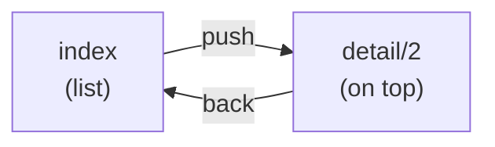
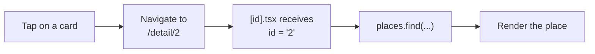
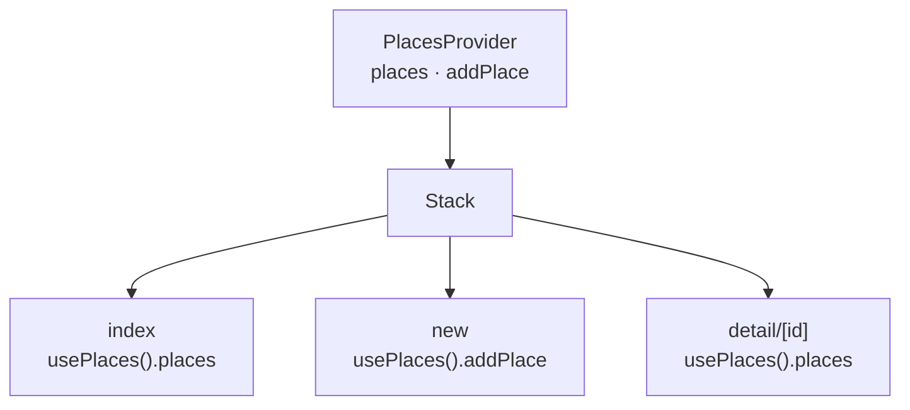
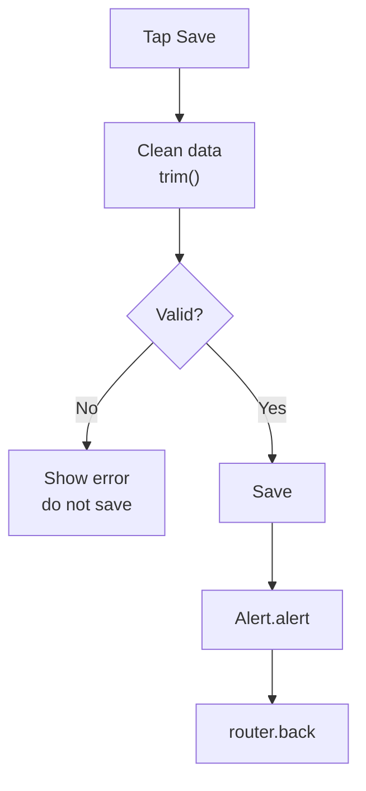

---
tags:
  - programacion-multiplataforma
  - DAM2
unidad: 2
bloque: 1
tema: Navegación con Expo Router y formularios con validación
---
# Unidad 2. Navegación y formularios

> [!summary] Ideas clave
> - Una aplicación real se compone de varias pantallas; cada una debe tener una responsabilidad clara.
> - Expo Router define las rutas a partir de los archivos de la carpeta `app/`: cada archivo es una pantalla.
> - `_layout.tsx` no es una pantalla: configura el navegador (`Stack`) que contiene a las demás.
> - Un archivo entre corchetes, como `[id].tsx`, es una ruta dinámica: una sola pantalla sirve para muchos elementos.
> - Los parámetros de ruta se leen con `useLocalSearchParams` y llegan siempre como texto.
> - Se navega de forma declarativa con `Link` o de forma imperativa con `router` (`push`, `back`, `replace`).
> - La pantalla coordina datos y navegación; el componente muestra una pieza reutilizable; la función auxiliar transforma o valida.
> - Un `TextInput` controlado guarda su valor en el estado (`value`) y lo actualiza con `onChangeText`.
> - Los datos se validan antes de guardarlos: campos vacíos, espacios sobrantes (`trim()`) y confirmación con `Alert.alert()`.

La [[01 - Introducción al desarrollo multiplataforma|Unidad 1]] trabajó con una sola pantalla. Esta unidad inicia el proyecto **MyPlaces**, una aplicación para guardar lugares interesantes que crece a lo largo de toda la UT2: primero navega entre pantallas y recoge datos con formularios; en los bloques siguientes los guardará, consultará una API y usará capacidades del dispositivo.

> [!info] Metodología de la UT2
> - Se parte de lo visto en la UT1 (componentes, props, `useState`, estilos), sin empezar de cero.
> - Una misma aplicación: cada reto le añade una capacidad.
> - Se busca una interfaz clara y funcional, no una obra de arte.
> - La IA puede utilizarse para consultar y entender, según las normas de clase.

| Bloque | Contenido | Horas |
|---|---|---|
| 1 | Navegación y formularios | 7 |
| 2 | Persistencia local | 5 |
| 3 | HTTP/HTTPS y API REST | 5 |
| 4 | Sensores y permisos | 6 |
| 5 | Comunicaciones inalámbricas | 3 |
| 6 | Pruebas, despliegue y documentación | 5 |
| — | Sprint 2 | 4 |

> [!info] Convención de estos apuntes
> El material del profesor usa JavaScript (`.jsx`). Estos apuntes usan **TypeScript** (`.tsx`), como el proyecto de Expo. Para pasar un ejemplo a JavaScript basta con eliminar las anotaciones de tipo (`: string`, `<{ id: string }>`, `type ...`).

---

## 1. De una pantalla a una aplicación

Una aplicación no es una única pantalla. El primer paso de MyPlaces es pasar de una **lista de lugares** al **detalle de un lugar**, lo que exige dos cosas:

- **Navegación**: un mecanismo para moverse entre pantallas.
- **Un identificador**: un dato que indique qué lugar debe mostrar el detalle.

> [!note] Definición: navegación
> Mecanismo que permite pasar de una pantalla a otra y volver atrás, manteniendo un historial de las pantallas visitadas.

> [!note] Definición: ruta
> Dirección que identifica una pantalla dentro de la aplicación, con el mismo formato que una URL: `/`, `/detail/3`.

---

## 2. Expo Router: rutas basadas en archivos

### 2.1. La carpeta `app/`

> [!note] Definición: Expo Router
> Sistema de navegación de Expo basado en archivos (*file-based routing*, enrutado basado en archivos): cada archivo de la carpeta `app/` se convierte automáticamente en una pantalla, y su ubicación determina su ruta.

```
src/app/
├── _layout.tsx       ← navigator configuration (not a screen)
├── index.tsx         ← "/"            list
├── new.tsx           ← "/new"         add form
└── detail/
    └── [id].tsx      ← "/detail/1", "/detail/2"...
```

| Archivo | Ruta | Función |
|---|---|---|
| `_layout.tsx` | — | Define el navegador que contiene las pantallas |
| `index.tsx` | `/` | Pantalla inicial de la carpeta |
| `new.tsx` | `/new` | Ruta estática |
| `detail/[id].tsx` | `/detail/:id` | Ruta dinámica |

> [!warning] Las rutas deben coincidir con archivos reales
> Una ruta que no corresponde a ningún archivo muestra la pantalla *Unmatched route*. Se debe respetar exactamente el nombre del archivo, incluidas mayúsculas y minúsculas: `/newPlace` exige `app/newPlace.tsx`.

> [!tip] Organización
> En `app/` solo van pantallas. Los componentes reutilizables van en `components/` y los datos en una carpeta aparte (`data/`), porque cualquier archivo dentro de `app/` se interpreta como una ruta.

### 2.2. El layout y el Stack

> [!note] Definición: layout
> Archivo `_layout.tsx` que envuelve a las pantallas de su carpeta y define cómo se navega entre ellas. No se muestra como una pantalla independiente.

> [!note] Definición: Stack
> Navegador en pila: cada pantalla nueva se coloca encima de la anterior, y al volver atrás se retira la de arriba. Incluye una cabecera con título y botón de retroceso.



```tsx
// app/_layout.tsx
import { Stack } from "expo-router";

export default function Layout() {
  return (
    <Stack screenOptions={{ headerTintColor: "#234c3b" }}>
      <Stack.Screen name="index" options={{ title: "Places" }} />
      <Stack.Screen name="detail/[id]" options={{ title: "Detail" }} />
    </Stack>
  );
}
```

| Elemento | Función |
|---|---|
| `screenOptions` | Opciones comunes a todas las pantallas (colores de cabecera, fondo…) |
| `Stack.Screen name` | Ruta a la que se aplican las opciones, sin extensión: `"detail/[id]"` |
| `options.title` | Título de la cabecera |
| `options.headerShown` | `false` oculta la cabecera |

> [!info]
> Registrar cada pantalla con `Stack.Screen` no es obligatorio: Expo Router detecta los archivos de `app/` automáticamente. Se registran para configurar sus opciones.

### 2.3. Rutas dinámicas

> [!note] Definición: ruta dinámica
> Ruta cuyo nombre de archivo va entre corchetes, como `[id].tsx`. El segmento entre corchetes acepta cualquier valor, y ese valor se entrega a la pantalla como **parámetro** con el nombre indicado (`id`).

Un único archivo `[id].tsx` sirve para todos los lugares, igual que un único componente sirve para muchas tarjetas. La pantalla lee el parámetro con el *hook* `useLocalSearchParams` y busca los datos con él:

```tsx
// app/detail/[id].tsx
import { useLocalSearchParams } from "expo-router";
import { places } from "@/data/places";

export default function Detail() {
  const { id } = useLocalSearchParams<{ id: string }>();
  const place = places.find((place) => place.id === id);
  // ...render place or a "not found" message
}
```



> [!danger] Los parámetros siempre son texto
> El parámetro `id` llega como `string`. Si los identificadores de los datos son números (`id: 2`), la comparación `place.id === id` nunca se cumple. Se recomienda usar identificadores de texto (`id: "2"`) o convertir con `Number(id)`.

> [!tip] Pasar solo el identificador
> Por la ruta viaja únicamente el `id`, no el objeto completo. Las dos pantallas importan los datos del mismo módulo: la ruta queda corta y el detalle siempre muestra los datos actuales.

> [!warning] Elemento inexistente
> El parámetro puede no corresponder a ningún elemento (un enlace antiguo, un lugar borrado). `find` devuelve entonces `undefined`, y la pantalla debe mostrar un mensaje en lugar de fallar.

---

## 3. Navegar entre pantallas

### 3.1. Navegación declarativa con `Link`

> [!note] Definición: Link
> Componente de Expo Router que convierte su contenido en un enlace a una ruta. En la web genera un enlace real (`<a href>`).

```tsx
import { Link } from "expo-router";

// Static route
<Link href="/new">Add place</Link>

// Dynamic route with parameters
<Link href={{ pathname: "/detail/[id]", params: { id: "3" } }}>
  <Text>See place</Text>
</Link>
```

La prop `asChild` hace que `Link` no dibuje su propio texto y transfiera su comportamiento al hijo, por ejemplo un `Pressable`:

```tsx
<Link href="/new" asChild>
  <Pressable style={styles.button}>
    <Text>Add place</Text>
  </Pressable>
</Link>
```

> [!danger] `Link asChild` con `style` en forma de función
> Con `asChild`, `Link` combina su estilo con el del hijo mediante `{ ...linkStyle, ...childStyle }`. Si el estilo del `Pressable` es una función (`style={({ pressed }) => [...]}`), esa combinación produce un objeto vacío y **se pierden todos los estilos**. En ese caso se usa un estilo fijo o se navega con `router` desde `onPress` (apartado 3.2).

### 3.2. Navegación imperativa con `router`

> [!note] Definición: navegación imperativa
> Navegación ordenada desde código, con una llamada a una función, en lugar de describirla con un componente. Se usa cuando la navegación depende de una acción previa (guardar, validar).

```tsx
import { router } from "expo-router";

<Pressable
  style={({ pressed }) => [styles.button, pressed && styles.pressed]}
  onPress={() => router.push({ pathname: "/detail/[id]", params: { id: place.id } })}
>
  <Text>See place</Text>
</Pressable>
```

| Método | Efecto |
|---|---|
| `router.push(ruta)` | Abre la ruta encima de la actual (se puede volver) |
| `router.back()` | Vuelve a la pantalla anterior |
| `router.replace(ruta)` | Sustituye la pantalla actual (no se puede volver a ella) |
| `router.canGoBack()` | Indica si existe una pantalla anterior |

| | `Link` | `router` |
|---|---|---|
| Estilo | Declarativo: «esto es un enlace a X» | Imperativo: «al pulsar, ir a X» |
| En la web | Genera un enlace real | Solo navega |
| Uso típico | Enlaces y elementos pulsables simples | Botones con estilos complejos; navegar tras guardar o validar |

### 3.3. Volver atrás

El `Stack` ya incluye un botón de retroceso en la cabecera. Si se añade un botón propio, conviene contemplar que la pantalla se haya abierto directamente desde un enlace, sin pantalla anterior:

```tsx
const goBack = () => {
  if (router.canGoBack()) router.back();
  else router.replace("/");
};
```

### 3.4. Título dinámico en la cabecera

El título de una pantalla puede cambiarse desde la propia pantalla, por ejemplo para mostrar el nombre del lugar, colocando un `Stack.Screen` dentro de su JSX:

```tsx
<Stack.Screen options={{ title: place ? place.name : "Not found" }} />
```

> [!example] Microejercicio 1. Navegación
> Crear una pantalla de lista y una de detalle. Desde cada tarjeta, abrir el detalle correspondiente y añadir un botón para volver atrás. Extensión: mostrar el nombre del lugar en la cabecera.

### 3.5. Rutas protegidas

Algunas pantallas solo deben ser accesibles bajo una condición, por ejemplo haber iniciado sesión. Expo Router lo resuelve en el layout con `Stack.Protected`:

> [!note] Definición: ruta protegida
> Ruta que solo puede visitarse cuando se cumple una condición (`guard`). Si la condición es falsa, Expo Router redirige automáticamente a la primera pantalla accesible.

```tsx
<Stack>
  <Stack.Protected guard={isLoggedIn}>
    <Stack.Screen name="index" />
  </Stack.Protected>
  <Stack.Protected guard={!isLoggedIn}>
    <Stack.Screen name="login" />
  </Stack.Protected>
</Stack>
```

Las pantallas no contienen código de navegación: basta con cambiar `isLoggedIn` para que el layout desbloquee unas rutas y bloquee otras.

| Enfoque | Cómo funciona | Uso |
|---|---|---|
| Renderizado condicional | `isLoggedIn ? <Home /> : <Login />` en un componente | Entender el concepto |
| `Stack.Protected` | El layout decide qué rutas son accesibles | Aplicaciones reales: mantiene historial y rutas |

> [!info] Alcance
> Para que `isLoggedIn` sea visible en el layout y en las pantallas se necesita compartir el estado, lo que se explica en el apartado 6.

---

## 4. Responsabilidades de componentes

Sin organización, toda la aplicación acaba en un único archivo de cientos de líneas. Se distinguen tres responsabilidades:

| Pieza | Responsabilidad | Ejemplo en MyPlaces |
|---|---|---|
| Pantalla | Coordina datos y navegación | `app/index.tsx`, `app/new.tsx` |
| Componente | Muestra una pieza reutilizable | `components/PlaceCard.tsx`, `components/PlaceForm.tsx` |
| Función auxiliar | Transforma o valida datos, sin interfaz | `utils/validatePlace.ts` |

> [!important]
> No se duplican tarjetas ni formularios: si dos pantallas muestran lo mismo, se extrae un componente.

```
src/
├── app/            ← screens (routes)
├── components/     ← reusable pieces
├── data/           ← data and types
└── utils/          ← helper functions
```

---

## 5. Formularios

### 5.1. `TextInput` controlado

> [!note] Definición: componente controlado
> Campo de entrada cuyo valor se guarda en el estado de React. El campo muestra lo que hay en el estado (`value`) y cada cambio actualiza el estado (`onChangeText`): el estado es la única fuente de verdad.

```tsx
const [name, setName] = useState("");

<TextInput value={name} onChangeText={setName} placeholder="Place name" />
```

| Prop | Función |
|---|---|
| `value` | Texto mostrado (viene del estado) |
| `onChangeText` | Función que recibe el nuevo texto en cada cambio |
| `placeholder` | Texto de ayuda cuando el campo está vacío |
| `multiline` | Permite varias líneas |
| `keyboardType` | Tipo de teclado: `"default"`, `"numeric"`, `"email-address"` |
| `autoCapitalize` | Mayúsculas automáticas: `"none"`, `"sentences"`, `"words"` |

> [!tip]
> En un campo `multiline`, `textAlignVertical: "top"` hace que en Android el texto empiece arriba y no centrado.

### 5.2. Varios campos en un único estado

Con varios campos, en lugar de un `useState` por campo se puede usar un único objeto:

```tsx
type PlaceFormData = { name: string; category: string; description: string };

const [form, setForm] = useState<PlaceFormData>({ name: "", category: "", description: "" });

const change = (key: keyof PlaceFormData, value: string) =>
  setForm({ ...form, [key]: value });

<TextInput value={form.name} onChangeText={(text) => change("name", text)} />
```

| Elemento | Significado |
|---|---|
| `...form` | Copia todos los campos actuales (*spread*) |
| `[key]: value` | Propiedad calculada: usa el **valor** de `key` como nombre de la propiedad |
| `keyof PlaceFormData` | Uno de los nombres de campo: `"name"`, `"category"` o `"description"` |

> [!danger] No modificar el objeto del estado
> `form.name = text` modifica el objeto sin avisar a React, y la interfaz no se actualiza. Siempre se crea un objeto nuevo con el *setter*.

### 5.3. El formulario como componente

El formulario es un componente que no sabe qué se hace con los datos: los entrega a la pantalla mediante una prop `onSubmit`. Así puede reutilizarse para crear y para editar.

```tsx
// components/PlaceForm.tsx
type PlaceFormProps = { onSubmit: (place: PlaceFormData) => void };

export default function PlaceForm({ onSubmit }: PlaceFormProps) {
  // ...fields
  return (
    // ...
    <Pressable onPress={() => onSubmit(form)}>
      <Text>Save</Text>
    </Pressable>
  );
}
```

```tsx
// app/new.tsx
export default function NewPlace() {
  const save = (place: PlaceFormData) => console.log(place);
  return <PlaceForm onSubmit={save} />;
}
```

> [!info]
> `console.log` en React Native escribe en la terminal donde se ejecuta `pnpm expo start`, no en la pantalla del emulador.

> [!warning] Archivos `.jsx` en un proyecto TypeScript
> Si el proyecto tiene `tsconfig.json` con `strict: true`, VS Code también revisa los archivos `.jsx` y marca los parámetros sin tipo (*Parameter implicitly has an 'any' type*). La aplicación funciona igual; el aviso se elimina con `"checkJs": false` en `compilerOptions`.

---

## 6. Compartir estado entre pantallas

Los datos de `data/places.ts` son una constante: el formulario no puede añadir lugares a ella. Para que un lugar guardado aparezca en la lista, la lista debe ser **estado compartido** entre pantallas.

> [!note] Definición: Context
> Mecanismo de React para compartir un valor con todos los componentes de un árbol sin pasarlo por props nivel a nivel. Se compone de un *Provider* (proveedor), que guarda el valor, y de `useContext`, que lo lee.

```tsx
// places-context.tsx
const PlacesContext = createContext<PlacesState | null>(null);

export function PlacesProvider({ children }: { children: ReactNode }) {
  const [places, setPlaces] = useState<Place[]>(initialPlaces);
  const addPlace = (place: Place) => setPlaces([...places, place]);

  return (
    <PlacesContext.Provider value={{ places, addPlace }}>{children}</PlacesContext.Provider>
  );
}

export function usePlaces() {
  const context = useContext(PlacesContext);
  if (!context) throw new Error("usePlaces must be used inside PlacesProvider");
  return context;
}
```

El *Provider* envuelve el `Stack` en el layout, y cualquier pantalla lee los datos con `usePlaces()`:

```tsx
// app/_layout.tsx
<PlacesProvider>
  <Stack />
</PlacesProvider>
```



> [!warning]
> `useContext` solo funciona en componentes que estén **dentro** del *Provider*. Por eso, si el propio layout necesita leer el contexto (por ejemplo, para `Stack.Protected`), el `Stack` se coloca en un componente hijo del *Provider*.

> [!info] Alcance
> El estado del Context sigue estando en memoria: se pierde al cerrar la aplicación. La persistencia se estudia en el bloque [[02.2 - Persistencia local|Persistencia local]].

---

## 7. Validar antes de guardar

El usuario también se equivoca. Antes de guardar se comprueba que los datos son correctos:

| Situación | Respuesta |
|---|---|
| Nombre vacío | Mostrar un mensaje y no guardar |
| Espacios al principio o al final | Limpiar con `trim()` |
| Información incorrecta | No guardar |
| Acción importante completada | Confirmar con `Alert.alert(...)` cuando tenga sentido |



La validación es una función auxiliar: recibe los datos y devuelve un mensaje de error o `null`.

```ts
// utils/validatePlace.ts
export function validatePlace(name: string): string | null {
  if (name.trim() === "") return "Name is required";
  return null;
}
```

```ts
validatePlace("   ");     // "Name is required"
validatePlace(" Park ");  // null
```

En la pantalla, el error se guarda en el estado para mostrarlo debajo del formulario:

```tsx
const [error, setError] = useState<string | null>(null);

const save = (form: PlaceFormData) => {
  const message = validatePlace(form.name);
  if (message) return setError(message);

  addPlace({ id: Date.now().toString(), ...form, name: form.name.trim() });
  Alert.alert("Saved", "The place has been added");
  router.back();
};

{error && <Text style={styles.error}>{error}</Text>}
```

> [!note] Definición: Alert
> API de React Native que muestra un diálogo nativo del sistema. Recibe un título, un mensaje y, opcionalmente, una lista de botones.

```ts
Alert.alert("Delete place", "Are you sure?", [
  { text: "Cancel", style: "cancel" },
  { text: "Delete", style: "destructive", onPress: () => remove(id) },
]);
```

> [!tip]
> `Date.now().toString()` genera un identificador único de texto, coherente con los parámetros de ruta.

> [!info] Selección de categoría
> React Native no incluye un componente desplegable equivalente a `<select>`. Para una categoría seleccionable lo más sencillo es una fila de botones (`Pressable`) que guardan la opción elegida en el estado; también existe el paquete `@react-native-picker/picker`.

> [!example] Microejercicio 2. Formulario
> Crear una pantalla «Añadir lugar» con nombre y descripción. Impedir guardar si el nombre está vacío. Mostrar un aviso y volver a la lista después de añadirlo. Extensión: categoría seleccionable.

---

## 8. Errores típicos

| Error | Consecuencia | Solución |
|---|---|---|
| Ruta que no coincide con el archivo | Pantalla *Unmatched route* | Mismo nombre y ubicación que el archivo |
| Componentes o datos dentro de `app/` | Se interpretan como rutas | Moverlos a `components/` y `data/` |
| `id` numérico en los datos | `find` no encuentra nada | Identificadores de texto o `Number(id)` |
| No contemplar un `id` inexistente | Error al leer `place.name` | Comprobar `place` antes de usarlo |
| `Link asChild` + `style` como función | Se pierden los estilos | Estilo fijo o `router.push` en `onPress` |
| `router.back()` sin pantalla anterior | No navega y muestra un aviso en la consola | `canGoBack()` y `replace("/")` |
| `form.name = text` | La interfaz no cambia | `setForm({ ...form, name: text })` |
| Guardar sin `trim()` | Nombres de solo espacios | Validar con `trim()` |
| `useContext` fuera del *Provider* | Error o valor `null` | Envolver con el *Provider* |
| Esperar el `console.log` en el emulador | No se ve nada | Mirar la terminal de Expo |

---

## 9. Ejemplo integrador

Lista de contactos con alta validada: combina rutas, ruta dinámica, Context, formulario controlado, validación y navegación imperativa. Se muestran solo las partes que aplican cada concepto.

```tsx
// contacts-context.tsx — shared state
type Contact = { id: string; name: string };

const ContactsContext = createContext<{
  contacts: Contact[];
  addContact: (name: string) => void;
} | null>(null);

export function ContactsProvider({ children }: { children: ReactNode }) {
  const [contacts, setContacts] = useState<Contact[]>([]);
  const addContact = (name: string) =>
    setContacts([...contacts, { id: Date.now().toString(), name }]);
  return (
    <ContactsContext.Provider value={{ contacts, addContact }}>{children}</ContactsContext.Provider>
  );
}

export const useContacts = () => {
  const context = useContext(ContactsContext);
  if (!context) throw new Error("useContacts must be used inside ContactsProvider");
  return context;
};
```

```tsx
// app/index.tsx — list: each row opens its dynamic route
const { contacts } = useContacts();

{contacts.map((contact) => (
  <Pressable
    key={contact.id}
    onPress={() => router.push({ pathname: "/contact/[id]", params: { id: contact.id } })}
  >
    <Text>{contact.name}</Text>
  </Pressable>
))}
```

```tsx
// app/new.tsx — controlled input + validation + navigation
const { addContact } = useContacts();
const [name, setName] = useState("");
const [error, setError] = useState<string | null>(null);

const save = () => {
  if (name.trim() === "") return setError("Name is required");
  addContact(name.trim());
  router.back();
};
```

```tsx
// app/contact/[id].tsx — read the parameter and set the header title
const { id } = useLocalSearchParams<{ id: string }>();
const contact = useContacts().contacts.find((contact) => contact.id === id);

<Stack.Screen options={{ title: contact ? contact.name : "Not found" }} />
```

Comportamiento esperado:

```
Save with "   "        → "Name is required", nothing is added
Save with " Ana "      → "Ana" added, back to the list
Tap "Ana" in the list  → /contact/<id>, header title "Ana"
```

---

## Bibliografía

- [Navigation basics](https://docs.expo.dev/router/basics/navigation) (documentación oficial de Expo)
- [Navigate between pages](https://docs.expo.dev/router/navigating-pages) (documentación oficial de Expo)
- [Link](https://docs.expo.dev/versions/latest/sdk/router/link) (documentación oficial de Expo)
- [Hooks](https://docs.expo.dev/router/reference/hooks) (documentación oficial de Expo)
- [Protected routes](https://docs.expo.dev/router/advanced/protected/) (documentación oficial de Expo)
- [Passing Data Deeply with Context](https://react.dev/learn/passing-data-deeply-with-context) (documentación oficial de React)
- [useContext](https://react.dev/reference/react/useContext) (documentación oficial de React)
- [TextInput](https://reactnative.dev/docs/textinput) (documentación oficial de React Native)
- [Alert](https://reactnative.dev/docs/alert) (documentación oficial de React Native)
