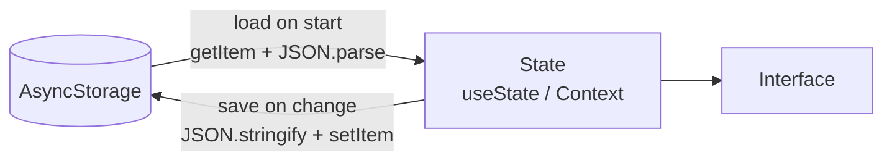
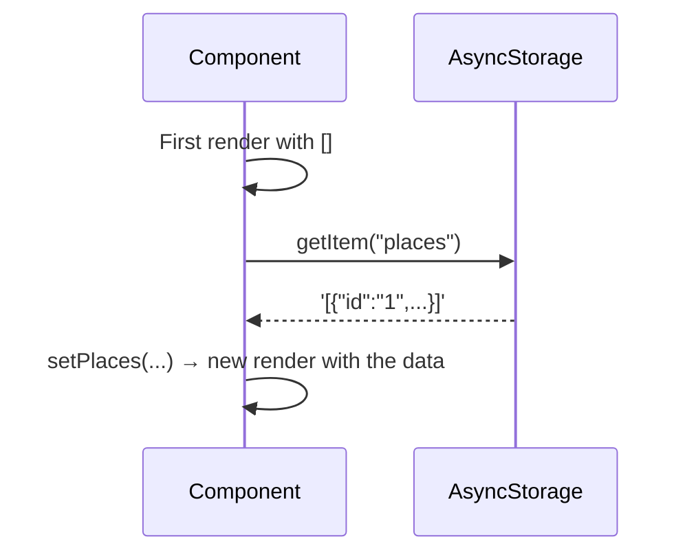

---
tags:
  - programacion-multiplataforma
  - DAM2
unidad: 2
bloque: 2
tema: Persistencia local con AsyncStorage, JSON y useEffect
---
# Unidad 2. Persistencia local

> [!summary] Ideas clave
> - Los datos guardados con `useState` o en un Context viven en memoria y se pierden al reiniciar la aplicación.
> - La persistencia consiste en guardar los datos en el dispositivo para recuperarlos más tarde.
> - AsyncStorage es un almacén clave/valor para datos pequeños, no sensibles y en formato texto.
> - AsyncStorage no es una base de datos relacional ni un almacén seguro para secretos.
> - `JSON.stringify()` convierte objetos y arrays en texto para guardarlos; `JSON.parse()` los recupera.
> - Las operaciones de AsyncStorage son asíncronas: se esperan con `await` y sus errores se capturan con `try`/`catch`.
> - `getItem` devuelve `null` si la clave no existe: siempre se contempla el caso sin datos guardados.
> - Los datos se cargan con `useEffect` al montar la pantalla; la función `async` se declara dentro del efecto.

En el bloque [[02.1 - Navegación y formularios|Navegación y formularios]] MyPlaces ya permite añadir lugares, pero al cerrar la aplicación desaparecen. Este bloque resuelve ese problema guardando la lista en el almacenamiento del dispositivo.

---

## 1. Datos en memoria frente a persistencia

> [!note] Definición: datos en memoria
> Datos que existen solo mientras la aplicación se ejecuta, como el estado de `useState` o el de un Context. Se pierden al cerrar o reiniciar la aplicación.

> [!note] Definición: persistencia
> Capacidad de conservar los datos más allá de la ejecución de la aplicación, guardándolos en un almacenamiento permanente del dispositivo.

| | `useState` / Context | Almacenamiento persistente |
|---|---|---|
| Dónde vive | Memoria RAM | Almacenamiento del dispositivo |
| Duración | Mientras el componente o la app existen | Hasta que se borra |
| Velocidad | Inmediata (síncrona) | Requiere esperar (asíncrona) |
| Actualiza la interfaz | Sí | No: hay que pasar los datos al estado |

> [!important]
> El almacenamiento persistente y el estado se complementan: el estado alimenta la interfaz y el almacenamiento conserva una copia. Al arrancar se lee el almacenamiento y se carga en el estado; al cambiar el estado, se guarda en el almacenamiento.



---

## 2. AsyncStorage

### 2.1. Qué es y cuándo usarlo

> [!note] Definición: almacenamiento clave/valor
> Modelo de almacenamiento en el que cada dato (*value*, valor) se guarda y se recupera mediante un nombre único (*key*, clave), sin tablas ni relaciones.

> [!note] Definición: AsyncStorage
> Biblioteca de React Native que ofrece un almacenamiento clave/valor persistente, asíncrono y sin cifrar, en el que tanto las claves como los valores son cadenas de texto.

Se instala con la versión compatible con el SDK de Expo:

```bash
pnpm expo install @react-native-async-storage/async-storage
```

```ts
import AsyncStorage from "@react-native-async-storage/async-storage";
```

| Necesidad | Solución recomendada |
|---|---|
| Datos pequeños y no sensibles (preferencias, listas cortas) | AsyncStorage |
| Secretos (contraseñas, *tokens* de sesión) | `expo-secure-store`, que cifra los datos |
| Muchos datos, búsquedas o relaciones entre tablas | `expo-sqlite`, una base de datos SQLite |

> [!danger] AsyncStorage no es seguro
> Los datos se guardan sin cifrar. Nunca deben guardarse en él contraseñas, *tokens* ni datos personales sensibles.

> [!info] Alcance
> En esta unidad solo se utiliza AsyncStorage. `expo-secure-store` y `expo-sqlite` se mencionan como referencia.

### 2.2. Operaciones básicas

| Método | Función | Devuelve |
|---|---|---|
| `setItem(key, value)` | Guarda (o sobrescribe) un valor | `Promise<void>` |
| `getItem(key)` | Lee un valor | `Promise<string \| null>` |
| `removeItem(key)` | Borra una clave | `Promise<void>` |
| `clear()` | Borra **todo** el almacenamiento de la app | `Promise<void>` |

> [!warning] `getItem` puede devolver `null`
> Si la clave no existe (por ejemplo, la primera vez que se abre la aplicación), `getItem` devuelve `null`. El código siempre debe contemplar este caso.

> [!tip]
> Las claves se definen una sola vez como constantes (`const STORAGE_KEY = "places";`) para evitar errores de escritura entre la lectura y la escritura.

---

## 3. JSON: guardar objetos como texto

AsyncStorage solo guarda texto. Para guardar arrays u objetos hay que convertirlos.

> [!note] Definición: serialización
> Conversión de una estructura de datos (objeto, array) en una cadena de texto que puede almacenarse o enviarse. La operación inversa se llama deserialización.

| Función | Dirección | Ejemplo |
|---|---|---|
| `JSON.stringify(valor)` | Objeto → texto | `[{ id: "1" }]` → `'[{"id":"1"}]'` |
| `JSON.parse(texto)` | Texto → objeto | `'[{"id":"1"}]'` → `[{ id: "1" }]` |

```ts
const places = [{ id: "1", name: "Park" }];

const text = JSON.stringify(places);
console.log(text);

const restored = JSON.parse(text);
console.log(restored[0].name);
```

```
[{"id":"1","name":"Park"}]
Park
```

> [!warning] Lo que JSON no conserva
> JSON solo representa texto, números, booleanos, `null`, arrays y objetos. Una fecha (`Date`) se convierte en texto y, al recuperarla, ya no es un `Date`; las funciones y los valores `undefined` desaparecen.

> [!danger] `JSON.parse` de un texto inválido
> Si el texto no es JSON válido, `JSON.parse` lanza un error que detiene la ejecución. Por eso la lectura se envuelve en `try`/`catch` (apartado 4).

---

## 4. Operaciones asíncronas

### 4.1. Promesas y `async`/`await`

> [!note] Definición: operación asíncrona
> Operación que no termina inmediatamente (leer del almacenamiento, consultar una API). La aplicación no se bloquea mientras espera: el resultado llega más tarde.

> [!note] Definición: promesa
> Objeto (*Promise*) que representa el resultado futuro de una operación asíncrona. Puede cumplirse con un valor o rechazarse con un error.

`await` espera a que una promesa se resuelva y obtiene su valor. Solo puede usarse dentro de una función marcada como `async`:

```ts
async function savePlaces(places: Place[]) {
  await AsyncStorage.setItem(STORAGE_KEY, JSON.stringify(places));
}

async function loadPlaces(): Promise<Place[]> {
  const text = await AsyncStorage.getItem(STORAGE_KEY);
  return text ? JSON.parse(text) : [];
}
```

> [!danger] Olvidar `await`
> Sin `await`, `getItem` devuelve la promesa y no el texto: `const text = AsyncStorage.getItem(key)` guarda un objeto `Promise`, y `JSON.parse(text)` falla.

### 4.2. Gestión de errores con `try`/`catch`

Leer o escribir puede fallar (almacenamiento lleno, datos corruptos). `try`/`catch` captura el error para que la aplicación no se detenga:

```ts
async function loadPlaces(): Promise<Place[]> {
  try {
    const text = await AsyncStorage.getItem(STORAGE_KEY);
    return text ? JSON.parse(text) : [];
  } catch (error) {
    console.warn("Could not load places", error);
    return [];
  }
}
```

| Caso | Resultado de `loadPlaces` |
|---|---|
| Datos guardados correctamente | El array guardado |
| Primera ejecución (clave inexistente) | `[]` |
| Texto corrupto | `[]` y un aviso en la consola |

---

## 5. Cargar datos con `useEffect`

### 5.1. El hook `useEffect`

> [!note] Definición: efecto
> Código que sincroniza un componente con algo externo a React (almacenamiento, red, sensores). Se ejecuta **después** de que el componente se dibuja.

> [!note] Definición: `useEffect`
> Hook que ejecuta un efecto. Recibe una función y un array de dependencias que indica cuándo debe volver a ejecutarse.

| Dependencias | Cuándo se ejecuta el efecto |
|---|---|
| `[]` | Una sola vez, al montar el componente |
| `[a, b]` | Al montar y cada vez que cambia `a` o `b` |
| Sin array | Después de cada render (rara vez es lo deseado) |

### 5.2. Cargar al montar

```tsx
const [places, setPlaces] = useState<Place[]>([]);

useEffect(() => {
  async function load() {
    setPlaces(await loadPlaces());
  }
  load();
}, []);
```



> [!danger] No pasar una función `async` directamente a `useEffect`
> `useEffect(async () => {...}, [])` es incorrecto: una función `async` siempre devuelve una promesa, y `useEffect` espera que su función devuelva nada o una función de limpieza. Se declara la función `async` **dentro** del efecto y se llama a continuación.

> [!info] Primer render vacío
> La lectura tarda un instante, así que el primer render muestra la lista vacía. Si se quiere evitar un parpadeo del mensaje «sin datos», se añade un estado `loading` que se pone a `false` al terminar la carga.

---

## 6. Guardar los cambios

### 6.1. Guardar en cada acción

La forma más clara es guardar en el mismo momento en que se modifica la lista: se calcula la lista nueva, se actualiza el estado y se guarda.

```ts
const addPlace = (place: Place) => {
  const updated = [...places, place];
  setPlaces(updated);
  savePlaces(updated);
};

const removePlace = (id: string) => {
  const updated = places.filter((place) => place.id !== id);
  setPlaces(updated);
  savePlaces(updated);
};
```

> [!warning] Guardar el valor nuevo, no el estado
> Tras `setPlaces(updated)`, la variable `places` todavía contiene el valor anterior hasta el siguiente render. Por eso se guarda `updated` y no `places`.

> [!note] Definición: `filter`
> Método de los arrays que devuelve un array nuevo solo con los elementos que cumplen una condición. Se usa para eliminar sin modificar el original.

### 6.2. Integración con el Context

En MyPlaces, la carga y el guardado se colocan en el *Provider* del Context (véase el bloque [[02.1 - Navegación y formularios|Navegación y formularios]], apartado 6). Así ninguna pantalla necesita saber que existe AsyncStorage:

```tsx
export function PlacesProvider({ children }: { children: ReactNode }) {
  const [places, setPlaces] = useState<Place[]>([]);

  useEffect(() => {
    loadPlaces().then(setPlaces);
  }, []);

  const addPlace = (place: Place) => {
    const updated = [...places, place];
    setPlaces(updated);
    savePlaces(updated);
  };

  // removePlace: same pattern with filter
  return <PlacesContext.Provider value={{ places, addPlace }}>{children}</PlacesContext.Provider>;
}
```

> [!tip]
> `loadPlaces().then(setPlaces)` es equivalente a declarar una función `async` dentro del efecto: `.then` ejecuta `setPlaces` con el resultado cuando la promesa se cumple.

---

## 7. El estado vacío

La lista puede estar vacía: primera ejecución, todos los lugares borrados o datos corruptos. La interfaz debe indicarlo en lugar de mostrar una pantalla en blanco.

```tsx
<FlatList
  data={places}
  keyExtractor={(place) => place.id}
  renderItem={({ item }) => <PlaceCard place={item} />}
  ListEmptyComponent={<Text>No places saved yet</Text>}
/>
```

> [!example] Microejercicio 3. Persistencia
> Conseguir que los lugares se conserven después de cerrar y volver a abrir la aplicación. Añadir una acción para eliminar un lugar. Comprobar qué ocurre si todavía no hay datos guardados.

> [!tip] Comprobar la persistencia
> Recargar la aplicación (tecla `r` en la terminal de Expo) ya sirve para comprobarla: la recarga borra el estado en memoria, pero no el almacenamiento. Para volver a empezar sin datos se borra la clave con `removeItem` o se borran los datos de la aplicación desde los ajustes del emulador.

---

## 8. Errores típicos

| Error | Consecuencia | Solución |
|---|---|---|
| `setItem(key, places)` con un array | Error de tipos; el valor no se guarda bien | `JSON.stringify(places)` |
| `JSON.parse(null)` sin comprobar | Devuelve `null` y luego falla el `map` | `text ? JSON.parse(text) : []` |
| Olvidar `await` | Se trabaja con una `Promise` en lugar del dato | `await` dentro de una función `async` |
| `useEffect(async () => ...)` | Aviso de React; la limpieza no funciona | Función `async` dentro del efecto |
| Guardar `places` tras `setPlaces` | Se guarda la lista anterior | Guardar la variable `updated` |
| Clave escrita distinta al leer y al escribir | Nunca se recuperan los datos | Constante `STORAGE_KEY` |
| Guardar contraseñas o *tokens* | Quedan sin cifrar en el dispositivo | `expo-secure-store` |
| Sin `try`/`catch` en la lectura | Un dato corrupto rompe el arranque | Capturar y devolver `[]` |
| Sin estado vacío | Pantalla en blanco | `ListEmptyComponent` |

---

## 9. Ejemplo integrador

Preferencias de usuario persistentes: un objeto con el nombre y el modo oscuro que se carga al arrancar, se guarda al cambiar y se puede restablecer. Combina JSON, `async`/`await`, `try`/`catch`, el caso `null` y `useEffect`.

```ts
// settings-storage.ts
type Settings = { username: string; darkMode: boolean };

const SETTINGS_KEY = "settings";
const DEFAULT_SETTINGS: Settings = { username: "", darkMode: false };

export async function loadSettings(): Promise<Settings> {
  try {
    const text = await AsyncStorage.getItem(SETTINGS_KEY);
    return text ? JSON.parse(text) : DEFAULT_SETTINGS;
  } catch {
    return DEFAULT_SETTINGS;
  }
}

export async function saveSettings(settings: Settings) {
  await AsyncStorage.setItem(SETTINGS_KEY, JSON.stringify(settings));
}

export async function resetSettings() {
  await AsyncStorage.removeItem(SETTINGS_KEY);
}
```

```tsx
// SettingsScreen.tsx
const [settings, setSettings] = useState<Settings>(DEFAULT_SETTINGS);

useEffect(() => {
  loadSettings().then(setSettings);
}, []);

const toggleDarkMode = (value: boolean) => {
  const updated = { ...settings, darkMode: value };
  setSettings(updated);
  saveSettings(updated);
};

<Switch value={settings.darkMode} onValueChange={toggleDarkMode} />
```

Comportamiento esperado:

```
First launch                 → { username: "", darkMode: false }
Enable dark mode, restart    → { username: "", darkMode: true }
resetSettings(), restart     → { username: "", darkMode: false }
```

---

## Bibliografía

- [Async Storage](https://docs.expo.dev/versions/v57.0.0/sdk/async-storage) (documentación oficial de Expo, SDK 57)
- [Store data](https://docs.expo.dev/develop/user-interface/store-data/) (documentación oficial de Expo)
- [SecureStore](https://docs.expo.dev/versions/v57.0.0/sdk/securestore) (documentación oficial de Expo, SDK 57)
- [SQLite](https://docs.expo.dev/versions/latest/sdk/sqlite) (documentación oficial de Expo)
- [useEffect](https://react.dev/reference/react/useEffect) (documentación oficial de React)
- [JSON.stringify()](https://developer.mozilla.org/en-US/docs/Web/JavaScript/Reference/Global_Objects/JSON/stringify) (MDN Web Docs)
- [JSON.parse()](https://developer.mozilla.org/en-US/docs/Web/JavaScript/Reference/Global_Objects/JSON/parse) (MDN Web Docs)
- [async function](https://developer.mozilla.org/en-US/docs/Web/JavaScript/Reference/Statements/async_function) (MDN Web Docs)
