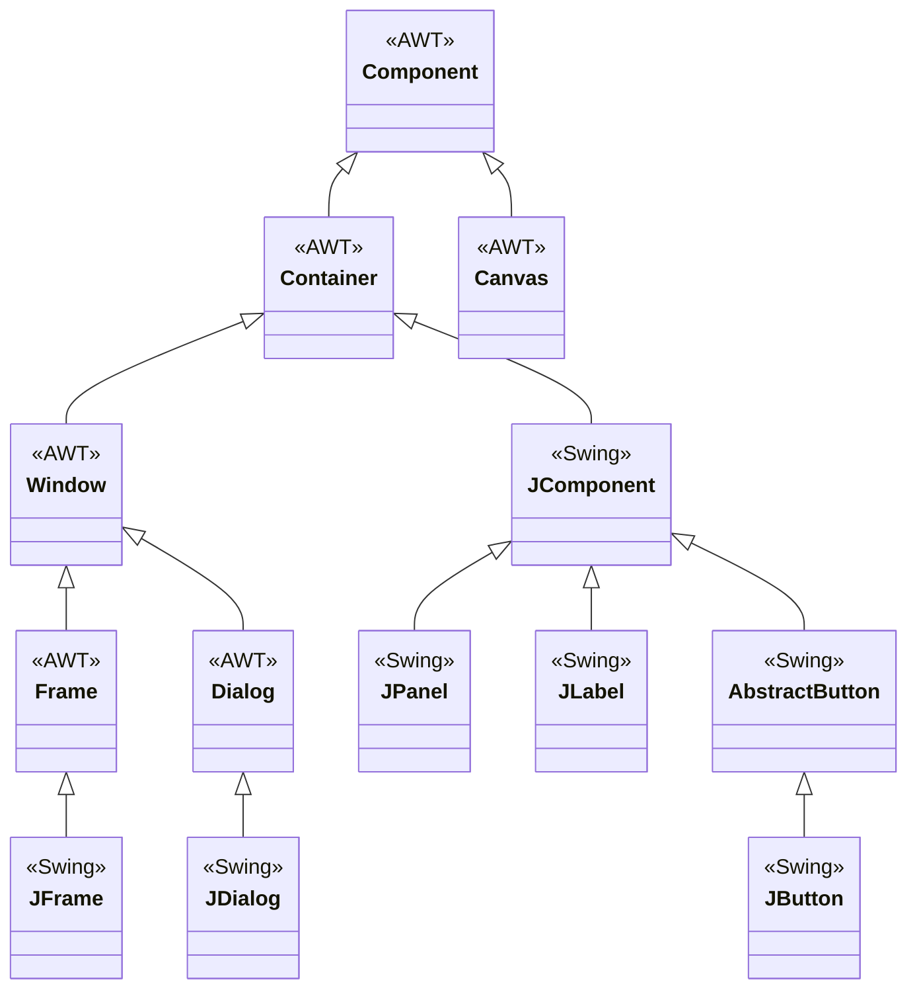
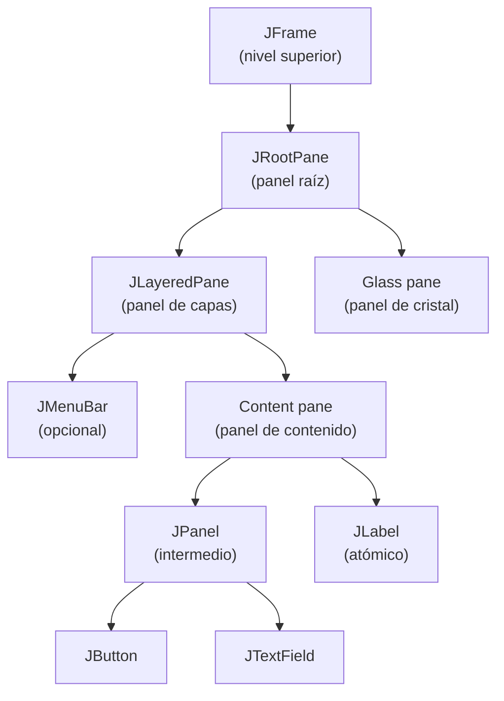
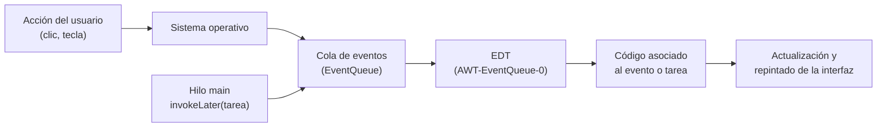

---
tags:
  - desarrollo-de-interfaces
  - DAM2
unidad: 1
tema: AWT y Swing, jerarquía de clases y de contenedores, el hilo de despacho de eventos y la primera ventana
---

# Unidad 1. Fundamentos de Swing

> [!summary] Ideas clave
> 
> - Java dispone de dos bibliotecas gráficas incluidas en el JDK: **AWT** (`java.awt`), la original, y **Swing** (`javax.swing`), construida sobre ella.
> - Un componente **pesado** tiene su propia ventana nativa del sistema operativo; un componente **ligero** se dibuja en Java sobre la ventana de su antecesor pesado más cercano.
> - Los componentes de Swing son ligeros, salvo los contenedores de nivel superior (`JFrame`, `JDialog`), que aportan la ventana nativa.
> - Todos los elementos gráficos derivan de `Component`; los que pueden contener otros derivan de `Container`, y casi todos los de Swing, de `JComponent`.
> - Una interfaz es un **árbol de contenedores** cuya raíz es un contenedor de nivel superior. Cada componente solo puede estar en un contenedor a la vez.
> - Swing **no es seguro para hilos**: todo acceso a sus componentes debe hacerse desde el **hilo de despacho de eventos** (EDT).
> - La interfaz se crea con `SwingUtilities.invokeLater()`, que traslada la tarea desde el hilo `main` al EDT.
> - Una tarea larga ejecutada en el EDT congela la interfaz.
> - Se recomienda que la clase de la ventana **contenga** un `JFrame` (composición) en lugar de **extenderlo** (herencia).
> - Un `JFrame` es invisible hasta que se llama a `setVisible(true)` y, por defecto, al cerrarse se oculta sin terminar el programa.

---

## 1. Introducción

Los programas de consola siguen un flujo **secuencial**: el código decide en qué orden se piden y se muestran los datos. Una aplicación de escritorio funciona de otro modo. Una vez construida la ventana, el programa queda a la espera y reacciona a lo que haga el usuario: pulsar un botón, escribir en un campo o redimensionar la ventana.

> [!note] Definición: interfaz gráfica de usuario Una **interfaz gráfica de usuario** (_graphical user interface_, GUI) es el medio de interacción entre el usuario y el programa basado en elementos visuales (ventanas, botones, campos de texto, menús) que se manejan con el ratón y el teclado.

> [!note] Definición: programación dirigida por eventos La **programación dirigida por eventos** (_event-driven programming_) es un paradigma en el que el flujo del programa lo determinan los **eventos**: sucesos, normalmente provocados por el usuario, a los que el programa responde ejecutando el código asociado.

Esta unidad presenta las bases sobre las que se construye cualquier ventana en Java: qué bibliotecas existen, cómo se organizan sus clases, cómo se anidan los componentes y en qué hilo debe ejecutarse el código de la interfaz.

> [!info] Alcance de la unidad La anatomía completa de `JFrame` se estudia en la [[02-ventana-principal|Unidad 2]]; los componentes, en la [[03-componentes-basicos|Unidad 3]]; los gestores de diseño, en la [[04-gestor-diseño|Unidad 4]], y el tratamiento de eventos, en la [[07-gestion-eventos|Unidad 7]].

---

## 2. Bibliotecas gráficas de Java

### 2.1. AWT

> [!note] Definición: AWT **AWT** (_Abstract Window Toolkit_) es la primera biblioteca gráfica de Java, presente desde el JDK 1.0. Se encuentra en el paquete `java.awt` y delega el dibujo de cada componente en el sistema de ventanas del sistema operativo.

Como cada componente de AWT es en realidad un componente nativo, su aspecto cambia según la plataforma y el conjunto de componentes disponibles se limita a los que tienen todos los sistemas operativos. Un ejemplo de componente de AWT es `Canvas`, una superficie rectangular vacía sobre la que el programa dibuja.

### 2.2. Swing

> [!note] Definición: Swing **Swing** es la biblioteca de componentes gráficos que forma parte de las JFC (_Java Foundation Classes_). Se encuentra en el paquete `javax.swing`, pertenece al módulo `java.desktop` y está construida sobre AWT, pero dibuja sus componentes en Java en lugar de delegar en el sistema operativo.

Las JFC agrupan, además de Swing, el soporte para cambiar el aspecto visual (_pluggable look and feel_), la API de accesibilidad, la API Java 2D para el dibujo y el soporte de internacionalización.

Los componentes de Swing se reconocen por el prefijo `J`: `JFrame`, `JPanel`, `JButton`, `JLabel`. Muchos tienen un equivalente en AWT sin el prefijo (`Frame`, `Panel`, `Button`, `Label`).

> [!important] Swing no sustituye a AWT Swing se apoya en AWT: sus clases heredan de las de AWT, y elementos como los gestores de diseño (`BorderLayout`, `FlowLayout`, `GridBagLayout`), los colores (`Color`) o los eventos se siguen importando de `java.awt`. Por eso un programa Swing importa clases de ambos paquetes.

### 2.3. Componentes pesados y ligeros

> [!note] Definición: componente pesado Un **componente pesado** (_heavyweight component_) es aquel que tiene su propia ventana nativa, opaca, gestionada por el sistema operativo.

> [!note] Definición: componente ligero Un **componente ligero** (_lightweight component_) es aquel que no tiene ventana nativa propia: reutiliza la de su antecesor pesado más cercano y Java se encarga de dibujarlo.

|Característica|Componente pesado|Componente ligero|
|---|---|---|
|Ventana nativa|Propia|La de su antecesor pesado|
|Quién lo dibuja|El sistema operativo|Java|
|Aspecto|Depende de la plataforma|Igual en todas las plataformas (configurable)|
|Ejemplos|Componentes de AWT (`Button`, `Canvas`, `Frame`)|Componentes de Swing (`JButton`, `JPanel`, `JLabel`)|

Los contenedores de nivel superior de Swing (`JFrame`, `JDialog`, `JWindow`) son la excepción: son pesados, porque alguien tiene que aportar la ventana nativa sobre la que se dibujan todos los componentes ligeros que contienen.

> [!warning] Mezclar componentes pesados y ligeros Hasta el JDK 6 Update 12, colocar componentes de AWT dentro de una interfaz Swing producía errores visuales: por ejemplo, un componente pesado se dibujaba por encima de un menú desplegable de Swing. Desde esa versión la mezcla está soportada, aunque con limitaciones. Se recomienda construir la interfaz solo con componentes de Swing y recurrir a uno de AWT, como `Canvas`, únicamente cuando se necesite algo que Swing no ofrece.

### 2.4. Comparativa

|Biblioteca|Paquete|Tipo de componentes|Situación actual|
|---|---|---|---|
|AWT|`java.awt`|Pesados|Incluida en el JDK; se usa sobre todo como base de Swing|
|Swing|`javax.swing`|Ligeros (salvo los de nivel superior)|Incluida en el JDK; biblioteca estándar para aplicaciones de escritorio|
|JavaFX|`javafx.*`|Propios, con grafo de escena|Distribuida aparte del JDK desde la versión 11 (OpenJFX)|

> [!info] JavaFX JavaFX es una plataforma más moderna para aplicaciones de escritorio, pero desde JavaFX 11 se distribuye separada del JDK y debe añadirse como dependencia. Esta asignatura se centra en Swing.

---

## 3. Jerarquía de clases

Todas las clases gráficas de Java forman una única jerarquía de herencia. Tres clases sostienen toda la estructura:

> [!note] Definición: `Component` `java.awt.Component` es la clase raíz de todos los elementos gráficos. Define lo que tiene cualquier elemento visible: posición, tamaño, visibilidad, colores, fuente y capacidad de recibir eventos.

> [!note] Definición: `Container` `java.awt.Container` es un `Component` que puede contener otros componentes. Añade los métodos para gestionarlos (`add()`, `remove()`, `getComponentCount()`) y la asociación con un gestor de diseño (`setLayout()`).

> [!note] Definición: `JComponent` `javax.swing.JComponent` es la clase base de casi todos los componentes de Swing. Hereda de `Container` y añade funcionalidad propia de Swing, como bordes, textos de ayuda (_tooltips_) o el soporte del aspecto configurable.



La cadena de herencia de cualquier clase puede comprobarse recorriendo sus superclases:

```java
static void printHierarchy(Class<?> type) {
    StringBuilder chain = new StringBuilder(type.getSimpleName());
    for (Class<?> c = type.getSuperclass(); c != null; c = c.getSuperclass()) {
        chain.append(" -> ").append(c.getSimpleName());
    }
    System.out.println(chain);
}

printHierarchy(JFrame.class);
printHierarchy(JPanel.class);
printHierarchy(Canvas.class);
printHierarchy(JButton.class);
```

```text
JFrame -> Frame -> Window -> Container -> Component -> Object
JPanel -> JComponent -> Container -> Component -> Object
Canvas -> Component -> Object
JButton -> AbstractButton -> JComponent -> Container -> Component -> Object
```

> [!important] `JFrame` no es un `JComponent` `JFrame` hereda de `Frame` (AWT), no de `JComponent`. Por eso no dispone de las funciones propias de los componentes Swing, como los bordes, y los componentes no se colocan directamente sobre la ventana, sino sobre un panel interior llamado **panel de contenido** (_content pane_).

> [!info] `Canvas` no es un contenedor `Canvas` hereda directamente de `Component`, no de `Container`: es una superficie de dibujo y no puede contener otros componentes.

---

## 4. Jerarquía de contenedores

### 4.1. Tipos de componentes según su papel

La jerarquía de clases describe de quién **hereda** cada clase. En una interfaz concreta importa otra relación: qué componente **está dentro** de cuál. Según su papel, los componentes se clasifican en tres grupos:

|Tipo|Función|Ejemplos|
|---|---|---|
|Contenedor de nivel superior|Ventana raíz que aporta la ventana nativa; no puede estar dentro de otro contenedor|`JFrame`, `JDialog`, `JWindow`|
|Contenedor intermedio|Agrupa y organiza otros componentes dentro de una ventana|`JPanel`, `JScrollPane`, `JSplitPane`, `JTabbedPane`|
|Componente atómico|Elemento final que muestra información o recibe datos del usuario|`JLabel`, `JButton`, `JTextField`, `JCheckBox`|

> [!note] Definición: contenedor de nivel superior Un **contenedor de nivel superior** (_top-level container_) es el que ocupa la raíz de una interfaz y proporciona el área en la que se dibujan los demás componentes. `JFrame` se usa para la ventana principal de una aplicación y `JDialog`, para ventanas secundarias o cuadros de diálogo.

> [!info] `JApplet` El tutorial de Oracle incluye `JApplet` entre los contenedores de nivel superior. Los navegadores ya no admiten Java y, desde Java 17, la API de _applets_, incluida `JApplet`, está marcada como obsoleta para su eliminación (JEP 398). No debe usarse.

### 4.2. El árbol de contenedores

> [!note] Definición: jerarquía de contenedores La **jerarquía de contenedores** (_containment hierarchy_) es el árbol de componentes de una ventana. Su raíz es un contenedor de nivel superior, y todo componente debe formar parte de uno de estos árboles para mostrarse en pantalla.

Una aplicación con una ventana principal y dos cuadros de diálogo tiene, por tanto, tres jerarquías de contenedores.

Entre el `JFrame` y los componentes que añade el programa existen varias capas intermedias que Swing crea automáticamente:



El programa solo trabaja, normalmente, con el **panel de contenido**: es ahí donde se añaden todos los componentes visibles salvo la barra de menús. Se obtiene con `getContentPane()`.

Recorriendo los padres de un componente con `getParent()` se aprecia esta estructura:

```java
JFrame frame = new JFrame("Hierarchy");
JLabel label = new JLabel("Hello");
frame.getContentPane().add(label);

// Walk up from the label to the top-level container
for (Component c = label; c != null; c = c.getParent()) {
    System.out.println(c.getClass().getSimpleName());
}
```

```text
JLabel
JPanel
JLayeredPane
JRootPane
JFrame
```

El segundo elemento, `JPanel`, es el panel de contenido que `JFrame` crea por defecto.

> [!info] Alcance El panel raíz, el panel de capas y el panel de cristal se estudian en la [[02-ventana-principal|Unidad 2]].

### 4.3. Un componente, un único contenedor

> [!important] Regla del contenedor único Cada componente solo puede estar contenido una vez. Si se añade a un segundo contenedor, Swing lo **retira** del primero: el componente se mueve, no se copia.

```java
JPanel first = new JPanel();
JPanel second = new JPanel();
JLabel label = new JLabel("Shared?");

first.add(label);
second.add(label); // the label is moved, not copied

System.out.println("first: " + first.getComponentCount());
System.out.println("second: " + second.getComponentCount());
```

```text
first: 0
second: 1
```

Para mostrar el mismo contenido en dos lugares hay que crear dos componentes distintos.

---

## 5. El hilo de despacho de eventos

### 5.1. Swing y los hilos

> [!note] Definición: seguridad frente a hilos Un código es **seguro para hilos** (_thread-safe_) cuando puede ejecutarse desde varios hilos a la vez sin que se produzcan resultados incorrectos.

La mayoría de los métodos de Swing **no** son seguros para hilos. En lugar de proteger cada componente con mecanismos de sincronización, Swing impone una regla más sencilla: todo el trabajo con la interfaz se realiza en un único hilo.

> [!note] Definición: hilo de despacho de eventos El **hilo de despacho de eventos** (_event dispatch thread_, EDT) es el hilo especial en el que Swing atiende los eventos de la interfaz. Toda creación, consulta o modificación de componentes Swing debe realizarse en él.

El EDT funciona como un bucle: extrae un evento de la **cola de eventos** (_event queue_), ejecuta el código asociado y pasa al siguiente.



> [!danger] Ignorar la regla del EDT Un programa que modifica componentes Swing desde otros hilos puede funcionar bien la mayoría de las veces y fallar de forma impredecible en otras. Estos errores son muy difíciles de reproducir, por lo que la regla debe cumplirse siempre, aunque el programa parezca funcionar.

### 5.2. Del hilo `main` al EDT

El método `main()` **no** se ejecuta en el EDT, sino en el hilo `main`, que se considera el **hilo inicial** (_initial thread_) del programa. Su función en una aplicación Swing es mínima: programar la creación de la interfaz en el EDT y terminar.

Para ello se usa `SwingUtilities.invokeLater()`, que recibe la tarea como un `Runnable` (normalmente, una expresión lambda) y la deposita en la cola de eventos:

```java
public static void main(String[] args) {
    System.out.println("main() runs on: " + Thread.currentThread().getName());

    SwingUtilities.invokeLater(() -> {
        System.out.println("invokeLater runs on: " + Thread.currentThread().getName());
        System.out.println("Is EDT? " + SwingUtilities.isEventDispatchThread());
    });
}
```

```text
main() runs on: main
invokeLater runs on: AWT-EventQueue-0
Is EDT? true
```

`AWT-EventQueue-0` es el nombre que la máquina virtual asigna al EDT. El método `SwingUtilities.isEventDispatchThread()` permite comprobar en cualquier punto si el código se está ejecutando en él.

### 5.3. `invokeLater()` e `invokeAndWait()`

|Método|Comportamiento|Uso habitual|
|---|---|---|
|`SwingUtilities.invokeLater(Runnable)`|Encola la tarea y **vuelve inmediatamente**, sin esperar a que se ejecute|Crear la interfaz desde `main()` y actualizarla desde otros hilos|
|`SwingUtilities.invokeAndWait(Runnable)`|Encola la tarea y **bloquea** el hilo que la llama hasta que el EDT la termina|Cuando el hilo que llama necesita que la tarea haya acabado para continuar|
|`SwingUtilities.isEventDispatchThread()`|Devuelve `true` si el hilo actual es el EDT|Comprobaciones y depuración|

> [!danger] `invokeAndWait()` desde el EDT Llamar a `invokeAndWait()` desde el propio EDT provocaría que el hilo se esperase a sí mismo. Java lo impide lanzando un `Error`:
> 
> ```text
> Error: Cannot call invokeAndWait from the event dispatcher thread
> ```

### 5.4. Tareas largas

Mientras el EDT ejecuta una tarea, no atiende ningún otro evento: no repinta la ventana, no responde a los clics y no procesa el teclado.

> [!danger] Bloquear el EDT Una operación lenta en el EDT (un cálculo pesado, la lectura de un fichero grande, una consulta a una base de datos o un `Thread.sleep()`) **congela la interfaz** hasta que termina. El código que se ejecuta en el EDT debe ser breve.

> [!info] Alcance Las tareas largas se ejecutan en otro hilo y comunican el resultado al EDT. Swing ofrece para ello la clase `SwingWorker`, que se estudia en la [[07-gestion-eventos|Unidad 7]].

---

## 6. La primera ventana

### 6.1. Herencia o composición

Existen dos formas de organizar la clase que representa una ventana:

|Forma|Código|Relación|
|---|---|---|
|Herencia|`class MainWindow extends JFrame`|La clase **es** una ventana|
|Composición|`class MainWindow { private final JFrame frame; }`|La clase **tiene** una ventana|

La forma por herencia es muy frecuente en tutoriales y es la que generan algunos editores visuales de interfaces. Sin embargo, en estos apuntes se utiliza la **composición**.

> [!tip] Por qué se prefiere la composición
> 
> - Al extender `JFrame`, la clase hereda cientos de métodos públicos de `JFrame`, `Frame`, `Window`, `Container` y `Component`, y todos quedan expuestos a quien la use. Con composición, la clase muestra solo los métodos que decide ofrecer.
> - La clase queda libre para heredar de otra si lo necesita, ya que Java no admite herencia múltiple.
> - Una ventana no suele añadir comportamiento nuevo a `JFrame`; solo lo configura y lo rellena. Extender una clase para configurarla es un uso de la herencia poco justificado.

### 6.2. Crear y mostrar la ventana

```java
public class MainWindow {
    private final JFrame frame;

    public MainWindow() {
        frame = new JFrame("My first window");
        frame.setSize(400, 300);
        frame.setLocationRelativeTo(null);                       // center on screen
        frame.setDefaultCloseOperation(JFrame.EXIT_ON_CLOSE);    // end the program on close
    }

    public void show() {
        frame.setVisible(true);
    }

    public static void main(String[] args) {
        SwingUtilities.invokeLater(() -> new MainWindow().show());
    }
}
```

|Método|Función|
|---|---|
|`new JFrame(String)`|Crea la ventana con el título indicado|
|`setSize(int, int)`|Fija el ancho y el alto en píxeles|
|`setLocationRelativeTo(null)`|Centra la ventana en la pantalla|
|`setDefaultCloseOperation(int)`|Indica qué ocurre al pulsar el botón de cerrar|
|`setVisible(true)`|Muestra la ventana; hasta entonces es invisible|

### 6.3. La operación de cierre

> [!warning] Cerrar no es terminar Por defecto, al pulsar el botón de cerrar, un `JFrame` solo se **oculta** (`HIDE_ON_CLOSE`). La ventana desaparece, pero el programa sigue en ejecución. En la ventana principal debe indicarse `EXIT_ON_CLOSE`.

|Constante|Efecto al cerrar|
|---|---|
|`DO_NOTHING_ON_CLOSE`|No hace nada; el programa decide qué hacer mediante un _listener_ de ventana|
|`HIDE_ON_CLOSE`|Oculta la ventana (valor por defecto)|
|`DISPOSE_ON_CLOSE`|Oculta la ventana y libera sus recursos|
|`EXIT_ON_CLOSE`|Termina la aplicación con `System.exit()`|

> [!info] Alcance Otros aspectos de la ventana, como `pack()`, el tamaño preferido o la sustitución del panel de contenido con `setContentPane()`, se estudian en la [[02-ventana-principal|Unidad 2]].

---

## 7. Errores típicos

> [!danger] Crear la interfaz directamente en `main()` Construir componentes en `main()` sin `invokeLater()` los crea fuera del EDT. El programa puede parecer correcto y fallar de forma esporádica.

> [!danger] Ejecutar tareas lentas en el EDT Un bucle largo o un `Thread.sleep()` en el código de la interfaz congela la ventana mientras dura.

> [!danger] Llamar a `invokeAndWait()` desde el EDT Lanza un `Error`, porque el hilo quedaría esperándose a sí mismo.

> [!warning] Olvidar `setVisible(true)` El programa se ejecuta, pero la ventana nunca aparece.

> [!warning] No configurar la operación de cierre Con el valor por defecto, `HIDE_ON_CLOSE`, cerrar la ventana principal deja el proceso en ejecución sin ninguna ventana visible.

> [!warning] Añadir el mismo componente a dos contenedores El componente desaparece del primero, porque solo puede tener un contenedor.

> [!warning] Mezclar componentes de AWT y Swing por error Como ambos paquetes se importan, es fácil escribir `Button` en lugar de `JButton` o `Panel` en lugar de `JPanel`. El programa compila, pero se introduce un componente pesado en una interfaz ligera.

---

## 8. Ejemplo integrador

El siguiente programa reúne lo visto en la unidad: la interfaz se crea en el EDT mediante `invokeLater()`, la clase contiene un `JFrame` en lugar de extenderlo, se añade un componente atómico al panel de contenido y se recorre la jerarquía de contenedores desde ese componente hasta la ventana.

```java
public class HelloWindow {
    private final JFrame frame;
    private final JLabel label;

    public HelloWindow() {
        frame = new JFrame("Hello Swing");
        label = new JLabel("Built on the EDT", SwingConstants.CENTER);

        frame.getContentPane().add(label);   // atomic component inside the content pane
        frame.setSize(300, 150);
        frame.setLocationRelativeTo(null);
        frame.setDefaultCloseOperation(JFrame.EXIT_ON_CLOSE);
    }

    public void show() {
        frame.setVisible(true);
        System.out.println("Window built on: " + Thread.currentThread().getName());

        // Containment hierarchy, from the label up to the window
        for (Component c = label; c != null; c = c.getParent()) {
            System.out.println("  " + c.getClass().getSimpleName());
        }
    }

    public static void main(String[] args) {
        System.out.println("Program started on: " + Thread.currentThread().getName());
        SwingUtilities.invokeLater(() -> new HelloWindow().show());
    }
}
```

```text
Program started on: main
Window built on: AWT-EventQueue-0
  JLabel
  JPanel
  JLayeredPane
  JRootPane
  JFrame
```

La ventana aparece centrada en la pantalla, con el texto en el centro, y el programa termina al cerrarla.

---

## Bibliografía

- [About the JFC and Swing](https://docs.oracle.com/javase/tutorial/uiswing/start/about.html) (tutorial oficial de Oracle)
- [Painting in AWT and Swing](https://www.oracle.com/java/technologies/painting.html) (artículo técnico de Oracle)
- [Mixing Heavyweight and Lightweight Components](https://www.oracle.com/technical-resources/articles/java/mixing-components.html) (artículo técnico de Oracle)
- [Package javax.swing, Java SE 17](https://docs.oracle.com/en/java/javase/17/docs/api/java.desktop/javax/swing/package-summary.html) (documentación oficial de la API)
- [Class JFrame, Java SE 17](https://docs.oracle.com/en/java/javase/17/docs/api/java.desktop/javax/swing/JFrame.html) (documentación oficial de la API)
- [The JComponent Class](https://docs.oracle.com/javase/tutorial/uiswing/components/jcomponent.html) (tutorial oficial de Oracle)
- [Using Top-Level Containers](https://docs.oracle.com/javase/tutorial/uiswing/components/toplevel.html) (tutorial oficial de Oracle)
- [Initial Threads](https://docs.oracle.com/javase/tutorial/uiswing/concurrency/initial.html) (tutorial oficial de Oracle)
- [The Event Dispatch Thread](https://docs.oracle.com/javase/tutorial/uiswing/concurrency/dispatch.html) (tutorial oficial de Oracle)
- [JEP 398: Deprecate the Applet API for Removal](https://openjdk.org/jeps/398) (propuesta oficial de OpenJDK)
- [OpenJFX](https://openjfx.io/) (sitio oficial de JavaFX)