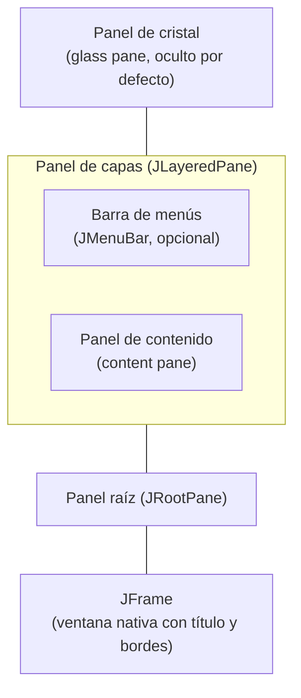
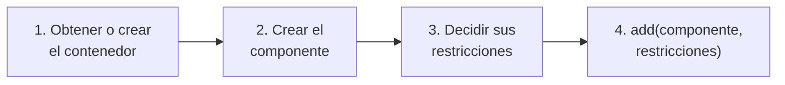
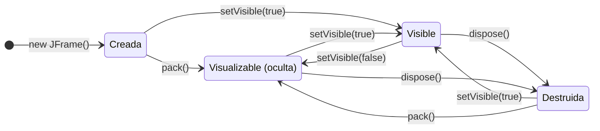
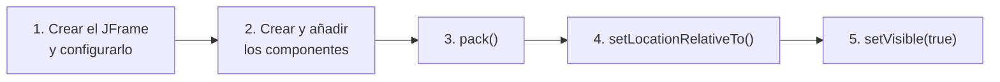

---
tags:
  - desarrollo-de-interfaces
  - DAM2
unidad: 2
tema: Anatomía de JFrame, el panel de contenido, tamaño y posición de la ventana y su ciclo de vida
---

# Unidad 2. La ventana principal

> [!summary] Ideas clave
> - Un `JFrame` tiene un único hijo, el **panel raíz** (`JRootPane`), que organiza el panel de capas, el panel de contenido, la barra de menús y el panel de cristal.
> - Los componentes visibles se añaden al **panel de contenido**, que se obtiene con `getContentPane()` y, por defecto, usa `BorderLayout`.
> - `add()`, `remove()` y `setLayout()` aplicados sobre el `JFrame` se redirigen automáticamente al panel de contenido.
> - Puede sustituirse el panel de contenido por un `JPanel` propio con `setContentPane()`; en ese caso, su gestor de diseño debe indicarse expresamente, porque el de `JPanel` es `FlowLayout`.
> - Para añadir un componente se sigue siempre el mismo flujo: obtener el contenedor, crear el componente, decidir sus restricciones y llamar a `add(componente, restricciones)`.
> - `pack()` ajusta la ventana al tamaño preferido de su contenido y es preferible a fijar un tamaño con `setSize()`.
> - La ventana respeta el tamaño mínimo fijado con `setMinimumSize()`, pero no el máximo.
> - Una ventana pasa por los estados creada, visualizable, visible, oculta y destruida; `dispose()` libera sus recursos nativos.
> - Los componentes se añaden antes de mostrar la ventana; si se añaden después, hay que llamar a `revalidate()`.

---

## 1. Introducción

La [[01 - Fundamentos de Swing|Unidad 1]] presentó `JFrame` como el contenedor de nivel superior de una aplicación y mostró cómo crear y mostrar una ventana vacía. Esta unidad estudia la ventana por dentro: qué paneles contiene, dónde se colocan los componentes, cómo se decide su tamaño y qué estados atraviesa desde que se crea hasta que se cierra.

Esta estructura explica algunos detalles que, sin ella, parecen arbitrarios: por qué los componentes no se añaden "a la ventana", sino a un panel interior, o por qué el gestor de diseño de ese panel no es el mismo que el de un `JPanel` cualquiera.

---

## 2. Estructura interna de `JFrame`

### 2.1. El panel raíz

> [!note] Definición: panel raíz
> El **panel raíz** (*root pane*) es un contenedor intermedio, de la clase `JRootPane`, que Swing crea automáticamente dentro de cada contenedor de nivel superior. Es el único hijo directo del `JFrame` y gestiona cuatro elementos: el panel de capas, el panel de contenido, la barra de menús y el panel de cristal.

Todos los contenedores de nivel superior de Swing (`JFrame`, `JDialog`, `JWindow`) implementan la interfaz `RootPaneContainer`, que ofrece los métodos para acceder a estos elementos:

```java
JFrame frame = new JFrame();

System.out.println("Root pane: " + frame.getRootPane().getClass().getSimpleName());
System.out.println("Layered pane: " + frame.getLayeredPane().getClass().getSimpleName());
System.out.println("Content pane: " + frame.getContentPane().getClass().getSimpleName());
System.out.println("Glass pane: " + frame.getGlassPane().getClass().getSimpleName()
        + ", visible = " + frame.getGlassPane().isVisible());
System.out.println("Menu bar: " + frame.getJMenuBar());
System.out.println("Frame children: " + frame.getComponentCount()
        + " (" + frame.getComponent(0).getClass().getSimpleName() + ")");
```

```text
Root pane: JRootPane
Layered pane: JLayeredPane
Content pane: JPanel
Glass pane: JPanel, visible = false
Menu bar: null
Frame children: 1 (JRootPane)
```

La salida muestra que el `JFrame` solo tiene un hijo, el panel raíz; que no hay barra de menús hasta que se asigna una, y que el panel de cristal existe pero está oculto.

> [!info] Implementación frente a especificación
> La documentación de `JRootPane` solo garantiza que el panel de contenido y el panel de cristal por defecto son objetos `JComponent`. En la implementación de OpenJDK ambos son `JPanel`, como muestra la salida anterior.

### 2.2. Las capas de la ventana

Los elementos del panel raíz se apilan unos sobre otros. En el diagrama, el elemento superior es el más cercano al usuario y el inferior, el más lejano:



| Elemento | Clase | Función | Acceso |
|---|---|---|---|
| Panel raíz | `JRootPane` | Contiene y coloca los otros cuatro elementos | `getRootPane()` |
| Panel de capas | `JLayeredPane` | Permite superponer componentes en distintas profundidades | `getLayeredPane()` |
| Panel de contenido | `Container` (por defecto, un `JPanel`) | Contiene todos los componentes visibles salvo la barra de menús | `getContentPane()`, `setContentPane()` |
| Barra de menús | `JMenuBar` | Menús de la ventana, situados sobre el panel de contenido | `getJMenuBar()`, `setJMenuBar()` |
| Panel de cristal | `Component` (por defecto, un `JPanel` invisible) | Capa transparente superior para interceptar eventos o dibujar encima | `getGlassPane()`, `setGlassPane()` |

### 2.3. El panel de capas

> [!note] Definición: panel de capas
> El **panel de capas** (*layered pane*) es un contenedor, de la clase `JLayeredPane`, que asigna a cada componente una profundidad (eje Z). Los componentes de las capas superiores se dibujan por encima de los de las inferiores.

Swing define varias capas estándar, identificadas por un número entero:

| Capa | Valor | Uso |
|---|---|---|
| `FRAME_CONTENT_LAYER` | -30000 | Panel de contenido y barra de menús |
| `DEFAULT_LAYER` | 0 | Capa por defecto para componentes añadidos al panel de capas |
| `PALETTE_LAYER` | 100 | Barras de herramientas y paletas flotantes |
| `MODAL_LAYER` | 200 | Diálogos modales internos |
| `POPUP_LAYER` | 300 | Menús desplegables y elementos emergentes |
| `DRAG_LAYER` | 400 | Componentes que se están arrastrando |

Como el panel de contenido está en la capa más baja, Swing puede mostrar un menú desplegable (`POPUP_LAYER`) por encima de cualquier componente de la ventana sin necesidad de crear otra ventana.

> [!tip] Uso habitual
> Rara vez se trabaja directamente con el panel de capas. Swing lo utiliza internamente para los menús, los textos de ayuda y otros elementos emergentes.

### 2.4. La barra de menús

La barra de menús no forma parte del panel de contenido: se asigna con `setJMenuBar()` y el panel raíz la coloca en la parte superior, por encima del panel de contenido.

> [!info] Alcance
> La creación de menús se estudia en la [[09 - Diálogos y menús|Unidad 9]].

### 2.5. El panel de cristal

> [!note] Definición: panel de cristal
> El **panel de cristal** (*glass pane*) es una capa transparente que cubre todo el panel raíz. Está oculta por defecto; cuando se hace visible, **intercepta todos los eventos de entrada** antes de que lleguen a los componentes inferiores, y puede usarse para dibujar sobre ellos.

Sus usos típicos son bloquear la interacción con la ventana mientras se ejecuta una operación o dibujar indicaciones superpuestas, como un indicador de carga.

> [!warning] Panel de cristal visible
> Si se hace visible el panel de cristal y se olvida ocultarlo, la ventana deja de responder al ratón aunque se vea con normalidad.

---

## 3. El panel de contenido

### 3.1. Obtener el panel de contenido

> [!note] Definición: panel de contenido
> El **panel de contenido** (*content pane*) es el contenedor del panel raíz que alberga todos los componentes visibles de la ventana, salvo la barra de menús. Se obtiene con `getContentPane()` y, por defecto, usa el gestor de diseño `BorderLayout`.

`getContentPane()` devuelve una referencia de tipo `Container`, no `JPanel`. Para añadir componentes basta con esa referencia:

```java
Container contentPane = frame.getContentPane();
contentPane.add(new JLabel("Hello"));
```

### 3.2. Redirección de `add()`

Para simplificar el código, `JFrame` redefine `add()`, `remove()` y `setLayout()` de forma que se aplican sobre el panel de contenido. Las dos líneas siguientes son equivalentes:

```java
frame.getContentPane().add(label);
frame.add(label); // forwarded to the content pane
```

```java
frame.add(label);

System.out.println(label.getParent() == frame.getContentPane());
System.out.println("Content pane children: " + frame.getContentPane().getComponentCount());
System.out.println("Frame children: " + frame.getComponentCount());
```

```text
true
Content pane children: 1
Frame children: 1
```

> [!warning] La redirección no es completa
> Solo se redirigen `add()`, `remove()` y `setLayout()`. Métodos como `getComponentCount()` o `getComponents()` aplicados al `JFrame` se refieren a sus hijos reales: el único hijo es el panel raíz, aunque se hayan añadido muchos componentes. Para consultar los componentes añadidos debe usarse `getContentPane()`.

### 3.3. Sustituir el panel de contenido

En lugar de trabajar con el panel de contenido que crea Swing, puede crearse un `JPanel` propio y asignarlo con `setContentPane()`:

```java
JPanel contentPane = new JPanel(new BorderLayout());
contentPane.setBorder(BorderFactory.createEmptyBorder(10, 10, 10, 10));
frame.setContentPane(contentPane);
```

Esta forma tiene dos ventajas:

- Se conserva una referencia de tipo `JPanel`, sin necesidad de conversiones, con acceso a los métodos de `JComponent`, como `setBorder()`. En el ejemplo, el borde vacío deja un margen de 10 píxeles alrededor del contenido.
- El panel puede construirse por separado, incluso en otra clase, y asignarse a la ventana al final.

> [!danger] El gestor de diseño de `JPanel` es `FlowLayout`
> El panel de contenido por defecto usa `BorderLayout`, pero un `JPanel` creado con `new JPanel()` usa `FlowLayout`. Al sustituir el panel de contenido, el gestor de diseño debe indicarse en el constructor (`new JPanel(new BorderLayout())`) o con `setLayout()`. Si se omite, los componentes se colocarán en fila, ignorando posiciones como `BorderLayout.WEST`.

```java
System.out.println(new JPanel().getLayout().getClass().getSimpleName());
```

```text
FlowLayout
```

> [!warning] El panel de contenido no puede ser nulo
> `setContentPane(null)` lanza una excepción:
>
> ```text
> IllegalComponentStateException: contentPane cannot be set to null.
> ```

### 3.4. Añadir componentes

Cualquier componente se incorpora a la ventana siguiendo el mismo flujo de trabajo:



El método `add()` tiene dos formas principales:

| Método | Significado |
|---|---|
| `add(Component comp)` | Añade el componente con la colocación por defecto del gestor de diseño |
| `add(Component comp, Object constraints)` | Añade el componente con unas **restricciones** que indican al gestor de diseño dónde y cómo colocarlo |

> [!note] Definición: restricciones
> Las **restricciones** (*constraints*) son el objeto que acompaña a un componente al añadirlo y que indica al gestor de diseño su posición y su comportamiento. Su tipo depende del gestor: con `BorderLayout` es una constante como `BorderLayout.WEST`; con `GridBagLayout`, un objeto `GridBagConstraints`.

```java
JPanel contentPane = new JPanel(new BorderLayout()); // 1. container
JPanel sidePanel = new JPanel();                     // 2. component
contentPane.add(sidePanel, BorderLayout.WEST);       // 3-4. constraints and add
```

> [!info] Alcance
> Los gestores de diseño y sus restricciones se estudian en la [[04-gestor-diseño|Unidad 4]] y en la [[05-gridbaglayout|Unidad 5]].

### 3.5. Añadir componentes con la ventana visible

> [!warning] Añadir después de mostrar
> `add()` invalida la distribución del contenedor, pero no la recalcula. Si la ventana ya se está mostrando, el componente nuevo no aparece hasta que se recalcula la distribución con `revalidate()`. Cuando además se retiran componentes, se recomienda llamar a `repaint()` para borrar lo que se veía en su lugar.
>
> ```java
> contentPane.add(newComponent);
> contentPane.revalidate();
> contentPane.repaint();
> ```

---

## 4. Tamaño y posición

### 4.1. `setSize()` frente a `pack()`

Existen dos formas de dar tamaño a una ventana:

| Método | Funcionamiento |
|---|---|
| `setSize(int width, int height)` | Fija el tamaño exacto de la ventana, incluidos el título y los bordes |
| `pack()` | Calcula el tamaño a partir del **tamaño preferido** de los componentes y de su gestor de diseño |

> [!note] Definición: tamaño preferido
> El **tamaño preferido** (*preferred size*) es el tamaño que un componente considera idóneo para mostrar su contenido. Cada componente lo calcula a partir de su contenido (un botón, a partir de su texto, por ejemplo) y puede fijarse con `setPreferredSize()`.

```java
JPanel area = new JPanel();
area.setPreferredSize(new Dimension(300, 200));
frame.add(area);

System.out.println("Before pack: " + frame.getSize());
frame.pack();
System.out.println("Content pane after pack: " + frame.getContentPane().getSize());
```

```text
Before pack: java.awt.Dimension[width=0,height=0]
Content pane after pack: java.awt.Dimension[width=300,height=200]
```

Tras `pack()`, el panel de contenido mide exactamente lo que necesita su contenido. La ventana completa es algo mayor, porque suma el título y los bordes, cuyo tamaño depende del sistema operativo.

> [!tip] Se prefiere `pack()`
> Con `setSize()`, el espacio disponible para el contenido depende del tamaño de los bordes de cada sistema y de la fuente utilizada, por lo que una ventana que se ve bien en un equipo puede recortar componentes en otro. `pack()` delega esa decisión en los gestores de diseño y se adapta a cada plataforma.

### 4.2. Tamaño mínimo y máximo

| Método | Efecto en una ventana |
|---|---|
| `setMinimumSize(Dimension)` | La ventana no puede ser menor: si se intenta reducir con `setSize()` o `pack()`, se amplía automáticamente al mínimo |
| `setMaximumSize(Dimension)` | No limita el tamaño de la ventana; solo es una indicación para los gestores de diseño |
| `setResizable(boolean)` | Permite o impide que el usuario cambie el tamaño |

```java
frame.setMinimumSize(new Dimension(400, 300));
frame.setSize(100, 100);
System.out.println("After setSize(100, 100): " + frame.getSize());

frame.setMaximumSize(new Dimension(500, 500));
frame.setSize(800, 800);
System.out.println("After setMaximumSize + setSize(800, 800): " + frame.getSize());
```

```text
After setSize(100, 100): java.awt.Dimension[width=400,height=300]
After setMaximumSize + setSize(800, 800): java.awt.Dimension[width=800,height=800]
```

> [!tip] Tamaño mínimo a partir de `pack()`
> Para impedir que el usuario reduzca la ventana por debajo del tamaño que necesita su contenido, se fija como mínimo el tamaño calculado por `pack()`:
>
> ```java
> frame.pack();
> frame.setMinimumSize(frame.getSize());
> ```

### 4.3. Posición

| Método | Efecto |
|---|---|
| `setLocation(int x, int y)` | Coloca la esquina superior izquierda en las coordenadas indicadas |
| `setBounds(int x, int y, int width, int height)` | Fija a la vez la posición y el tamaño |
| `setLocationRelativeTo(Component c)` | Centra la ventana sobre el componente indicado o, si es `null`, en la pantalla |
| `setExtendedState(JFrame.MAXIMIZED_BOTH)` | Maximiza la ventana |

Las coordenadas de pantalla tienen su origen (0, 0) en la esquina superior izquierda; el eje X crece hacia la derecha y el eje Y, hacia abajo.

> [!warning] Centrar después de dar tamaño
> `setLocationRelativeTo()` calcula la posición a partir del tamaño actual de la ventana. Si se llama antes de `pack()` o de `setSize()`, centra una ventana de tamaño 0 × 0 y, al crecer después, la ventana queda desplazada hacia abajo y a la derecha.

---

## 5. Ciclo de vida de la ventana

### 5.1. Estados

> [!note] Definición: componente visualizable
> Un componente es **visualizable** (*displayable*) cuando está asociado a un recurso nativo de pantalla. Que sea visualizable no significa que se vea: indica que el sistema operativo ya ha creado la ventana real, visible u oculta.

Una ventana atraviesa los siguientes estados:



Los estados pueden comprobarse con `isDisplayable()` e `isVisible()`:

```java
static void state(String step, JFrame f) {
    System.out.printf("%-20s displayable=%-5b visible=%b%n", step, f.isDisplayable(), f.isVisible());
}

JFrame frame = new JFrame();
state("new JFrame()", frame);
frame.pack();
state("pack()", frame);
frame.setVisible(true);
state("setVisible(true)", frame);
frame.setVisible(false);
state("setVisible(false)", frame);
frame.dispose();
state("dispose()", frame);
frame.setVisible(true);
state("setVisible(true)", frame);
```

```text
new JFrame()         displayable=false visible=false
pack()               displayable=true  visible=false
setVisible(true)     displayable=true  visible=true
setVisible(false)    displayable=true  visible=false
dispose()            displayable=false visible=false
setVisible(true)     displayable=true  visible=true
```

| Método | Efecto |
|---|---|
| `pack()` | Hace visualizable la ventana (si no lo era) y calcula su tamaño |
| `setVisible(true)` | Hace visualizable la ventana (si no lo era) y la muestra |
| `setVisible(false)` | Oculta la ventana, pero conserva sus recursos nativos |
| `dispose()` | Oculta la ventana y libera sus recursos nativos y los de sus componentes |

> [!info] Una ventana destruida puede reutilizarse
> `dispose()` no destruye el objeto Java: solo libera los recursos nativos. Si después se llama a `pack()` o a `setVisible(true)`, la ventana se vuelve a crear con el mismo contenido y estado que tenía.

> [!warning] Propiedades que exigen una ventana no visualizable
> Algunas propiedades solo pueden cambiarse antes de que la ventana sea visualizable. Por ejemplo, `setUndecorated(true)`, que elimina el título y los bordes, lanza una excepción si se llama después de `pack()` o de `setVisible(true)`:
>
> ```text
> IllegalComponentStateException: The frame is displayable.
> ```

### 5.2. Orden de construcción recomendado



> [!important] `setVisible(true)` va siempre al final
> La ventana se muestra cuando ya tiene todos sus componentes, su tamaño y su posición. Así se evita que el usuario vea cómo aparecen o se recolocan los elementos, y que haya que recalcular la distribución con `revalidate()`.

### 5.3. Cierre y fin del programa

La [[01 - Fundamentos de Swing|Unidad 1]] presentó las cuatro operaciones de cierre. Su efecto sobre la ejecución del programa depende de una regla de AWT:

> [!note] Definición: cierre automático de AWT
> El **cierre automático** (*auto-shutdown*) de AWT es la regla por la que la máquina virtual puede terminar por sí sola cuando no queda ningún componente visualizable y no hay eventos pendientes en las colas de eventos, siempre que no haya otros hilos no demonio en ejecución.

De ella se deduce el comportamiento de cada opción:

| Operación de cierre | Estado de la ventana tras cerrarla | ¿Termina el programa? |
|---|---|---|
| `HIDE_ON_CLOSE` (por defecto) | Oculta, pero visualizable | No: sigue existiendo un componente visualizable |
| `DISPOSE_ON_CLOSE` | Destruida | Sí, si era la última ventana visualizable y no hay otros hilos activos |
| `EXIT_ON_CLOSE` | Se termina el proceso | Sí, siempre, mediante `System.exit()` |
| `DO_NOTHING_ON_CLOSE` | Sin cambios | No; el programa decide qué hacer |

Se ha comprobado que una ventana única con `DISPOSE_ON_CLOSE` termina el programa al destruirse, mientras que con `HIDE_ON_CLOSE` el proceso queda en ejecución sin ninguna ventana visible.

> [!tip] `EXIT_ON_CLOSE` o `DISPOSE_ON_CLOSE`
> `EXIT_ON_CLOSE` es la opción habitual para la ventana principal de una aplicación con una sola ventana. `DISPOSE_ON_CLOSE` es más respetuosa cuando hay varias ventanas o tareas que deben terminar ordenadamente, porque no fuerza la salida del proceso.

---

## 6. Otras propiedades de la ventana

| Método | Función |
|---|---|
| `setTitle(String)` | Cambia el texto de la barra de título |
| `setIconImage(Image)` | Fija el icono de la ventana, que el sistema muestra en la barra de título o de tareas |
| `setResizable(boolean)` | Permite o impide redimensionar la ventana |
| `setUndecorated(boolean)` | Elimina el título y los bordes; solo antes de que la ventana sea visualizable |
| `setExtendedState(int)` | Maximiza (`MAXIMIZED_BOTH`) o minimiza (`ICONIFIED`) la ventana |

---

## 7. Errores típicos

> [!danger] Sustituir el panel de contenido sin indicar el gestor de diseño
> `frame.setContentPane(new JPanel())` deja la ventana con `FlowLayout`, y las restricciones de `BorderLayout` dejan de tener efecto.

> [!warning] Contar los componentes sobre el `JFrame`
> `frame.getComponentCount()` devuelve 1 (el panel raíz), independientemente de los componentes añadidos. Debe consultarse `frame.getContentPane()`.

> [!warning] Añadir componentes tras `setVisible(true)` sin `revalidate()`
> Los componentes nuevos no aparecen hasta que se recalcula la distribución.

> [!warning] Llamar a `setLocationRelativeTo(null)` antes de `pack()`
> La ventana se centra con tamaño 0 × 0 y queda desplazada al crecer.

> [!warning] Usar `setSize()` con valores fijos
> El contenido puede quedar recortado en sistemas con bordes o fuentes de otro tamaño. Se prefiere `pack()`.

> [!warning] Confiar en `setMaximumSize()` para limitar la ventana
> La ventana lo ignora. Para impedir que crezca se usa `setResizable(false)`.

> [!warning] Dejar visible el panel de cristal
> La ventana deja de responder al ratón.

---

## 8. Ejemplo integrador

El siguiente programa aplica el flujo completo de la unidad: sustituye el panel de contenido por un `JPanel` propio con `BorderLayout` y un margen, añade un panel lateral y un área principal con sus restricciones, ajusta el tamaño con `pack()`, fija ese tamaño como mínimo, centra la ventana y la muestra al final.

```java
public class AppWindow {
    private final JFrame frame;

    public AppWindow() {
        frame = new JFrame("Application");
        frame.setDefaultCloseOperation(JFrame.EXIT_ON_CLOSE);

        // 1. Own content pane: explicit layout and a 10 px margin
        JPanel contentPane = new JPanel(new BorderLayout());
        contentPane.setBorder(BorderFactory.createEmptyBorder(10, 10, 10, 10));
        frame.setContentPane(contentPane);

        // 2. Create the components
        JPanel sidePanel = new JPanel();
        sidePanel.setBackground(Color.LIGHT_GRAY);
        sidePanel.setPreferredSize(new Dimension(120, 200));

        JPanel mainArea = new JPanel();
        mainArea.setBackground(Color.WHITE);
        mainArea.setPreferredSize(new Dimension(300, 200));

        // 3. Add them with their constraints
        contentPane.add(sidePanel, BorderLayout.WEST);
        contentPane.add(mainArea, BorderLayout.CENTER);

        // 4. Size, minimum size and position
        frame.pack();
        frame.setMinimumSize(frame.getSize());
        frame.setLocationRelativeTo(null);
    }

    public void show() {
        frame.setVisible(true);
        System.out.println("Content pane: " + frame.getContentPane().getWidth()
                + " x " + frame.getContentPane().getHeight());
    }

    public static void main(String[] args) {
        SwingUtilities.invokeLater(() -> new AppWindow().show());
    }
}
```

```text
Content pane: 440 x 220
```

El ancho del panel de contenido es la suma de los dos paneles (120 + 300) más el margen izquierdo y derecho (10 + 10); el alto, los 200 píxeles de los paneles más los márgenes superior e inferior. La ventana aparece centrada, con un panel gris a la izquierda y un área blanca a la derecha, y no puede reducirse por debajo de ese tamaño.

---

## Bibliografía

- [How to Make Frames (Main Windows)](https://docs.oracle.com/javase/tutorial/uiswing/components/frame.html) (tutorial oficial de Oracle)
- [How to Use Root Panes](https://docs.oracle.com/javase/tutorial/uiswing/components/rootpane.html) (tutorial oficial de Oracle)
- [Class JFrame, Java SE 17](https://docs.oracle.com/en/java/javase/17/docs/api/java.desktop/javax/swing/JFrame.html) (documentación oficial de la API)
- [Class JRootPane, Java SE 17](https://docs.oracle.com/en/java/javase/17/docs/api/java.desktop/javax/swing/JRootPane.html) (documentación oficial de la API)
- [Class Window, Java SE 17](https://docs.oracle.com/en/java/javase/17/docs/api/java.desktop/java/awt/Window.html) (documentación oficial de la API)
- [Class Container, Java SE 17](https://docs.oracle.com/en/java/javase/17/docs/api/java.desktop/java/awt/Container.html) (documentación oficial de la API)
- [AWT Threading Issues](https://docs.oracle.com/en/java/javase/17/docs/api/java.desktop/java/awt/doc-files/AWTThreadIssues.html) (documentación oficial de la API)
