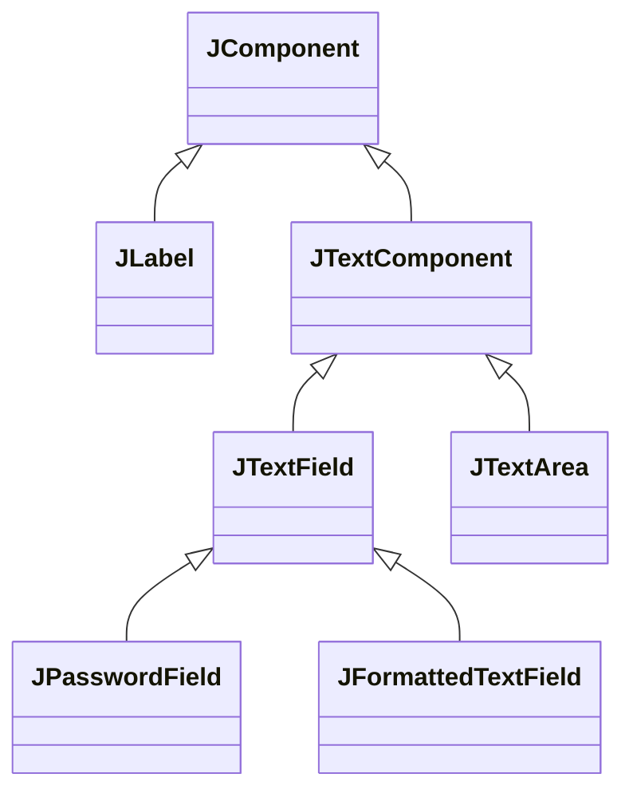
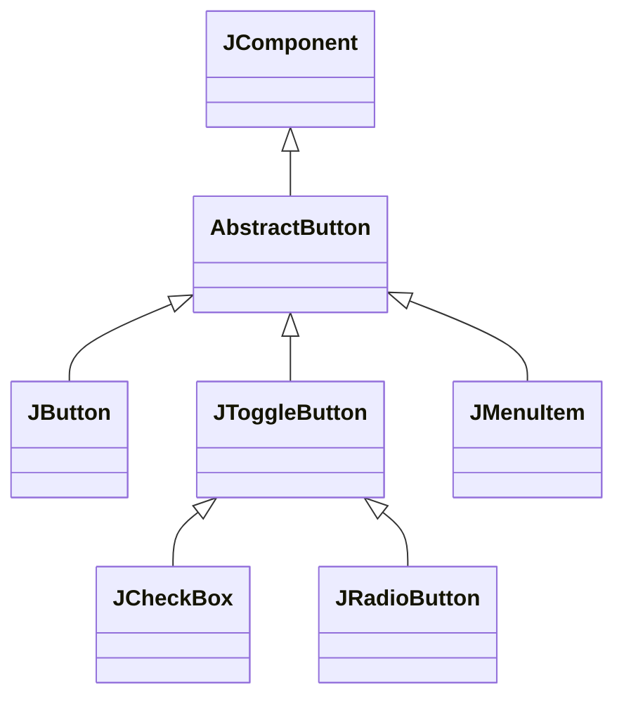
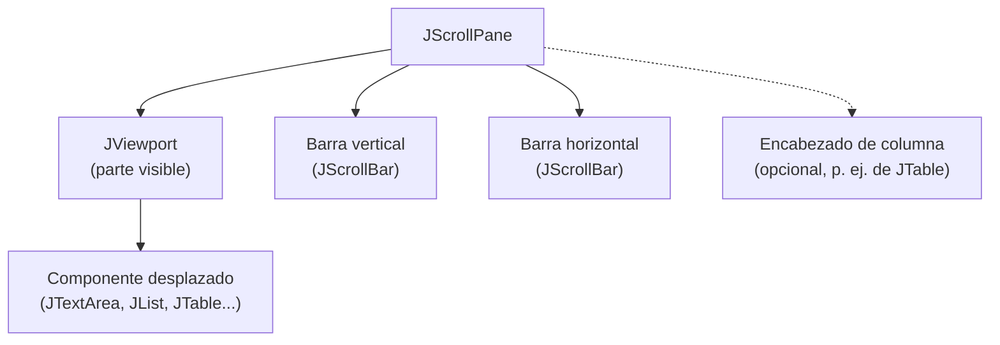

---
tags:
  - desarrollo-de-interfaces
  - DAM2
unidad: 3
tema: Componentes de texto, botones, selección, valores numéricos, listas, tablas, modelos de datos y paneles de desplazamiento
---

# Unidad 3. Componentes básicos

> [!summary] Ideas clave
> - Todos los componentes de esta unidad heredan de `JComponent` y comparten métodos como `setEnabled()`, `setToolTipText()`, `setFont()` o `setPreferredSize()`.
> - `JLabel` muestra texto o imágenes que el usuario no puede modificar; `JTextField`, `JPasswordField` y `JTextArea` permiten escribir.
> - La contraseña de un `JPasswordField` se lee con `getPassword()`, que devuelve un `char[]` que debe borrarse tras usarlo.
> - Todos los botones heredan de `AbstractButton`; `JCheckBox` y `JRadioButton` son botones de dos estados que se consultan con `isSelected()`.
> - Los `JRadioButton` solo son excluyentes si se agrupan en un `ButtonGroup`, que no es un componente y no se añade a ningún contenedor.
> - `JSlider`, `JSpinner` y `JProgressBar` trabajan con valores numéricos dentro de un rango.
> - La mayoría de los componentes Swing guardan sus datos en un **modelo** separado de la vista; para modificar el contenido de una lista o una tabla se trabaja con su modelo.
> - `JTextArea`, `JList` y `JTable` se colocan dentro de un `JScrollPane` para poder desplazarse por su contenido.
> - Una tabla solo muestra los encabezados de columna automáticamente si está dentro de un `JScrollPane`.

---

## 1. Introducción

Una vez construida la ventana ([[02 - La ventana principal|Unidad 2]]), hay que llenarla de componentes con los que el usuario pueda leer información e introducir datos. Swing ofrece un catálogo amplio, que el tutorial oficial de Oracle agrupa según su función:

| Categoría | Función | Componentes |
|---|---|---|
| Visualización | Mostrar información que el usuario no modifica | `JLabel`, `JProgressBar` |
| Entrada de texto | Escribir texto libre | `JTextField`, `JPasswordField`, `JTextArea` |
| Botones y selección | Ejecutar acciones o elegir entre opciones | `JButton`, `JCheckBox`, `JRadioButton`, `JComboBox` |
| Valores numéricos | Elegir un valor dentro de un rango | `JSlider`, `JSpinner` |
| Componentes complejos | Mostrar colecciones de datos | `JList`, `JTable` |
| Contenedores intermedios | Organizar o desplazar otros componentes | `JPanel`, `JScrollPane` |

Esta unidad estudia cómo crear cada componente, configurarlo y leer o modificar su valor desde el código.

> [!info] Alcance de la unidad
> Esta unidad se limita a leer y escribir el estado de los componentes. La forma de reaccionar cuando el usuario actúa sobre ellos (pulsar un botón, cambiar una selección) se estudia en la [[07-gestion-eventos|Unidad 7]], y su colocación en la ventana, en la [[04-gestor-diseño|Unidad 4]].

---

## 2. Características comunes

Como todos los componentes de la unidad heredan de `JComponent` ([[01 - Fundamentos de Swing|Unidad 1]]), comparten un conjunto de métodos:

| Método | Función |
|---|---|
| `setEnabled(boolean)` | Activa o desactiva el componente; desactivado, se muestra atenuado y no responde |
| `setVisible(boolean)` | Muestra u oculta el componente |
| `setToolTipText(String)` | Fija el texto de ayuda (*tooltip*) que aparece al dejar el ratón encima |
| `setFont(Font)` | Cambia la fuente del texto |
| `setForeground(Color)` / `setBackground(Color)` | Cambian el color del texto y el del fondo |
| `setOpaque(boolean)` | Indica si el componente pinta su fondo |
| `setPreferredSize(Dimension)` | Fija el tamaño preferido que usarán los gestores de diseño |
| `setBorder(Border)` | Añade un borde alrededor del componente |

> [!note] Definición: componente opaco
> Un componente es **opaco** (*opaque*) cuando pinta todos los píxeles de su área, incluido el fondo. Un componente **transparente** solo pinta su contenido (por ejemplo, el texto) y deja ver lo que hay detrás.

> [!warning] Fondo de un `JLabel`
> `JLabel` es transparente por defecto, mientras que `JPanel` es opaco. Por eso `label.setBackground(Color.YELLOW)` no tiene ningún efecto visible hasta que se llama a `label.setOpaque(true)`.

---

## 3. Componentes de texto

Los componentes en los que el usuario escribe derivan de `JTextComponent`, que reúne la funcionalidad común de edición: `getText()`, `setText()`, `setEditable()`, selección y copia de texto.



### 3.1. `JLabel`

> [!note] Definición: `JLabel`
> `JLabel` es un componente que muestra un texto, una imagen o ambos. El usuario no puede seleccionarlo ni modificarlo; se usa para títulos, rótulos de campos y mensajes.

```java
JLabel nameLabel = new JLabel("Name:");
JLabel title = new JLabel("Welcome", SwingConstants.CENTER); // centered text
nameLabel.setLabelFor(nameField);   // links the label to the field it describes
```

| Método | Función |
|---|---|
| `setText(String)` / `getText()` | Cambia o consulta el texto |
| `setIcon(Icon)` | Muestra una imagen |
| `setHorizontalAlignment(int)` | Alinea el contenido (`SwingConstants.LEFT`, `CENTER`, `RIGHT`) |
| `setLabelFor(Component)` | Asocia la etiqueta al componente que describe, lo que ayuda a las tecnologías de accesibilidad |

> [!tip] Texto con formato
> Si el texto de un `JLabel` empieza por `<html>`, se interpreta como HTML. Así se pueden mostrar varias líneas, negritas o colores:
>
> ```java
> JLabel help = new JLabel("<html><b>Bold</b> and <i>italic</i></html>");
> ```
>
> Si basta con una fuente o un color para todo el texto, se recomienda usar `setFont()` y `setForeground()`, que son más eficientes.

### 3.2. `JTextField`

> [!note] Definición: `JTextField`
> `JTextField` es un campo para escribir **una sola línea** de texto.

```java
JTextField nameField = new JTextField(15);   // about 15 characters wide
nameField.setText("Ada");
System.out.println("Text: " + nameField.getText());
System.out.println("Columns: " + nameField.getColumns());

nameField.setEditable(false);
System.out.println("Editable: " + nameField.isEditable());
```

```text
Text: Ada
Columns: 15
Editable: false
```

> [!important] Las columnas no limitan el texto
> El número de **columnas** que se pasa al constructor solo sirve para calcular el ancho preferido del campo a partir de la fuente. No limita la cantidad de caracteres que el usuario puede escribir. Se recomienda indicarlo siempre, para que el campo no cambie de tamaño al cambiar su texto.

| Método | Función |
|---|---|
| `getText()` / `setText(String)` | Lee o escribe el contenido |
| `setColumns(int)` | Fija el ancho preferido en columnas |
| `setEditable(boolean)` | Permite o impide la edición; un campo no editable sigue permitiendo seleccionar y copiar |
| `setHorizontalAlignment(int)` | Alinea el texto dentro del campo |

> [!info] Campos especializados
> `JFormattedTextField` es un campo que restringe la entrada a un formato (fechas, números). Antes de validar a mano el texto de un `JTextField`, conviene comprobar si `JFormattedTextField` o `JSpinner` resuelven el caso.

### 3.3. `JPasswordField`

> [!note] Definición: `JPasswordField`
> `JPasswordField` es un `JTextField` que oculta los caracteres escritos y muestra en su lugar un **carácter de eco** (*echo character*), normalmente un punto.

```java
JPasswordField passwordField = new JPasswordField(15);
passwordField.setText("secret");

char[] password = passwordField.getPassword();
System.out.println("Length: " + password.length);
System.out.println("Matches: " + Arrays.equals(password, "secret".toCharArray()));
Arrays.fill(password, '0');  // wipe the copy when done
```

```text
Length: 6
Matches: true
```

> [!danger] `getPassword()`, no `getText()`
> El método `getText()` de `JPasswordField` está obsoleto (*deprecated*) desde Java 1.2. Las cadenas de Java son inmutables: una contraseña guardada en un `String` permanece en memoria hasta que el recolector de basura la elimina, y no puede borrarse. `getPassword()` devuelve un `char[]` que sí puede sobrescribirse con `Arrays.fill()` en cuanto deja de necesitarse.

> [!tip] Comparar contraseñas
> Para comparar dos `char[]` se usa `Arrays.equals()`. El operador `==` compararía las referencias de los arrays, no su contenido.

### 3.4. `JTextArea`

> [!note] Definición: `JTextArea`
> `JTextArea` es un área para escribir texto de **varias líneas**, todo con la misma fuente y el mismo formato.

```java
JTextArea notes = new JTextArea(5, 20);  // 5 rows, 20 columns
notes.setLineWrap(true);                 // wrap long lines
notes.setWrapStyleWord(true);            // ...at word boundaries
notes.setText("First line");
notes.append("\nSecond line");
System.out.println("Lines: " + notes.getLineCount());
```

```text
Lines: 2
```

| Método | Función |
|---|---|
| `JTextArea(int rows, int columns)` | Crea el área con un tamaño preferido de filas y columnas |
| `append(String)` | Añade texto al final |
| `setLineWrap(boolean)` | Activa el salto de línea automático; por defecto está desactivado |
| `setWrapStyleWord(boolean)` | Si es `true`, corta las líneas entre palabras; si es `false` (por defecto), en cualquier carácter |
| `getLineCount()` | Devuelve el número de líneas |

> [!warning] `JTextArea` no se desplaza por sí misma
> Si el texto no cabe, el área crece o se recorta, pero no muestra barras de desplazamiento. Debe colocarse dentro de un `JScrollPane` (apartado 7).

### 3.5. Resumen de los componentes de texto

| Componente | Líneas | Lectura del valor | Uso |
|---|---|---|---|
| `JLabel` | Una (o varias con HTML) | `getText()` | Texto fijo |
| `JTextField` | Una | `getText()` | Datos cortos: nombre, correo |
| `JPasswordField` | Una | `getPassword()` | Contraseñas |
| `JTextArea` | Varias | `getText()` | Textos largos: comentarios, notas |

---

## 4. Botones y selección

Todos los botones de Swing heredan de `AbstractButton`, que aporta el texto, el icono, el estado activado y la gestión de la pulsación. Los botones de dos estados (marcado o no marcado) heredan además de `JToggleButton`.



### 4.1. `JButton`

> [!note] Definición: `JButton`
> `JButton` es un botón que ejecuta una acción al pulsarlo. No conserva ningún estado: tras la pulsación vuelve a su aspecto inicial.

```java
JButton save = new JButton("Save");
save.setMnemonic(KeyEvent.VK_S);   // Alt+S presses the button
save.setEnabled(false);            // disabled until there is something to save
```

| Método | Función |
|---|---|
| `setText(String)` / `setIcon(Icon)` | Fija el texto o el icono |
| `setEnabled(boolean)` | Activa o desactiva el botón |
| `setMnemonic(int)` | Asocia un atajo de teclado (Alt + letra) y subraya esa letra |
| `doClick()` | Simula una pulsación desde el código |

> [!tip] Botón por defecto
> El panel raíz permite elegir un botón que se activa al pulsar Intro en cualquier parte de la ventana, como un botón *Aceptar*:
>
> ```java
> frame.getRootPane().setDefaultButton(save);
> ```

> [!info] Alcance
> El código que se ejecuta al pulsar un botón se asocia mediante un *listener*, que se estudia en la [[07-gestion-eventos|Unidad 7]].

### 4.2. `JCheckBox`

> [!note] Definición: `JCheckBox`
> `JCheckBox` es una casilla de verificación: un botón de dos estados que representa una opción **independiente**, que se puede activar o desactivar sin afectar a las demás.

```java
JCheckBox subscribe = new JCheckBox("Subscribe", true);  // initially checked
System.out.println("Selected: " + subscribe.isSelected());
subscribe.setSelected(false);
System.out.println("Selected: " + subscribe.isSelected());
```

```text
Selected: true
Selected: false
```

### 4.3. `JRadioButton` y `ButtonGroup`

> [!note] Definición: `JRadioButton`
> `JRadioButton` es un botón de opción: un botón de dos estados pensado para elegir **una sola** opción entre varias excluyentes.

> [!note] Definición: `ButtonGroup`
> `ButtonGroup` es un objeto que agrupa varios botones de forma que solo uno de ellos puede estar seleccionado a la vez. Al seleccionar un botón del grupo, se deselecciona el que estaba seleccionado.

```java
JRadioButton small = new JRadioButton("Small", true);
JRadioButton large = new JRadioButton("Large");

ButtonGroup size = new ButtonGroup();   // not a component: only links the buttons
size.add(small);
size.add(large);

large.setSelected(true);
System.out.println("Small: " + small.isSelected() + ", Large: " + large.isSelected());
```

```text
Small: false, Large: true
```

Sin el grupo, los botones son independientes y pueden quedar seleccionados a la vez:

```java
JRadioButton a = new JRadioButton("A", true);
JRadioButton b = new JRadioButton("B");
b.setSelected(true);
System.out.println("Without group -> A: " + a.isSelected() + ", B: " + b.isSelected());
```

```text
Without group -> A: true, B: true
```

> [!danger] `ButtonGroup` no es un componente
> `ButtonGroup` hereda directamente de `Object`: no se dibuja y **no se añade a ningún contenedor**. Los botones del grupo sí deben añadirse uno a uno al panel. Añadir solo el grupo, o añadir los botones sin agruparlos, son dos errores frecuentes.

> [!tip] Selección inicial
> Un `ButtonGroup` empieza sin ningún botón seleccionado. Se recomienda seleccionar uno al crearlo, para que el formulario siempre tenga un valor válido.

### 4.4. `JComboBox`

> [!note] Definición: `JComboBox`
> `JComboBox` es una lista desplegable: muestra la opción seleccionada y, al pulsarla, despliega las demás. Por defecto no es editable; con `setEditable(true)` permite además escribir un valor que no esté en la lista.

`JComboBox` es una clase genérica: el tipo entre ángulos indica el tipo de los elementos.

```java
JComboBox<String> country = new JComboBox<>(new String[] {"Spain", "France", "Italy"});
country.setSelectedIndex(1);
System.out.println("Index: " + country.getSelectedIndex());
System.out.println("Item: " + country.getSelectedItem());

String selected = (String) country.getSelectedItem();  // returns Object: cast needed
country.addItem("Portugal");
System.out.println("Items: " + country.getItemCount());
```

```text
Index: 1
Item: France
Items: 4
```

| Método | Función |
|---|---|
| `getSelectedItem()` | Devuelve el elemento seleccionado como `Object` |
| `getSelectedIndex()` | Devuelve la posición seleccionada, o -1 si no hay ninguna |
| `setSelectedItem(Object)` / `setSelectedIndex(int)` | Selecciona un elemento |
| `addItem(E)` / `removeItem(Object)` | Añade o elimina elementos |
| `setEditable(boolean)` | Permite escribir valores propios |

> [!warning] `getSelectedItem()` devuelve `Object`
> Aunque el `JComboBox` sea genérico, `getSelectedItem()` devuelve `Object`, porque en un combo editable el usuario puede escribir un valor de otro tipo. Es necesaria una conversión explícita.

### 4.5. Qué componente de selección elegir

| Situación | Componente recomendado |
|---|---|
| Opción independiente de sí o no | `JCheckBox` |
| Pocas opciones excluyentes (2-5) que deben verse a la vez | `JRadioButton` con `ButtonGroup` |
| Muchas opciones excluyentes o poco espacio | `JComboBox` |
| Muchas opciones y posibilidad de elegir varias | `JList` (apartado 6) |

---

## 5. Valores numéricos

### 5.1. `JSlider`

> [!note] Definición: `JSlider`
> `JSlider` es un deslizador que permite elegir un valor entero entre un mínimo y un máximo arrastrando un control. Sin argumentos, crea un deslizador horizontal de 0 a 100 con valor inicial 50.

```java
JSlider volume = new JSlider(0, 100, 50);  // min, max, initial value
volume.setMajorTickSpacing(25);            // a mark every 25 units
volume.setPaintTicks(true);
volume.setPaintLabels(true);

volume.setValue(75);
System.out.println("Value: " + volume.getValue());
volume.setValue(150);                      // out of range
System.out.println("Value after 150: " + volume.getValue());
```

```text
Value: 75
Value after 150: 100
```

El deslizador ajusta automáticamente los valores fuera de rango al límite más próximo.

| Método | Función |
|---|---|
| `getValue()` / `setValue(int)` | Lee o fija el valor |
| `setMajorTickSpacing(int)` / `setMinorTickSpacing(int)` | Separación de las marcas principales y secundarias |
| `setPaintTicks(boolean)` | Dibuja las marcas |
| `setPaintLabels(boolean)` | Dibuja los números de las marcas principales |
| `setOrientation(int)` | Orientación horizontal o vertical |

> [!warning] Marcas invisibles
> Por defecto, la separación entre marcas es 0. Para que se vean hay que fijar una separación **y** llamar a `setPaintTicks(true)`.

### 5.2. `JSpinner`

> [!note] Definición: `JSpinner`
> `JSpinner` es un campo con dos flechas que permite recorrer una secuencia de valores (números, fechas o elementos de una lista) hacia delante o hacia atrás, o escribir el valor directamente. A diferencia de `JComboBox`, no despliega ninguna lista.

La secuencia de valores la define su **modelo**:

| Modelo | Valores |
|---|---|
| `SpinnerNumberModel` | Números con mínimo, máximo y paso |
| `SpinnerListModel` | Elementos de un array o una lista |
| `SpinnerDateModel` | Fechas |

```java
JSpinner age = new JSpinner(new SpinnerNumberModel(18, 0, 120, 1)); // value, min, max, step
age.setValue(30);
int ageValue = (Integer) age.getValue();   // returns Object: cast needed
System.out.println("Age: " + ageValue);
System.out.println("Next: " + age.getNextValue());

JSpinner day = new JSpinner(new SpinnerListModel(new String[] {"Mon", "Tue", "Wed"}));
System.out.println("List spinner: " + day.getValue() + ", next: " + day.getNextValue());
```

```text
Age: 30
Next: 31
List spinner: Mon, next: Tue
```

> [!warning] `setValue()` no comprueba los límites
> Las flechas y la edición del usuario respetan el mínimo y el máximo, pero `setValue()` llamado desde el código no los comprueba. Con el modelo anterior, `age.setValue(200)` deja el valor en 200 aunque el máximo sea 120. El programa debe asegurarse de asignar valores válidos.

### 5.3. `JProgressBar`

> [!note] Definición: `JProgressBar`
> `JProgressBar` es una barra que muestra el avance de una tarea. Su valor se mueve entre un mínimo y un máximo (por defecto, 0 y 100) y solo lo modifica el programa, no el usuario.

```java
JProgressBar progress = new JProgressBar(0, 200);
progress.setStringPainted(true);   // show the percentage as text
progress.setValue(50);
System.out.println("Percent: " + progress.getPercentComplete());
System.out.println("String: " + progress.getString());
```

```text
Percent: 0.25
String: 25%
```

| Método | Función |
|---|---|
| `setValue(int)` | Actualiza el avance |
| `setStringPainted(boolean)` | Muestra el porcentaje (o el texto de `setString()`) dentro de la barra |
| `getPercentComplete()` | Devuelve el avance como fracción entre 0 y 1 |
| `setIndeterminate(boolean)` | Muestra una animación continua cuando no se conoce la duración de la tarea |

> [!danger] La barra no avanza si la tarea bloquea el EDT
> Una barra de progreso se usa precisamente durante tareas largas. Si esa tarea se ejecuta en el EDT, la interfaz queda congelada y la barra no se repinta hasta el final ([[01 - Fundamentos de Swing|Unidad 1]]). La tarea debe ejecutarse en otro hilo, con `SwingWorker`, que se estudia en la [[07-gestion-eventos|Unidad 7]].

---

## 6. Listas, tablas y modelos de datos

### 6.1. Modelos de datos

Las listas y las tablas muestran colecciones de datos que suelen cambiar mientras el programa se ejecuta. Swing separa esos datos del componente que los dibuja.

> [!note] Definición: modelo
> El **modelo** (*model*) de un componente Swing es el objeto que guarda sus datos o su estado. El componente (la vista) consulta el modelo para dibujarse, y el modelo avisa al componente cuando sus datos cambian para que se redibuje.

Casi todos los componentes de la unidad tienen un modelo, aunque en los más sencillos se crea automáticamente y no hace falta tratarlo de forma directa. La tabla recoge la implementación que se obtiene al crear cada componente sin indicar un modelo:

| Componente | Interfaz del modelo | Implementación por defecto |
|---|---|---|
| `JButton` | `ButtonModel` | `DefaultButtonModel` |
| `JCheckBox`, `JRadioButton` | `ButtonModel` | `JToggleButton.ToggleButtonModel` |
| `JTextField`, `JTextArea` | `Document` | `PlainDocument` |
| `JComboBox` | `ComboBoxModel` | `DefaultComboBoxModel` |
| `JSlider`, `JProgressBar` | `BoundedRangeModel` | `DefaultBoundedRangeModel` |
| `JSpinner` | `SpinnerModel` | `SpinnerNumberModel` |
| `JList` | `ListModel` | Un modelo interno de solo lectura; para una lista modificable se usa `DefaultListModel` |
| `JTable` | `TableModel` | `DefaultTableModel` (constructor sin argumentos); un modelo interno si se crea a partir de arrays |

> [!important] Se modifican los datos, no la vista
> Para añadir, eliminar o cambiar elementos de una lista o una tabla, se modifica su **modelo**. El componente se actualiza solo, porque el modelo le notifica cada cambio.

> [!info] Arquitectura de modelo separable
> Swing no aplica el patrón modelo-vista-controlador en su forma pura: la vista y el controlador de cada componente están unidos en un único objeto que proporciona el aspecto visual. La documentación de Oracle denomina a este diseño **arquitectura de modelo separable** (*separable model architecture*).

### 6.2. `JList`

> [!note] Definición: `JList`
> `JList` es un componente que muestra una lista de elementos en columna y permite seleccionar uno o varios.

La forma más sencilla de crearla es a partir de un array. En ese caso, el modelo que se crea es de solo lectura: no se pueden añadir ni eliminar elementos.

```java
JList<String> colors = new JList<>(new String[] {"Red", "Green", "Blue", "Yellow"});
colors.setSelectedIndices(new int[] {0, 2});
System.out.println("Selected values: " + colors.getSelectedValuesList());
System.out.println("First selected: " + colors.getSelectedValue());
```

```text
Selected values: [Red, Blue]
First selected: Red
```

Cuando el contenido debe cambiar, se crea la lista sobre un `DefaultListModel` y se trabaja con él:

```java
DefaultListModel<String> listModel = new DefaultListModel<>();
JList<String> tasks = new JList<>(listModel);

listModel.addElement("Write report");
listModel.addElement("Send email");
System.out.println("Tasks shown: " + tasks.getModel().getSize());

listModel.remove(0);
System.out.println("After remove: " + tasks.getModel().getElementAt(0));
```

```text
Tasks shown: 2
After remove: Send email
```

El **modo de selección** determina cuántos elementos pueden seleccionarse:

| Constante de `ListSelectionModel` | Selección permitida |
|---|---|
| `SINGLE_SELECTION` | Un único elemento |
| `SINGLE_INTERVAL_SELECTION` | Un bloque de elementos consecutivos |
| `MULTIPLE_INTERVAL_SELECTION` | Cualquier combinación de elementos (valor por defecto) |

| Método | Función |
|---|---|
| `setSelectionMode(int)` | Fija el modo de selección |
| `getSelectedValue()` | Devuelve el primer elemento seleccionado, o `null` |
| `getSelectedValuesList()` | Devuelve una `List` con todos los seleccionados |
| `getSelectedIndex()` / `getSelectedIndices()` | Devuelven las posiciones seleccionadas |
| `setVisibleRowCount(int)` | Número de filas visibles dentro de un `JScrollPane` (por defecto, 8) |

> [!danger] Modificar una lista creada con un array
> Una `JList` construida a partir de un array no admite cambios en su contenido. Si la lista debe crecer o reducirse, debe crearse sobre un `DefaultListModel`.

### 6.3. `JTable`

> [!note] Definición: `JTable`
> `JTable` es un componente que muestra datos en forma de tabla, con filas, columnas y encabezados de columna, y que permite seleccionar y editar celdas.

La forma más directa de crear una tabla es a partir de un array bidimensional con los datos y un array con los nombres de las columnas:

```java
String[] columns = {"Name", "Age"};
Object[][] data = {
    {"Ada", 36},
    {"Alan", 41}
};
JTable table = new JTable(data, columns);

System.out.println("Rows: " + table.getRowCount() + ", columns: " + table.getColumnCount());
System.out.println("Cell (1, 0): " + table.getValueAt(1, 0));
System.out.println("Column 1 name: " + table.getColumnName(1));
System.out.println("Editable: " + table.isCellEditable(0, 0));
```

```text
Rows: 2, columns: 2
Cell (1, 0): Alan
Column 1 name: Age
Editable: true
```

> [!warning] Limitaciones del constructor con arrays
> - Todas las celdas son editables por el usuario.
> - Todos los valores se muestran como texto: un `Boolean` no aparece como casilla, ni los números se alinean a la derecha.
> - No permite añadir ni eliminar filas.

Para una tabla cuyo contenido cambia, se usa un `DefaultTableModel`:

```java
DefaultTableModel tableModel = new DefaultTableModel(columns, 0);  // 0 initial rows
JTable people = new JTable(tableModel);

tableModel.addRow(new Object[] {"Grace", 45});
tableModel.addRow(new Object[] {"Linus", 28});
System.out.println("Rows in view: " + people.getRowCount());

tableModel.setValueAt(46, 0, 1);    // row 0, column 1
System.out.println("Updated: " + people.getValueAt(0, 1));
```

```text
Rows in view: 2
Updated: 46
```

| Método de `DefaultTableModel` | Función |
|---|---|
| `addRow(Object[])` | Añade una fila al final |
| `insertRow(int, Object[])` | Inserta una fila en una posición |
| `removeRow(int)` | Elimina una fila |
| `setValueAt(Object, int, int)` | Cambia el valor de una celda (fila, columna) |
| `setRowCount(int)` | Cambia el número de filas; con 0 vacía la tabla |

> [!danger] Encabezados que no aparecen
> Los nombres de las columnas solo se muestran automáticamente cuando la tabla está dentro de un `JScrollPane`. Si se añade la tabla directamente a un panel, los encabezados no se ven.

> [!info] Modelos de tabla propios
> Para controlar qué celdas son editables o qué tipo de dato tiene cada columna, se crea una clase que extiende `AbstractTableModel`. Es una técnica más avanzada que queda fuera del alcance de esta unidad.

---

## 7. Desplazamiento: `JScrollPane`

> [!note] Definición: `JScrollPane`
> `JScrollPane` es un contenedor intermedio que muestra una parte de un componente más grande que el espacio disponible y añade barras de desplazamiento para recorrerlo.

El componente que se desplaza se pasa al constructor, y es el `JScrollPane`, no el componente, lo que se añade al panel:

```java
JTextArea notes = new JTextArea(5, 20);
JScrollPane scroll = new JScrollPane(notes);
panel.add(scroll);    // add the scroll pane, not the text area
```

Internamente, el componente se coloca dentro de una **ventana de visualización** (*viewport*), de la clase `JViewport`, que muestra solo la parte visible:

```java
System.out.println("View: " + scroll.getViewport().getView().getClass().getSimpleName());
System.out.println("Parent of notes: " + notes.getParent().getClass().getSimpleName());
```

```text
View: JTextArea
Parent of notes: JViewport
```



Las **políticas** de las barras deciden cuándo se muestran:

| Constante de `ScrollPaneConstants` | Comportamiento |
|---|---|
| `VERTICAL_SCROLLBAR_AS_NEEDED` / `HORIZONTAL_SCROLLBAR_AS_NEEDED` | Solo cuando el contenido no cabe (valor por defecto) |
| `VERTICAL_SCROLLBAR_ALWAYS` / `HORIZONTAL_SCROLLBAR_ALWAYS` | Siempre |
| `VERTICAL_SCROLLBAR_NEVER` / `HORIZONTAL_SCROLLBAR_NEVER` | Nunca |

```java
JScrollPane scroll = new JScrollPane(notes,
        ScrollPaneConstants.VERTICAL_SCROLLBAR_ALWAYS,
        ScrollPaneConstants.HORIZONTAL_SCROLLBAR_NEVER);
```

> [!danger] Añadir el componente y no el panel de desplazamiento
> Tras `new JScrollPane(notes)`, `notes` ya pertenece al `JViewport`. Si después se añade `notes` a otro panel, sale del `JScrollPane` (regla del contenedor único, [[01 - Fundamentos de Swing|Unidad 1]]) y las barras desaparecen.

---

## 8. Errores típicos

> [!danger] Leer una contraseña con `getText()`
> El método está obsoleto y deja la contraseña en un `String` que no se puede borrar de la memoria.

> [!danger] Radio buttons sin `ButtonGroup`
> Los botones de opción no son excluyentes por sí mismos; sin grupo, pueden marcarse todos a la vez.

> [!danger] Añadir el `ButtonGroup` a un panel
> No compila: `add()` espera un `Component`, y `ButtonGroup` no lo es. Los botones se añaden de uno en uno.

> [!danger] Tabla sin `JScrollPane`
> Los encabezados de las columnas no se muestran.

> [!warning] `setBackground()` en un `JLabel` sin `setOpaque(true)`
> El fondo no se pinta porque la etiqueta es transparente.

> [!warning] Olvidar la conversión de `getSelectedItem()` y `getValue()`
> Ambos devuelven `Object`; asignarlos directamente a un `String` o a un `int` no compila.

> [!warning] Interpretar las columnas de `JTextField` como límite de caracteres
> Solo determinan el ancho preferido; el usuario puede escribir más texto.

> [!warning] Asignar a un `JSpinner` valores fuera de rango desde el código
> `setValue()` no comprueba los límites del modelo.

---

## 9. Ejemplo integrador

El siguiente formulario de registro reúne la mayoría de los componentes de la unidad: campos de texto y de contraseña, una lista desplegable, un selector numérico, dos botones de opción agrupados, un área de texto con desplazamiento y una casilla. El método `summary()` lee el valor de cada componente. En `main()` se rellenan los campos desde el código para simular lo que escribiría un usuario.

```java
public class SignUpForm {
    private final JFrame frame = new JFrame("Sign up");
    private final JTextField nameField = new JTextField(15);
    private final JPasswordField passwordField = new JPasswordField(15);
    private final JComboBox<String> countryBox = new JComboBox<>(new String[] {"Spain", "France", "Italy"});
    private final JSpinner ageSpinner = new JSpinner(new SpinnerNumberModel(18, 0, 120, 1));
    private final JRadioButton basicPlan = new JRadioButton("Basic", true);
    private final JRadioButton proPlan = new JRadioButton("Pro");
    private final JCheckBox newsletterBox = new JCheckBox("Send me news");
    private final JTextArea commentsArea = new JTextArea(3, 15);

    public SignUpForm() {
        ButtonGroup planGroup = new ButtonGroup();   // only one plan can be selected
        planGroup.add(basicPlan);
        planGroup.add(proPlan);
        JPanel planPanel = new JPanel();
        planPanel.add(basicPlan);
        planPanel.add(proPlan);

        commentsArea.setLineWrap(true);

        JPanel form = new JPanel(new GridLayout(0, 2, 5, 5));   // rows of label + field
        form.setBorder(BorderFactory.createEmptyBorder(10, 10, 10, 10));
        form.add(new JLabel("Name:"));
        form.add(nameField);
        form.add(new JLabel("Password:"));
        form.add(passwordField);
        form.add(new JLabel("Country:"));
        form.add(countryBox);
        form.add(new JLabel("Age:"));
        form.add(ageSpinner);
        form.add(new JLabel("Plan:"));
        form.add(planPanel);
        form.add(new JLabel("Comments:"));
        form.add(new JScrollPane(commentsArea));
        form.add(new JLabel());
        form.add(newsletterBox);

        frame.setContentPane(form);
        frame.setDefaultCloseOperation(JFrame.EXIT_ON_CLOSE);
        frame.pack();
        frame.setLocationRelativeTo(null);
    }

    public void show() {
        frame.setVisible(true);
    }

    public String summary() {
        return "Name: " + nameField.getText()
                + "\nPassword length: " + passwordField.getPassword().length
                + "\nCountry: " + countryBox.getSelectedItem()
                + "\nAge: " + ageSpinner.getValue()
                + "\nPlan: " + (proPlan.isSelected() ? "Pro" : "Basic")
                + "\nNewsletter: " + newsletterBox.isSelected()
                + "\nComments: " + commentsArea.getText();
    }

    public static void main(String[] args) {
        SwingUtilities.invokeLater(() -> {
            SignUpForm form = new SignUpForm();
            form.show();

            // Values a user could have entered
            form.nameField.setText("Ada");
            form.passwordField.setText("secret");
            form.countryBox.setSelectedItem("Italy");
            form.ageSpinner.setValue(36);
            form.proPlan.setSelected(true);
            form.newsletterBox.setSelected(true);
            form.commentsArea.setText("Looking forward to it");

            System.out.println(form.summary());
        });
    }
}
```

```text
Name: Ada
Password length: 6
Country: Italy
Age: 36
Plan: Pro
Newsletter: true
Comments: Looking forward to it
```

El formulario usa `GridLayout`, que coloca los componentes en una cuadrícula de dos columnas (etiqueta y campo) con todas las filas de la misma altura. Por eso el área de comentarios no es más alta que el resto de los campos. Corregir este tipo de limitaciones es el objetivo de los gestores de diseño.

> [!info] Alcance
> `GridLayout` y los demás gestores de diseño se estudian en la [[04-gestor-diseño|Unidad 4]]; `GridBagLayout`, que permite filas de distinta altura, en la [[05-gridbaglayout|Unidad 5]].

---

## Bibliografía

- [Using Swing Components](https://docs.oracle.com/javase/tutorial/uiswing/components/index.html) (tutorial oficial de Oracle)
- [How to Use Labels](https://docs.oracle.com/javase/tutorial/uiswing/components/label.html) (tutorial oficial de Oracle)
- [How to Use Text Fields](https://docs.oracle.com/javase/tutorial/uiswing/components/textfield.html) (tutorial oficial de Oracle)
- [How to Use Password Fields](https://docs.oracle.com/javase/tutorial/uiswing/components/passwordfield.html) (tutorial oficial de Oracle)
- [Class JPasswordField, Java SE 17](https://docs.oracle.com/en/java/javase/17/docs/api/java.desktop/javax/swing/JPasswordField.html) (documentación oficial de la API)
- [How to Use Text Areas](https://docs.oracle.com/javase/tutorial/uiswing/components/textarea.html) (tutorial oficial de Oracle)
- [How to Use Buttons, Check Boxes, and Radio Buttons](https://docs.oracle.com/javase/tutorial/uiswing/components/button.html) (tutorial oficial de Oracle)
- [How to Use Combo Boxes](https://docs.oracle.com/javase/tutorial/uiswing/components/combobox.html) (tutorial oficial de Oracle)
- [How to Use Sliders](https://docs.oracle.com/javase/tutorial/uiswing/components/slider.html) (tutorial oficial de Oracle)
- [How to Use Spinners](https://docs.oracle.com/javase/tutorial/uiswing/components/spinner.html) (tutorial oficial de Oracle)
- [Class SpinnerNumberModel, Java SE 17](https://docs.oracle.com/en/java/javase/17/docs/api/java.desktop/javax/swing/SpinnerNumberModel.html) (documentación oficial de la API)
- [How to Use Progress Bars](https://docs.oracle.com/javase/tutorial/uiswing/components/progress.html) (tutorial oficial de Oracle)
- [Using Models](https://docs.oracle.com/javase/tutorial/uiswing/components/model.html) (tutorial oficial de Oracle)
- [How to Use Lists](https://docs.oracle.com/javase/tutorial/uiswing/components/list.html) (tutorial oficial de Oracle)
- [How to Use Tables](https://docs.oracle.com/javase/tutorial/uiswing/components/table.html) (tutorial oficial de Oracle)
- [How to Use Scroll Panes](https://docs.oracle.com/javase/tutorial/uiswing/components/scrollpane.html) (tutorial oficial de Oracle)
