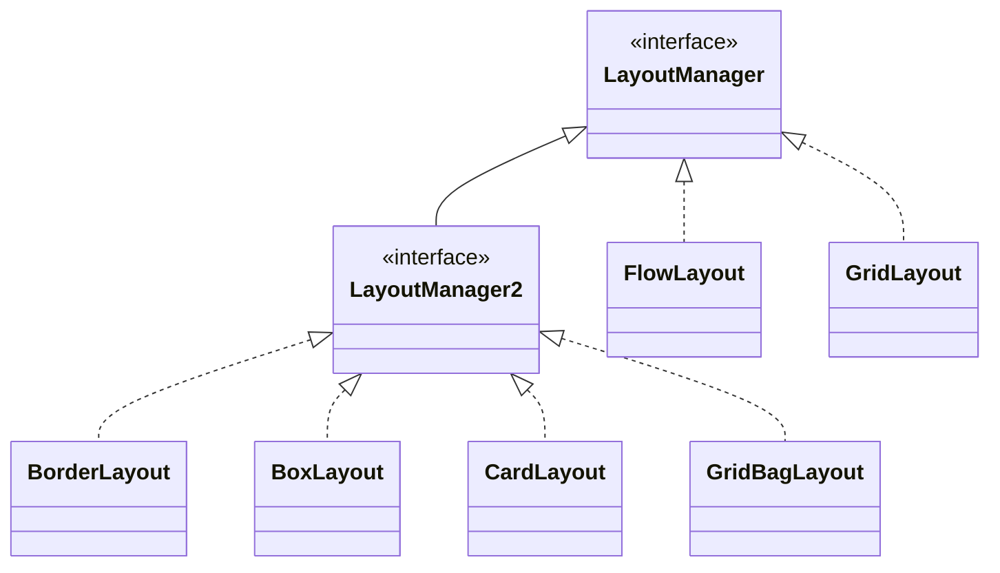
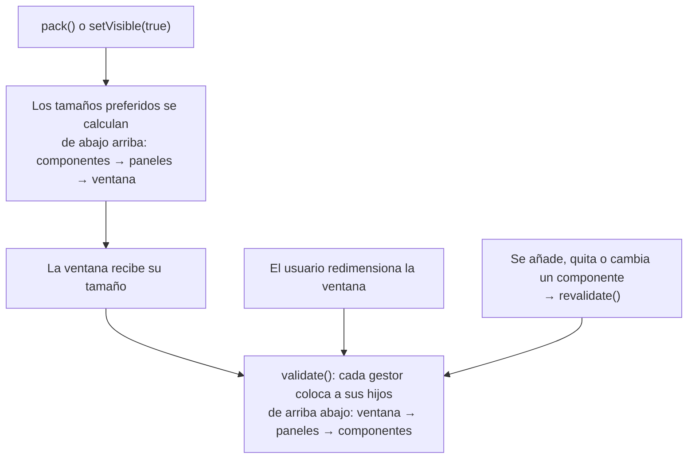
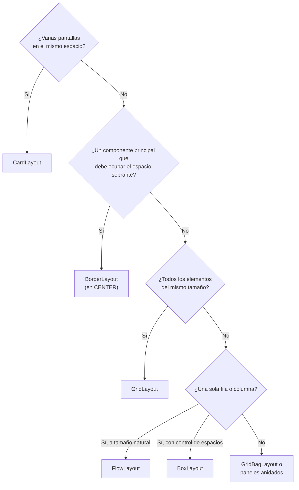

---
tags:
  - desarrollo-de-interfaces
  - DAM2
unidad: 4
tema: Gestores de diseño de Swing (FlowLayout, BorderLayout, GridLayout, BoxLayout y CardLayout), posicionamiento absoluto y criterios de elección
---

# Unidad 4. Gestores de diseño

> [!summary] Ideas clave
> - Un **gestor de diseño** decide la posición y el tamaño de cada componente de un contenedor y los recalcula cada vez que el contenedor cambia de tamaño. Esas son las "reglas" que hacen que una interfaz se adapte.
> - Cada contenedor tiene un único gestor: `JPanel` usa `FlowLayout` por defecto, y el panel de contenido de un `JFrame`, `BorderLayout`.
> - Los gestores trabajan con tres tamaños de cada componente (mínimo, preferido y máximo), pero cada uno respeta solo algunos.
> - `FlowLayout` coloca los componentes en fila, a su tamaño preferido, y pasa a la fila siguiente cuando no caben.
> - `BorderLayout` divide el contenedor en cinco zonas; todo el espacio sobrante va a la zona central.
> - `GridLayout` crea una cuadrícula de celdas iguales y estira cada componente hasta llenar su celda.
> - `BoxLayout` coloca los componentes en una sola fila o columna, respeta el tamaño máximo y usa componentes invisibles (pegamento y áreas rígidas) para repartir el espacio.
> - `CardLayout` apila varios componentes en el mismo espacio y muestra solo uno a la vez.
> - El **posicionamiento absoluto** (`setLayout(null)` y `setBounds()`) no se adapta al tamaño de la ventana, a las fuentes ni al idioma, y debe evitarse.
> - Las interfaces reales se construyen **anidando paneles**, cada uno con el gestor más adecuado para su parte.

---

## 1. Introducción

En la [[02 - La ventana principal|Unidad 2]] se estableció el flujo para añadir un componente: obtener el contenedor, crear el componente, decidir sus restricciones y llamar a `add()`. Falta responder a la pregunta central: **¿quién decide dónde aparece cada componente y qué tamaño tiene?**

La respuesta es el gestor de diseño del contenedor. La nota de clase lo resumía así: cada contenedor se debe adaptar siguiendo "unas reglas" para hacerlo *responsive*. El programador no indica coordenadas en píxeles, sino un conjunto de reglas (en fila, en cuadrícula, en el borde superior, ocupando todo el espacio sobrante), y el gestor las aplica cada vez que la ventana se muestra o cambia de tamaño.

> [!note] Definición: diseño adaptable
> Una interfaz tiene un **diseño adaptable** (*responsive design*) cuando reorganiza o redimensiona sus componentes al cambiar el espacio disponible, de modo que siga siendo usable a cualquier tamaño de ventana.

> [!info] Alcance de la unidad
> Esta unidad estudia cada gestor por separado. `GridBagLayout`, el más flexible, se estudia en la [[05-gridbaglayout|Unidad 5]], y la combinación de gestores para construir interfaces complejas, en la [[06-diseño-adaptable-contendedores-intermedios|Unidad 6]].

---

## 2. Conceptos generales

### 2.1. El gestor de diseño

> [!note] Definición: gestor de diseño
> Un **gestor de diseño** (*layout manager*) es un objeto que implementa la interfaz `LayoutManager` y que determina la posición y el tamaño de los componentes de un contenedor. También calcula el tamaño mínimo, preferido y máximo del propio contenedor a partir de los de sus componentes.

Cada contenedor tiene asociado un único gestor, que se indica en el constructor o con `setLayout()`:

```java
JPanel panel = new JPanel(new BorderLayout());   // in the constructor
panel.setLayout(new GridLayout(2, 2));           // or afterwards
```

| Contenedor | Gestor por defecto |
|---|---|
| `JPanel` | `FlowLayout` |
| Panel de contenido de `JFrame` y `JDialog` | `BorderLayout` |
| `Box` | `BoxLayout` |

La documentación de Oracle advierte que `FlowLayout` y `BorderLayout`, los gestores por defecto, rara vez bastan por sí solos en una aplicación real: lo habitual es sustituirlos o combinarlos con otros.

Los gestores que admiten restricciones al añadir un componente implementan además la interfaz `LayoutManager2`:



### 2.2. Los tres tamaños de un componente

Todo componente informa de tres tamaños, que el gestor consulta para decidir su tamaño final:

| Tamaño | Método de consulta | Método para fijarlo | Significado |
|---|---|---|---|
| Mínimo | `getMinimumSize()` | `setMinimumSize()` | Menor tamaño con el que el componente sigue siendo usable |
| Preferido | `getPreferredSize()` | `setPreferredSize()` | Tamaño idóneo para mostrar su contenido |
| Máximo | `getMaximumSize()` | `setMaximumSize()` | Mayor tamaño que el componente admite |

Cada componente calcula estos valores a partir de su contenido: un botón, a partir de su texto y de la fuente; un campo de texto, a partir de su número de columnas. Algunos componentes, como `JButton` o `JLabel`, tienen un tamaño máximo igual al preferido; otros, como `JPanel` o `JTextField`, admiten crecer sin límite.

> [!important] Los tamaños son indicaciones, no órdenes
> El gestor de diseño decide qué tamaños respeta. La mayoría ignora el tamaño máximo; `BoxLayout` lo respeta. `GridLayout` ignora los tres y da a todos los componentes el mismo tamaño. Por eso fijar `setPreferredSize()` no garantiza que el componente tenga ese tamaño.

### 2.3. Espacios entre componentes

Existen tres formas de separar componentes:

| Técnica | Ejemplo | Dónde se usa |
|---|---|---|
| Separación del gestor (*gap*) | `new BorderLayout(10, 5)` | `FlowLayout`, `BorderLayout`, `GridLayout` |
| Borde vacío | `panel.setBorder(BorderFactory.createEmptyBorder(10, 10, 10, 10))` | Margen alrededor de un panel |
| Componentes invisibles | `Box.createRigidArea(new Dimension(10, 0))` | `BoxLayout` |

> [!note] Definición: márgenes interiores
> Los **márgenes interiores** (*insets*) de un contenedor son el espacio que queda entre su borde y la zona donde el gestor coloca los componentes. Se consultan con `getInsets()` y, en un `JPanel`, los determina su borde.

### 2.4. Cuándo se recalcula la distribución

El gestor no actúa en cada `add()`, sino cuando el contenedor se **valida**:



| Método | Función |
|---|---|
| `invalidate()` | Marca el contenedor como pendiente de recolocar |
| `validate()` | Recoloca los componentes de un contenedor inválido y de sus descendientes |
| `revalidate()` | Marca el componente como inválido y programa la validación desde el contenedor raíz más cercano; es el método que se usa en Swing |
| `doLayout()` | Pide al gestor que coloque los hijos inmediatamente; lo invoca `validate()` |

> [!info] Validación tras añadir componentes
> Como se vio en la [[02 - La ventana principal|Unidad 2]], si se añaden componentes a una ventana ya visible, hay que llamar a `revalidate()` para que el gestor los coloque.

### 2.5. Cómo leer los ejemplos de la unidad

Para medir el comportamiento de cada gestor sin depender de las fuentes del sistema, los ejemplos usan tres métodos auxiliares. `block()` crea un panel vacío con un nombre y un tamaño preferido fijo; `layoutAt()` da un tamaño al contenedor y pide al gestor que coloque los componentes, y `describe()` muestra la posición (`x`, `y`) y el tamaño (`w`, `h`) resultantes de cada componente.

```java
static JPanel block(String name, int w, int h) {
    JPanel p = new JPanel();
    p.setName(name);
    p.setPreferredSize(new Dimension(w, h));
    return p;
}

static void layoutAt(Container c, int w, int h) {
    c.setSize(w, h);
    c.doLayout();
}

static void describe(Container c) {
    for (Component child : c.getComponents()) {
        Rectangle r = child.getBounds();
        String name = child.getName() == null ? child.getClass().getSimpleName() : child.getName();
        System.out.printf("  %-8s x=%-3d y=%-3d w=%-3d h=%d%s%n", name, r.x, r.y, r.width, r.height,
                child.isVisible() ? "" : "  (hidden)");
    }
}
```

Las coordenadas son relativas al contenedor: (0, 0) es su esquina superior izquierda.

---

## 3. Posicionamiento absoluto

> [!note] Definición: posicionamiento absoluto
> El **posicionamiento absoluto** (*absolute positioning*) consiste en eliminar el gestor de diseño de un contenedor con `setLayout(null)` y fijar a mano la posición y el tamaño de cada componente con `setBounds(x, y, ancho, alto)`.

```java
JPanel absolute = new JPanel(null);       // no layout manager
JPanel button = block("Button", 0, 0);
button.setBounds(10, 10, 100, 30);        // x, y, width, height
absolute.add(button);

layoutAt(absolute, 400, 300);
describe(absolute);
layoutAt(absolute, 800, 600);
describe(absolute);
```

```text
  Button   x=10  y=10  w=100 h=30
  Button   x=10  y=10  w=100 h=30
```

Al duplicar el tamaño del contenedor, el componente no se mueve ni crece. Además, un contenedor sin gestor no sabe calcular su tamaño preferido:

```java
System.out.println("preferred: " + new JPanel(null).getPreferredSize());
```

```text
preferred: java.awt.Dimension[width=0,height=0]
```

| Problema | Consecuencia |
|---|---|
| No reacciona al redimensionar | Al ampliar la ventana queda espacio vacío; al reducirla, los componentes se recortan |
| Ignora las fuentes y el aspecto visual | Un texto más largo o una fuente mayor en otro sistema operativo no cabe en el tamaño fijado |
| Ignora el idioma | Una traducción con textos más largos, o un idioma que se escribe de derecha a izquierda, rompe la distribución |
| Tamaño preferido nulo | `pack()` deja la ventana con el tamaño mínimo |
| Componentes sin `setBounds()` | Tienen tamaño 0 × 0 y no se ven |

> [!danger] Evitar el posicionamiento absoluto
> El posicionamiento absoluto es lo contrario de un diseño adaptable. Oracle recomienda usar un gestor de diseño siempre que sea posible y reservar el posicionamiento absoluto para casos muy concretos, como contenedores que implementan su propia lógica de colocación.

> [!info] Editores visuales
> Algunos editores visuales de interfaces generan código con posicionamiento absoluto al arrastrar componentes sobre la ventana. El resultado se ve bien en el equipo donde se diseñó, pero no se adapta.

---

## 4. `FlowLayout`

> [!note] Definición: `FlowLayout`
> `FlowLayout` coloca los componentes uno tras otro en una fila, a su tamaño preferido, como las palabras de un texto. Cuando no caben más en la fila actual, continúa en la siguiente. Es el gestor por defecto de `JPanel`.

Por defecto centra cada fila y deja 5 píxeles de separación horizontal y vertical, también en los bordes:

```java
JPanel flow = new JPanel();   // FlowLayout by default
flow.add(block("A", 100, 30));
flow.add(block("B", 100, 30));
flow.add(block("C", 100, 30));

layoutAt(flow, 400, 100);
describe(flow);
```

```text
  A        x=45  y=5   w=100 h=30
  B        x=150 y=5   w=100 h=30
  C        x=255 y=5   w=100 h=30
```

Si el contenedor se estrecha hasta 250 píxeles, el tercer componente pasa a una segunda fila, también centrada:

```text
  A        x=22  y=5   w=100 h=30
  B        x=127 y=5   w=100 h=30
  C        x=75  y=40  w=100 h=30
```

| Constructor | Resultado |
|---|---|
| `FlowLayout()` | Filas centradas, separación de 5 píxeles |
| `FlowLayout(int align)` | Alineación indicada, separación de 5 píxeles |
| `FlowLayout(int align, int hgap, int vgap)` | Alineación y separaciones indicadas |

Las alineaciones disponibles son `LEFT`, `CENTER`, `RIGHT`, `LEADING` (inicio de línea) y `TRAILING` (final de línea).

```java
JPanel left = new JPanel(new FlowLayout(FlowLayout.LEFT, 10, 0));
left.add(block("A", 100, 30));
left.add(block("B", 100, 30));
layoutAt(left, 400, 30);
describe(left);
```

```text
  A        x=10  y=0   w=100 h=30
  B        x=120 y=0   w=100 h=30
```

> [!warning] El tamaño preferido supone una sola fila
> `FlowLayout` calcula el tamaño preferido del contenedor como si todos los componentes cupieran en una única fila. En el ejemplo anterior, el panel informa de un tamaño preferido de 320 × 40 aunque, con 250 píxeles de ancho, necesite dos filas. Si el panel está dentro de otro gestor que respeta su altura preferida, la segunda fila puede quedar cortada.

> [!tip] Uso habitual
> `FlowLayout` es adecuado para grupos pequeños de componentes a su tamaño natural: una fila de botones o de opciones. No sirve para formularios, porque no alinea etiquetas y campos en columnas.

---

## 5. `BorderLayout`

> [!note] Definición: `BorderLayout`
> `BorderLayout` divide el contenedor en cinco zonas: superior, inferior, inicio de línea, final de línea y centro. Cada zona admite un único componente, y todo el espacio sobrante se asigna a la zona central. Es el gestor por defecto del panel de contenido.

```text
┌───────────────────────────────────────────┐
│                PAGE_START                 │
├────────────┬─────────────────┬────────────┤
│            │                 │            │
│ LINE_START │     CENTER      │  LINE_END  │
│            │                 │            │
├────────────┴─────────────────┴────────────┤
│                 PAGE_END                  │
└───────────────────────────────────────────┘
```

La zona se indica como restricción en `add()`. Existen dos juegos de constantes:

| Constante relativa (recomendada) | Constante absoluta | Zona |
|---|---|---|
| `PAGE_START` | `NORTH` | Superior |
| `PAGE_END` | `SOUTH` | Inferior |
| `LINE_START` | `WEST` | Inicio de línea (izquierda en español) |
| `LINE_END` | `EAST` | Final de línea (derecha en español) |
| `CENTER` | `CENTER` | Centro |

> [!tip] Constantes relativas
> Oracle recomienda las constantes relativas porque se adaptan a la orientación del idioma: en un idioma que se escribe de derecha a izquierda, como el árabe, `LINE_START` pasa a estar a la derecha. Las absolutas siguen funcionando y aparecen en mucho código existente.

Cada zona usa el tamaño preferido del componente solo en una dirección:

```java
JPanel border = new JPanel(new BorderLayout());
border.add(block("Top", 50, 40), BorderLayout.PAGE_START);
border.add(block("Bottom", 50, 30), BorderLayout.PAGE_END);
border.add(block("Start", 80, 50), BorderLayout.LINE_START);
border.add(block("End", 60, 50), BorderLayout.LINE_END);
border.add(block("Center", 10, 10), BorderLayout.CENTER);

layoutAt(border, 400, 300);
describe(border);
```

```text
  Top      x=0   y=0   w=400 h=40
  Bottom   x=0   y=270 w=400 h=30
  Start    x=0   y=40  w=80  h=230
  End      x=340 y=40  w=60  h=230
  Center   x=80  y=40  w=260 h=230
```

Al ampliar el contenedor a 600 × 400, solo cambia el tamaño de la zona central y la longitud de las zonas laterales:

```text
  Top      x=0   y=0   w=600 h=40
  Bottom   x=0   y=370 w=600 h=30
  Start    x=0   y=40  w=80  h=330
  End      x=540 y=40  w=60  h=330
  Center   x=80  y=40  w=460 h=330
```

| Zona | Altura | Anchura |
|---|---|---|
| `PAGE_START`, `PAGE_END` | La preferida | Todo el ancho del contenedor |
| `LINE_START`, `LINE_END` | El alto restante | La preferida |
| `CENTER` | El alto restante | El ancho restante |

El constructor `BorderLayout(int hgap, int vgap)` añade separación entre zonas:

```java
JPanel gaps = new JPanel(new BorderLayout(10, 5));
gaps.add(block("Top", 50, 40), BorderLayout.PAGE_START);
gaps.add(block("Start", 80, 50), BorderLayout.LINE_START);
gaps.add(block("Center", 10, 10), BorderLayout.CENTER);
layoutAt(gaps, 400, 300);
describe(gaps);
```

```text
  Top      x=0   y=0   w=400 h=40
  Start    x=0   y=45  w=80  h=255
  Center   x=90  y=45  w=310 h=255
```

Las zonas vacías no ocupan espacio: en este ejemplo no hay componente al final de línea ni en la parte inferior, y la zona central se extiende hasta los bordes.

> [!danger] Una zona, un componente
> Si se añaden dos componentes a la misma zona, solo se ve el último. El primero sigue dentro del contenedor, pero con tamaño 0 × 0. Además, `add()` sin restricción equivale a añadir en `CENTER`:
>
> ```java
> JPanel twice = new JPanel(new BorderLayout());
> twice.add(block("First", 50, 50));    // no constraint: CENTER
> twice.add(block("Second", 50, 50));   // CENTER again
> layoutAt(twice, 200, 100);
> describe(twice);
> ```
>
> ```text
>   First    x=0   y=0   w=0   h=0
>   Second   x=0   y=0   w=200 h=100
> ```
>
> Para colocar varios componentes en una zona, se agrupan antes en un `JPanel`.

> [!tip] Uso habitual
> `BorderLayout` es la estructura típica de una ventana: barra de herramientas arriba, barra de estado abajo, panel lateral a un lado y contenido principal en el centro, que es el que crece.

---

## 6. `GridLayout`

> [!note] Definición: `GridLayout`
> `GridLayout` organiza los componentes en una cuadrícula de filas y columnas en la que **todas las celdas tienen el mismo tamaño**. Cada componente se estira hasta ocupar su celda entera, y las celdas se rellenan por filas, de izquierda a derecha.

```java
JPanel grid = new JPanel(new GridLayout(2, 3, 5, 5));   // rows, cols, hgap, vgap
for (int i = 1; i <= 6; i++) {
    grid.add(block("G" + i, 10 * i, 10 * i));           // different preferred sizes
}
layoutAt(grid, 310, 105);
describe(grid);
```

```text
  G1       x=0   y=0   w=100 h=50
  G2       x=105 y=0   w=100 h=50
  G3       x=210 y=0   w=100 h=50
  G4       x=0   y=55  w=100 h=50
  G5       x=105 y=55  w=100 h=50
  G6       x=210 y=55  w=100 h=50
```

Aunque los seis bloques tienen tamaños preferidos distintos, todos reciben 100 × 50. El tamaño preferido de la cuadrícula se calcula a partir del componente más grande: con celdas de 60 × 60, son 3 × 60 + 2 × 5 = 190 de ancho y 2 × 60 + 5 = 125 de alto.

| Constructor | Resultado |
|---|---|
| `GridLayout()` | Una fila con una columna por componente |
| `GridLayout(int rows, int cols)` | Cuadrícula sin separación |
| `GridLayout(int rows, int cols, int hgap, int vgap)` | Cuadrícula con separación |

Uno de los dos valores puede ser 0, que significa "tantos como hagan falta". `GridLayout(0, 2)` crea dos columnas y las filas necesarias, como en el formulario de la [[03-componentes-basicos|Unidad 3]]:

```java
JPanel cols = new JPanel(new GridLayout(0, 2));
for (int i = 1; i <= 5; i++) cols.add(block("C" + i, 10, 10));
layoutAt(cols, 200, 90);
describe(cols);
```

```text
  C1       x=0   y=0   w=100 h=30
  C2       x=100 y=0   w=100 h=30
  C3       x=0   y=30  w=100 h=30
  C4       x=100 y=30  w=100 h=30
  C5       x=0   y=60  w=100 h=30
```

> [!warning] El número de filas tiene prioridad
> Cuando el número de filas no es 0, el de columnas se ignora y se recalcula según el número de componentes. `GridLayout(2, 3)` con siete componentes no crea 2 × 3 celdas, sino 2 filas de 4 columnas:
>
> ```text
>   R1       x=0   y=0   w=100 h=50
>   R2       x=100 y=0   w=100 h=50
>   R3       x=200 y=0   w=100 h=50
>   R4       x=300 y=0   w=100 h=50
>   R5       x=0   y=50  w=100 h=50
>   R6       x=100 y=50  w=100 h=50
>   R7       x=200 y=50  w=100 h=50
> ```
>
> Para fijar el número de columnas se usa 0 como número de filas: `GridLayout(0, 3)`.

> [!tip] Uso habitual
> `GridLayout` es adecuado cuando todos los elementos deben ser iguales: el teclado de una calculadora, una botonera o una galería de miniaturas. En un formulario estira los campos de texto y las etiquetas al mismo tamaño, lo que suele dar un resultado poco natural.

---

## 7. `BoxLayout`

### 7.1. Funcionamiento

> [!note] Definición: `BoxLayout`
> `BoxLayout` coloca los componentes en una sola fila o en una sola columna. A diferencia de los gestores anteriores, respeta el **tamaño máximo** y la **alineación** de cada componente.

El eje se indica en el constructor, que además recibe el contenedor al que se aplica:

```java
JPanel column = new JPanel();
column.setLayout(new BoxLayout(column, BoxLayout.PAGE_AXIS));  // the panel is passed twice
```

| Constante | Eje |
|---|---|
| `PAGE_AXIS` (recomendada) / `Y_AXIS` | Vertical, de arriba abajo |
| `LINE_AXIS` (recomendada) / `X_AXIS` | Horizontal, en el sentido de la escritura |

> [!danger] Un `BoxLayout` no se puede compartir
> El `BoxLayout` queda ligado al contenedor que recibe en su constructor. Si se asigna a otro contenedor, la primera operación sobre él lanza un error:
>
> ```text
> AWTError: BoxLayout can't be shared
> ```

> [!tip] La clase `Box`
> `Box` es un contenedor ligero que ya usa `BoxLayout`. `Box.createVerticalBox()` y `Box.createHorizontalBox()` evitan escribir el contenedor dos veces.

### 7.2. Tamaño de los componentes

En el eje principal, `BoxLayout` empieza por el tamaño preferido y reparte el espacio que sobra o falta entre los componentes, dentro de sus tamaños mínimo y máximo. En el eje perpendicular, estira cada componente hasta el ancho del contenedor, sin superar su máximo.

Un `JPanel` no tiene tamaño máximo, por lo que crece en ambas direcciones:

```java
JPanel column = new JPanel();
column.setLayout(new BoxLayout(column, BoxLayout.PAGE_AXIS));
column.add(block("A", 100, 30));
column.add(block("B", 150, 30));

layoutAt(column, 300, 200);
describe(column);
```

```text
  A        x=0   y=0   w=300 h=100
  B        x=0   y=100 w=300 h=100
```

Limitando el tamaño máximo se controla qué crece:

```java
JPanel a = block("A", 100, 30);
a.setMaximumSize(new Dimension(100, 30));                // never grows
JPanel b = block("B", 150, 30);
b.setMaximumSize(new Dimension(Integer.MAX_VALUE, 30));  // grows in width only
```

```text
  A        x=100 y=0   w=100 h=30
  B        x=0   y=30  w=300 h=30
```

> [!warning] Campos de texto que crecen en altura
> `JTextField` tiene un tamaño máximo ilimitado también en altura. En una columna con `BoxLayout`, un campo de texto se estira verticalmente hasta ocupar todo el espacio libre. Se evita limitando su altura máxima a la preferida:
>
> ```java
> field.setMaximumSize(new Dimension(Integer.MAX_VALUE, field.getPreferredSize().height));
> ```

### 7.3. Alineación

En la salida anterior, el bloque A aparece centrado (`x=100`). En el eje perpendicular, `BoxLayout` coloca cada componente según su **alineación**, un valor entre 0 (inicio) y 1 (final) que se fija con `setAlignmentX()` o `setAlignmentY()`.

| Constante de `Component` | Valor | Posición en una columna |
|---|---|---|
| `LEFT_ALIGNMENT` | 0.0 | A la izquierda |
| `CENTER_ALIGNMENT` | 0.5 | Centrado |
| `RIGHT_ALIGNMENT` | 1.0 | A la derecha |

La alineación por defecto depende de la clase: `JPanel` usa 0.5, mientras que `JButton` y `JLabel` usan 0.0.

> [!warning] Alineaciones distintas en la misma columna
> Si se mezclan componentes con alineaciones diferentes, por ejemplo un `JLabel` y un `JPanel`, la columna queda descolocada de forma poco intuitiva. Se recomienda dar la misma alineación a todos los componentes del contenedor:
>
> ```java
> a.setAlignmentX(Component.LEFT_ALIGNMENT);
> b.setAlignmentX(Component.LEFT_ALIGNMENT);
> ```
>
> ```text
>   A        x=0   y=0   w=100 h=30
>   B        x=0   y=30  w=100 h=30
> ```

### 7.4. Componentes invisibles

`BoxLayout` no tiene separación entre componentes. Para crear espacios se añaden **componentes de relleno** (*fillers*): componentes invisibles que solo ocupan espacio.

| Relleno | Método de creación | Comportamiento |
|---|---|---|
| Área rígida | `Box.createRigidArea(Dimension)` | Espacio fijo del tamaño indicado |
| Pegamento (*glue*) | `Box.createHorizontalGlue()`, `Box.createVerticalGlue()` | Espacio elástico que absorbe todo el sobrante |
| Puntal (*strut*) | `Box.createHorizontalStrut(int)`, `Box.createVerticalStrut(int)` | Espacio fijo en un eje, pero ilimitado en el otro |
| Relleno personalizado | `new Box.Filler(min, pref, max)` | Espacio con tamaños mínimo, preferido y máximo propios |

El caso más frecuente es una fila de botones alineada a la derecha: el pegamento empuja los botones hacia el final y un área rígida los separa.

```java
JPanel row = new JPanel();
row.setLayout(new BoxLayout(row, BoxLayout.LINE_AXIS));
row.add(Box.createHorizontalGlue());                  // pushes the buttons to the right
row.add(ok);
row.add(Box.createRigidArea(new Dimension(10, 0)));   // fixed 10 px gap
row.add(cancel);

layoutAt(row, 400, 30);
describe(row);
```

```text
  Filler   x=0   y=15  w=230 h=0
  OK       x=230 y=0   w=80  h=30
  Filler   x=310 y=15  w=10  h=0
  Cancel   x=320 y=0   w=80  h=30
```

Con 600 píxeles de ancho, el pegamento pasa de 230 a 430 píxeles y los botones se desplazan, sin cambiar de tamaño ni de separación.

> [!tip] Áreas rígidas mejor que puntales
> Un puntal horizontal tiene una altura máxima prácticamente ilimitada (32 767 píxeles), por lo que una fila con puntales dentro de una columna puede crecer en altura sin motivo. Oracle recomienda usar áreas rígidas, cuyo tamaño máximo coincide con el indicado.

> [!tip] Uso habitual
> `BoxLayout` sirve para filas y columnas que necesitan control fino de los espacios: barras de botones, listas verticales de opciones o paneles laterales.

---

## 8. `CardLayout`

> [!note] Definición: `CardLayout`
> `CardLayout` apila varios componentes, llamados **tarjetas** (*cards*), en el mismo espacio y muestra solo uno a la vez, como una baraja en la que solo se ve la carta superior.

Cada tarjeta se añade con un nombre como restricción, y se muestra llamando a los métodos del gestor, que reciben el contenedor:

```java
CardLayout cards = new CardLayout();
JPanel deck = new JPanel(cards);
deck.add(block("Login", 200, 100), "login");
deck.add(block("Home", 300, 150), "home");
deck.add(block("Help", 100, 50), "help");

layoutAt(deck, 300, 150);
describe(deck);

cards.show(deck, "home");
describe(deck);
```

```text
  Login    x=0   y=0   w=300 h=150
  Home     x=0   y=0   w=300 h=150  (hidden)
  Help     x=0   y=0   w=300 h=150  (hidden)

  Login    x=0   y=0   w=300 h=150  (hidden)
  Home     x=0   y=0   w=300 h=150
  Help     x=0   y=0   w=300 h=150  (hidden)
```

Todas las tarjetas ocupan el contenedor entero, pero solo una es visible. Inicialmente se muestra la primera que se añadió.

| Método | Función |
|---|---|
| `show(Container, String)` | Muestra la tarjeta con el nombre indicado |
| `first(Container)` / `last(Container)` | Muestra la primera o la última |
| `next(Container)` / `previous(Container)` | Muestra la siguiente o la anterior; al llegar al final, vuelve al principio |

El tamaño preferido del contenedor es el de la tarjeta más grande (300 × 150 en el ejemplo), de modo que todas caben sin cambiar el tamaño de la ventana.

> [!tip] Uso habitual
> `CardLayout` es útil para asistentes paso a paso o para cambiar de pantalla dentro de una misma ventana (por ejemplo, de la pantalla de inicio de sesión a la principal). Cuando el usuario debe elegir la pantalla mediante pestañas, `JTabbedPane` resuelve lo mismo con menos código; se estudia en la [[06-diseño-adaptable-contendedores-intermedios|Unidad 6]].

---

## 9. Otros gestores

| Gestor | Características | Estudio |
|---|---|---|
| `GridBagLayout` | Cuadrícula flexible: filas y columnas de distinto tamaño, componentes que ocupan varias celdas y reparto configurable del espacio sobrante | [[05-gridbaglayout\|Unidad 5]] |
| `GroupLayout` | Define la distribución horizontal y la vertical por separado; diseñado para editores visuales como el de NetBeans | Fuera del alcance |
| `SpringLayout` | Define relaciones entre los bordes de los componentes; diseñado para editores visuales | Fuera del alcance |

> [!info] La nota de clase
> La nota proponía sustituir `BorderLayout` por `GridBagLayout`. Esto se debe a que `BorderLayout` solo ofrece cinco zonas fijas, mientras que `GridBagLayout` permite definir una cuadrícula a medida con un comportamiento distinto para cada celda.

---

## 10. Comparativa y elección

### 10.1. Comparativa

| Gestor | Distribución | Tamaño de los componentes | ¿Respeta el máximo? | Restricción en `add()` |
|---|---|---|---|---|
| `FlowLayout` | Filas que continúan en la siguiente | Preferido | No | Ninguna |
| `BorderLayout` | Cinco zonas | Preferido en una dirección; el centro, todo el sobrante | No | Zona (`PAGE_START`…) |
| `GridLayout` | Cuadrícula de celdas iguales | El de la celda; ignora los tres tamaños | No | Ninguna |
| `BoxLayout` | Una fila o una columna | Preferido, ajustado entre mínimo y máximo | Sí | Ninguna (rellenos invisibles) |
| `CardLayout` | Una tarjeta visible a la vez | Todo el contenedor | No | Nombre de la tarjeta |
| `null` | Coordenadas fijas | El fijado con `setBounds()` | No aplica | Ninguna (`setBounds()`) |

### 10.2. Elección del gestor



> [!important] Anidar paneles
> Ningún gestor resuelve por sí solo una ventana completa. La técnica habitual es dividir la interfaz en zonas, crear un `JPanel` para cada una con el gestor más adecuado, y anidar unos paneles dentro de otros. El ejemplo integrador de esta unidad aplica esta técnica, que se desarrolla en la [[06-diseño-adaptable-contendedores-intermedios|Unidad 6]].

### 10.3. Orientación de los componentes

`FlowLayout`, `BorderLayout`, `BoxLayout`, `GridLayout` y `GridBagLayout` tienen en cuenta la **orientación** del contenedor, que indica si el texto se escribe de izquierda a derecha o de derecha a izquierda. Las constantes relativas (`LINE_START`, `PAGE_AXIS`, `LEADING`) se basan en ella, por lo que la misma interfaz se invierte automáticamente en idiomas como el árabe o el hebreo al aplicar `applyComponentOrientation()`.

---

## 11. Errores típicos

> [!danger] Añadir varios componentes a la misma zona de `BorderLayout`
> Solo se ve el último. Ocurre también al llamar a `add()` sin restricción varias veces, porque todos van a `CENTER`.

> [!danger] Compartir un `BoxLayout` entre contenedores
> Lanza `AWTError: BoxLayout can't be shared`. Cada contenedor necesita su propia instancia, creada con ese mismo contenedor.

> [!danger] Usar posicionamiento absoluto para una ventana redimensionable
> Los componentes no se adaptan y, con `pack()`, la ventana queda con tamaño mínimo.

> [!warning] Esperar que `setPreferredSize()` se respete siempre
> `GridLayout` lo ignora, y `BorderLayout` solo lo usa en una dirección.

> [!warning] `GridLayout(2, 3)` con más de seis componentes
> Las columnas se recalculan. Para fijar las columnas se usa `GridLayout(0, 3)`.

> [!warning] Campos de texto estirados en `BoxLayout` o `GridLayout`
> En `BoxLayout` crecen en altura si no se limita su tamaño máximo; en `GridLayout` ocupan toda la celda.

> [!warning] Mezclar alineaciones en `BoxLayout`
> Los componentes aparecen desplazados. Todos deben tener la misma alineación en el eje perpendicular.

> [!warning] Confiar en la altura preferida de un panel con `FlowLayout`
> Se calcula como si hubiera una sola fila, aunque los componentes necesiten varias.

---

## 12. Ejemplo integrador

La siguiente ventana de ajustes combina cuatro gestores anidados:

- El panel de contenido usa `BorderLayout`: el título arriba, el formulario en el centro y los botones abajo.
- El formulario usa `GridLayout(0, 2)` para formar parejas de etiqueta y campo.
- Las opciones del tema van en un panel con `FlowLayout` alineado a la izquierda.
- Los botones usan `BoxLayout` con pegamento y un área rígida para alinearse a la derecha.

```text
┌──────────────────────────────────────┐
│            User settings             │  ← PAGE_START (JLabel)
├──────────────────────────────────────┤
│ Name:            [                 ] │
│ Email:           [                 ] │  ← CENTER (GridLayout 0 × 2)
│ Theme:           (•) Light ( ) Dark  │  ← FlowLayout dentro de una celda
├──────────────────────────────────────┤
│                       [ OK ] [Cancel]│  ← PAGE_END (BoxLayout + glue)
└──────────────────────────────────────┘
```

```java
public class SettingsWindow {
    private final JFrame frame = new JFrame("Settings");
    private final JPanel form = new JPanel(new GridLayout(0, 2, 5, 5));
    private final JButton okButton = new JButton("OK");
    private final JButton cancelButton = new JButton("Cancel");

    public SettingsWindow() {
        // PAGE_START: title
        JLabel title = new JLabel("User settings", SwingConstants.CENTER);

        // CENTER: label + field grid; the theme row uses a FlowLayout panel
        JRadioButton light = new JRadioButton("Light", true);
        JRadioButton dark = new JRadioButton("Dark");
        ButtonGroup theme = new ButtonGroup();
        theme.add(light);
        theme.add(dark);
        JPanel themePanel = new JPanel(new FlowLayout(FlowLayout.LEFT, 5, 0));
        themePanel.add(light);
        themePanel.add(dark);

        form.add(new JLabel("Name:"));
        form.add(new JTextField(12));
        form.add(new JLabel("Email:"));
        form.add(new JTextField(12));
        form.add(new JLabel("Theme:"));
        form.add(themePanel);

        // PAGE_END: buttons pushed to the right with glue, separated by a rigid area
        JPanel buttons = new JPanel();
        buttons.setLayout(new BoxLayout(buttons, BoxLayout.LINE_AXIS));
        buttons.add(Box.createHorizontalGlue());
        buttons.add(okButton);
        buttons.add(Box.createRigidArea(new Dimension(10, 0)));
        buttons.add(cancelButton);

        JPanel content = new JPanel(new BorderLayout(0, 10));
        content.setBorder(BorderFactory.createEmptyBorder(10, 10, 10, 10));
        content.add(title, BorderLayout.PAGE_START);
        content.add(form, BorderLayout.CENTER);
        content.add(buttons, BorderLayout.PAGE_END);

        frame.setContentPane(content);
        frame.setDefaultCloseOperation(JFrame.EXIT_ON_CLOSE);
        frame.pack();
        frame.setLocationRelativeTo(null);
    }

    public void show() {
        frame.setVisible(true);
    }

    // Grows the window and reports how each region reacted
    public void growAndReport(int extraWidth, int extraHeight) {
        Rectangle formBefore = form.getBounds();
        Rectangle okBefore = okButton.getBounds();

        frame.setSize(frame.getWidth() + extraWidth, frame.getHeight() + extraHeight);
        frame.validate();

        System.out.println("Form: width +" + (form.getWidth() - formBefore.width)
                + ", height +" + (form.getHeight() - formBefore.height));
        System.out.println("OK button: moved +" + (okButton.getX() - okBefore.x)
                + " px, size unchanged: " + okButton.getSize().equals(okBefore.getSize()));
    }

    public static void main(String[] args) {
        SwingUtilities.invokeLater(() -> {
            SettingsWindow window = new SettingsWindow();
            window.show();
            window.growAndReport(200, 90);
        });
    }
}
```

```text
Form: width +200, height +90
OK button: moved +200 px, size unchanged: true
```

Al ampliar la ventana 200 píxeles de ancho y 90 de alto, el formulario, situado en `CENTER`, recibe todo el espacio sobrante, mientras que los botones solo se desplazan hacia la derecha gracias al pegamento, sin cambiar de tamaño. El resultado también muestra la limitación de `GridLayout`: los 90 píxeles extra de alto se reparten entre las tres filas, de modo que los campos de texto se estiran verticalmente. La [[05-gridbaglayout|Unidad 5]] resuelve este problema.

---

## Bibliografía

- [Laying Out Components Within a Container](https://docs.oracle.com/javase/tutorial/uiswing/layout/index.html) (tutorial oficial de Oracle)
- [A Visual Guide to Layout Managers](https://docs.oracle.com/javase/tutorial/uiswing/layout/visual.html) (tutorial oficial de Oracle)
- [Using Layout Managers](https://docs.oracle.com/javase/tutorial/uiswing/layout/using.html) (tutorial oficial de Oracle)
- [How Layout Management Works](https://docs.oracle.com/javase/tutorial/uiswing/layout/howLayoutWorks.html) (tutorial oficial de Oracle)
- [Doing Without a Layout Manager (Absolute Positioning)](https://docs.oracle.com/javase/tutorial/uiswing/layout/none.html) (tutorial oficial de Oracle)
- [How to Use FlowLayout](https://docs.oracle.com/javase/tutorial/uiswing/layout/flow.html) (tutorial oficial de Oracle)
- [How to Use BorderLayout](https://docs.oracle.com/javase/tutorial/uiswing/layout/border.html) (tutorial oficial de Oracle)
- [How to Use GridLayout](https://docs.oracle.com/javase/tutorial/uiswing/layout/grid.html) (tutorial oficial de Oracle)
- [How to Use BoxLayout](https://docs.oracle.com/javase/tutorial/uiswing/layout/box.html) (tutorial oficial de Oracle)
- [How to Use CardLayout](https://docs.oracle.com/javase/tutorial/uiswing/layout/card.html) (tutorial oficial de Oracle)
