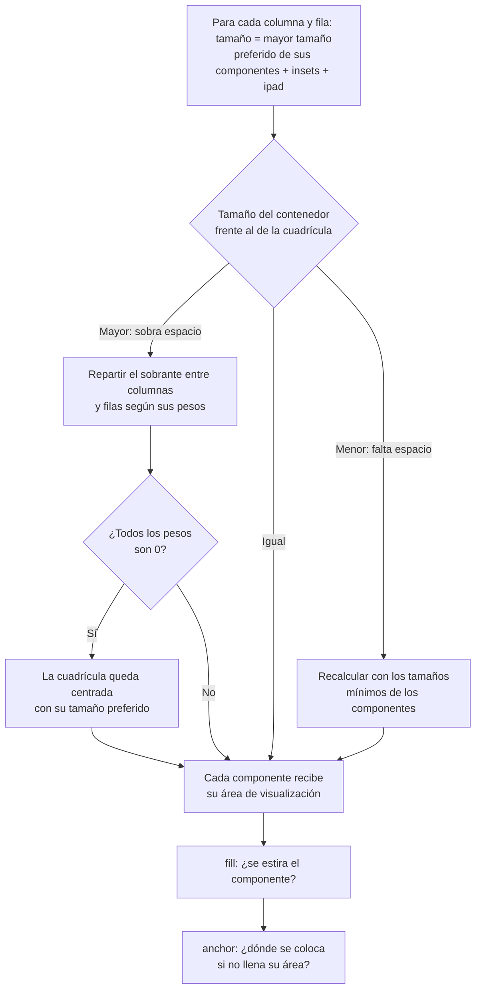

---
tags:
  - desarrollo-de-interfaces
  - DAM2
unidad: 5
tema: GridBagLayout y GridBagConstraints, posición, extensión, reparto del espacio, relleno, alineación, márgenes y patrones de uso
---

# Unidad 5. GridBagLayout en profundidad

> [!summary] Ideas clave
> - `GridBagLayout` organiza los componentes en una cuadrícula cuyas filas y columnas pueden tener **tamaños distintos**; cada componente puede ocupar varias celdas.
> - Cada componente se añade con un objeto `GridBagConstraints`, cuyos campos indican su posición, cuántas celdas ocupa, cómo crece y cómo se alinea: `add(componente, restricciones)`.
> - El ancho de cada columna y el alto de cada fila se calculan a partir del tamaño preferido de sus componentes.
> - `weightx` y `weighty` deciden qué columnas y filas reciben el **espacio sobrante**. Si todos los pesos son 0, los componentes se agrupan en el centro y la interfaz no se adapta.
> - Los pesos reparten el espacio **sobrante**, no el total: con pesos 0.3 y 0.7, las columnas no ocupan necesariamente el 30 % y el 70 % de la ventana.
> - `fill` indica si el componente se estira para ocupar su área, y `anchor`, dónde se coloca cuando no la ocupa entera.
> - `insets` añade un margen exterior alrededor del componente, e `ipadx`/`ipady`, un relleno interior que lo agranda.
> - Si el contenedor es más pequeño que el tamaño preferido de su contenido, `GridBagLayout` pasa a usar los tamaños mínimos, lo que puede encoger bruscamente los campos de texto.
> - `add()` guarda una **copia** de las restricciones. Reutilizar el mismo objeto es posible, pero cualquier campo que no se restablezca se arrastra al componente siguiente; por eso se recomienda crear unas restricciones nuevas para cada componente.

---

## 1. Introducción

La [[04-gestor-diseño|Unidad 4]] terminó con dos limitaciones. `GridLayout` obliga a que todas las celdas tengan el mismo tamaño, por lo que estira por igual las etiquetas, los campos de una línea y las áreas de texto. `BorderLayout` solo ofrece cinco zonas fijas. Para construir un formulario en el que las etiquetas mantengan su tamaño, los campos crezcan solo en anchura y un área de texto ocupe el espacio restante, hace falta un gestor que permita definir **una regla distinta para cada componente**.

Ese gestor es `GridBagLayout`. La nota de clase lo resumía con la idea central de esta unidad: el método `add()` recibe el objeto y los parámetros que determinan su **posición y su comportamiento**. Esos parámetros son las restricciones (*constraints*).

> [!info] Alcance de la unidad
> Esta unidad estudia `GridBagLayout` en un único contenedor. La combinación de `GridBagLayout` con otros gestores y contenedores intermedios se estudia en la [[06-diseño-adaptable-contendedores-intermedios|Unidad 6]].

---

## 2. Conceptos

### 2.1. La cuadrícula

> [!note] Definición: `GridBagLayout`
> `GridBagLayout` es un gestor de diseño que coloca los componentes en una **cuadrícula dinámica** de filas y columnas. A diferencia de `GridLayout`, las filas pueden tener alturas distintas y las columnas anchos distintos, y un componente puede ocupar varias celdas contiguas.

> [!note] Definición: área de visualización
> El **área de visualización** (*display area*) de un componente es el rectángulo formado por la celda o celdas que ocupa en la cuadrícula. El componente puede llenarla entera o ocupar solo una parte, según sus restricciones.

El número de filas y columnas no se declara: lo determina la posición de los componentes añadidos. La celda (0, 0) es la esquina superior izquierda; `gridx` crece hacia la derecha y `gridy` hacia abajo.

```text
          columna 0      columna 1      columna 2
        ┌────────────┬──────────────┬────────────┐
fila 0  │  (0, 0)    │   (1, 0)     │  (2, 0)    │
        ├────────────┼──────────────┴────────────┤
fila 1  │  (0, 1)    │   área de visualización   │  ← componente en (1, 1)
        │            │   de 2 columnas           │     con gridwidth = 2
        └────────────┴───────────────────────────┘
```

### 2.2. Las restricciones

> [!note] Definición: `GridBagConstraints`
> `GridBagConstraints` es la clase cuyos objetos describen las restricciones de un componente dentro de un `GridBagLayout`: en qué celda empieza, cuántas celdas ocupa, cómo se reparte el espacio sobrante, si se estira y cómo se alinea. Se pasa como segundo argumento de `add()`.

El flujo de trabajo es el descrito en la [[02 - La ventana principal|Unidad 2]], con las restricciones como tercer paso:

```java
JPanel panel = new JPanel(new GridBagLayout());   // 1. container with GridBagLayout
JLabel label = new JLabel("Name:");                // 2. component
GridBagConstraints c = new GridBagConstraints();   // 3. constraints
c.gridx = 0;
c.gridy = 0;
panel.add(label, c);                               // 4. add with constraints
```

| Campo | Función | Valor por defecto |
|---|---|---|
| `gridx`, `gridy` | Columna y fila de la primera celda del componente | `RELATIVE` |
| `gridwidth`, `gridheight` | Número de columnas y filas que ocupa | `1` |
| `weightx`, `weighty` | Proporción del espacio sobrante que recibe su columna o fila | `0.0` |
| `fill` | Si el componente se estira para llenar su área | `NONE` |
| `anchor` | Posición del componente dentro de su área cuando no la llena | `CENTER` |
| `insets` | Margen exterior entre el componente y el borde de su área | `new Insets(0, 0, 0, 0)` |
| `ipadx`, `ipady` | Relleno interior que se suma al tamaño del componente | `0` |

Todos los campos son públicos y se asignan directamente. Las constantes (`RELATIVE`, `REMAINDER`, `NONE`, `CENTER`…) son atributos estáticos de `GridBagConstraints`.

### 2.3. Cómo leer los ejemplos de la unidad

Los ejemplos reutilizan los métodos auxiliares de la [[04-gestor-diseño|Unidad 4]]: `block()` crea un panel con un tamaño preferido fijo, `layoutAt()` da un tamaño al contenedor y lo distribuye, y `describe()` muestra la posición (`x`, `y`) y el tamaño (`w`, `h`) de cada componente.

---

## 3. Posición y extensión

### 3.1. `gridx` y `gridy`

`gridx` indica la columna y `gridy` la fila de la celda superior izquierda del componente. El tamaño de cada columna es el ancho preferido del componente más ancho que contiene, y el de cada fila, la altura preferida del más alto:

```java
JPanel p = new JPanel(new GridBagLayout());
GridBagConstraints c = new GridBagConstraints();
c.gridx = 0; c.gridy = 0;
p.add(block("A", 100, 30), c);
c.gridx = 1; c.gridy = 0;
p.add(block("B", 60, 50), c);
c.gridx = 0; c.gridy = 1;
p.add(block("C", 40, 20), c);

layoutAt(p, 160, 70);
describe(p);
```

```text
  A        x=0   y=10  w=100 h=30
  B        x=100 y=0   w=60  h=50
  C        x=30  y=50  w=40  h=20
```

La columna 0 mide 100 (el ancho de A) y la fila 0 mide 50 (la altura de B). Como A y C son más pequeños que su celda y `anchor` vale `CENTER`, aparecen centrados en ella.

> [!tip] Inspeccionar la cuadrícula
> `getLayoutDimensions()` devuelve los anchos de las columnas y las alturas de las filas, lo que resulta útil para depurar:
>
> ```java
> int[][] dims = ((GridBagLayout) p.getLayout()).getLayoutDimensions();
> System.out.println("column widths: " + Arrays.toString(dims[0])
>         + ", row heights: " + Arrays.toString(dims[1]));
> ```
>
> ```text
> column widths: [100, 60], row heights: [50, 20]
> ```

### 3.2. Posición relativa

El valor por defecto de `gridx` y `gridy` es `GridBagConstraints.RELATIVE`: el componente se coloca justo a continuación del último que se añadió.

```java
JPanel rel = new JPanel(new GridBagLayout());
GridBagConstraints r = new GridBagConstraints();   // gridx = gridy = RELATIVE
rel.add(block("A", 50, 20), r);
rel.add(block("B", 50, 20), r);
r.gridwidth = GridBagConstraints.REMAINDER;        // last in its row
rel.add(block("C", 50, 20), r);
r.gridwidth = 1;
rel.add(block("D", 50, 20), r);
```

```text
  A        x=0   y=0   w=50  h=20
  B        x=50  y=0   w=50  h=20
  C        x=100 y=0   w=50  h=20
  D        x=0   y=20  w=50  h=20
```

> [!tip] Posiciones explícitas
> El tutorial de Oracle recomienda indicar `gridx` y `gridy` en cada componente en lugar de depender de `RELATIVE`, porque el resultado es más predecible y el código se entiende sin seguir el orden de las llamadas a `add()`.

### 3.3. `gridwidth` y `gridheight`

`gridwidth` y `gridheight` indican cuántas **celdas** (no píxeles) ocupa el componente en horizontal y en vertical.

```java
JPanel span = new JPanel(new GridBagLayout());
GridBagConstraints s = new GridBagConstraints();
s.fill = GridBagConstraints.BOTH;

s.gridx = 0; s.gridy = 0; s.gridwidth = 2;                   // two columns
span.add(block("Wide", 50, 30), s);
s.gridx = 0; s.gridy = 1; s.gridwidth = 1; s.gridheight = 2; // two rows
span.add(block("Tall", 50, 30), s);
s.gridx = 1; s.gridy = 1; s.gridheight = 1;
span.add(block("B", 80, 30), s);
s.gridx = 1; s.gridy = 2;
span.add(block("C", 80, 30), s);

layoutAt(span, 130, 90);
describe(span);
```

```text
  Wide     x=0   y=0   w=130 h=30
  Tall     x=0   y=30  w=50  h=60
  B        x=50  y=30  w=80  h=30
  C        x=50  y=60  w=80  h=30
```

```text
┌──────────────────┐
│       Wide       │
├──────┬───────────┤
│      │     B     │
│ Tall ├───────────┤
│      │     C     │
└──────┴───────────┘
```

| Valor especial | Significado |
|---|---|
| `GridBagConstraints.REMAINDER` | El componente es el último de su fila (o columna) y ocupa hasta el final |
| `GridBagConstraints.RELATIVE` | El componente es el penúltimo de su fila (o columna) |

---

## 4. Reparto del espacio: `weightx` y `weighty`

### 4.1. Sin pesos, no hay adaptación

Cuando el contenedor es mayor que el tamaño preferido de la cuadrícula, sobra espacio. Los **pesos** (*weights*) deciden a qué columnas y filas se asigna.

> [!danger] Todos los pesos a 0
> Con el valor por defecto, 0.0, ninguna columna ni fila recibe espacio sobrante: la cuadrícula conserva su tamaño preferido y queda **centrada** en el contenedor, con el espacio libre alrededor. Es el error más frecuente con `GridBagLayout`, porque la ventana crece pero el contenido no.
>
> La cuadrícula anterior, en un contenedor de 400 × 200:
>
> ```text
>   A        x=120 y=75  w=100 h=30
>   B        x=220 y=65  w=60  h=50
>   C        x=150 y=115 w=40  h=20
> ```
>
> Las columnas siguen midiendo 100 y 60, y las filas 50 y 20; solo se han desplazado al centro.

### 4.2. Cómo se reparte el espacio sobrante

> [!note] Definición: peso
> El **peso** de una columna (`weightx`) o de una fila (`weighty`) es un número no negativo que indica qué proporción del espacio sobrante recibe. El espacio sobrante es la diferencia entre el tamaño del contenedor y el tamaño preferido de la cuadrícula.

Los ejemplos siguientes usan dos columnas, un panel lateral (*Side*) y uno principal (*Main*), ambos con `fill = BOTH`, en un contenedor de 600 píxeles de ancho:

```java
c.fill = GridBagConstraints.BOTH;
c.weighty = 1.0;
c.gridx = 0; c.weightx = w1;
p.add(block("Side", pref1, 50), c);
c.gridx = 1; c.weightx = w2;
p.add(block("Main", pref2, 50), c);
```

| Pesos | Ancho preferido | Espacio sobrante | Reparto del sobrante | Ancho final |
|---|---|---|---|---|
| 1 / 1 | 100 / 100 | 400 | 200 / 200 | 300 / 300 |
| 0 / 1 | 100 / 100 | 400 | 0 / 400 | 100 / 500 |
| 0.3 / 0.7 | 100 / 100 | 400 | 120 / 280 | **220 / 380** |
| 3 / 7 | 100 / 100 | 400 | 120 / 280 | 220 / 380 |
| 0.3 / 0.7 | 0 / 0 | 600 | 180 / 420 | **180 / 420** |

Las salidas reales de los casos con pesos 0.3 y 0.7 son:

```text
== weights 0.3 / 0.7, pref 100 / 100, width 600
  Side     x=0   y=0   w=220 h=100
  Main     x=220 y=0   w=380 h=100
== weights 0.3 / 0.7, pref 0 / 0, width 600
  Side     x=0   y=0   w=180 h=100
  Main     x=180 y=0   w=420 h=100
```

> [!danger] Los pesos no son porcentajes del total
> Con pesos 0.3 y 0.7, las columnas **no** ocupan el 30 % y el 70 % de la ventana (180 y 420 píxeles), sino 220 y 380: cada columna conserva su tamaño preferido y solo el **sobrante** se reparte en esa proporción. El reparto coincide con los porcentajes únicamente cuando los tamaños preferidos son proporcionales a los pesos, por ejemplo cuando ambos son 0.

> [!important] Solo importa la proporción
> Los pesos 3 y 7 producen el mismo resultado que 0.3 y 0.7. Lo relevante es la relación entre ellos. Por convención, Oracle recomienda usar valores entre 0.0 y 1.0.

### 4.3. El peso de una columna o una fila

Una columna no tiene peso propio: su peso es el **mayor `weightx`** de los componentes que contiene. Del mismo modo, el peso de una fila es el mayor `weighty` de sus componentes.

```java
mc.fill = GridBagConstraints.HORIZONTAL;
mc.gridx = 0; mc.gridy = 0; mc.weightx = 0;
m.add(block("A", 100, 20), mc);
mc.gridx = 0; mc.gridy = 1; mc.weightx = 1;   // same column, weight 1
m.add(block("B", 100, 20), mc);
mc.gridx = 1; mc.gridy = 0; mc.weightx = 0;
m.add(block("C", 100, 20), mc);

layoutAt(m, 400, 40);
describe(m);
```

```text
  A        x=0   y=0   w=300 h=20
  B        x=0   y=20  w=300 h=20
  C        x=300 y=0   w=100 h=20
column weights: [1.0, 0.0]
```

Aunque A tiene peso 0, su columna crece porque B, en la misma columna, tiene peso 1.

> [!tip] Asignar el peso a un componente por columna
> Basta con dar peso a un componente de cada columna o fila que deba crecer. En un formulario, es habitual asignar `weightx = 1.0` a todos los campos de la columna de la derecha y dejar a 0 la columna de las etiquetas.

---

## 5. Relleno y alineación

Los pesos deciden el tamaño de las **celdas**. Qué hace el componente dentro de su área lo deciden `fill` y `anchor`.

### 5.1. `fill`

`fill` indica si el componente se estira cuando su área de visualización es mayor que su tamaño preferido. En una celda de 300 × 100 con un bloque de 100 × 30:

| Valor | Comportamiento | Resultado medido |
|---|---|---|
| `NONE` (por defecto) | Conserva su tamaño preferido | `x=100 y=35 w=100 h=30` |
| `HORIZONTAL` | Ocupa todo el ancho; conserva la altura | `x=0 y=35 w=300 h=30` |
| `VERTICAL` | Ocupa toda la altura; conserva el ancho | `x=100 y=0 w=100 h=100` |
| `BOTH` | Ocupa toda el área | `x=0 y=0 w=300 h=100` |

> [!important] Peso y relleno trabajan juntos
> Un peso sin relleno amplía la celda, pero el componente se queda con su tamaño preferido en el centro del espacio. Un relleno sin peso estira el componente hasta el tamaño de su celda, que no crece. Para que un componente crezca con la ventana, necesita **ambos**: peso en esa dirección y el relleno correspondiente.

### 5.2. `anchor`

`anchor` indica dónde se coloca el componente dentro de su área cuando no la ocupa entera. Existen tres grupos de valores:

| Grupo | Valores |
|---|---|
| Relativos a la orientación (recomendados) | `PAGE_START`, `PAGE_END`, `LINE_START`, `LINE_END`, `FIRST_LINE_START`, `FIRST_LINE_END`, `LAST_LINE_START`, `LAST_LINE_END` |
| Absolutos | `CENTER`, `NORTH`, `NORTHEAST`, `EAST`, `SOUTHEAST`, `SOUTH`, `SOUTHWEST`, `WEST`, `NORTHWEST` |
| Relativos a la línea base del texto | `BASELINE`, `BASELINE_LEADING`, `BASELINE_TRAILING`, `ABOVE_BASELINE`, `BELOW_BASELINE` y sus variantes |

Con orientación de izquierda a derecha, los valores relativos se sitúan así dentro del área:

| | | |
|---|---|---|
| `FIRST_LINE_START` | `PAGE_START` | `FIRST_LINE_END` |
| `LINE_START` | `CENTER` | `LINE_END` |
| `LAST_LINE_START` | `PAGE_END` | `LAST_LINE_END` |

En una celda de 300 × 100 con un bloque de 100 × 30 y `fill = NONE`:

```text
  LS       x=0   y=35  w=100 h=30     ← LINE_START
  FLS      x=0   y=0   w=100 h=30     ← FIRST_LINE_START
  PE       x=100 y=70  w=100 h=30     ← PAGE_END
  LLE      x=200 y=70  w=100 h=30     ← LAST_LINE_END
```

> [!tip] Valores relativos
> Como en `BorderLayout`, se prefieren los valores relativos a la orientación, porque se invierten automáticamente en idiomas que se escriben de derecha a izquierda.

> [!info] Alineación por la línea base
> Los valores `BASELINE` alinean los componentes de una fila por la línea sobre la que se apoya su texto, de modo que una etiqueta y un campo de texto de alturas distintas quedan visualmente alineados.

> [!warning] `anchor` no tiene efecto con `fill = BOTH`
> Si el componente llena toda su área, no hay espacio en el que desplazarlo. Con `HORIZONTAL`, solo tiene efecto la parte vertical del `anchor`; con `VERTICAL`, solo la horizontal.

---

## 6. Márgenes y relleno interior

### 6.1. `insets`

> [!note] Definición: `insets` en `GridBagConstraints`
> El campo `insets` define el **margen exterior** del componente: el espacio mínimo que se deja entre el componente y los bordes de su área de visualización. Se expresa con un objeto `Insets(arriba, izquierda, abajo, derecha)`.

```java
JPanel in = new JPanel(new GridBagLayout());
GridBagConstraints ic = new GridBagConstraints();
ic.insets = new Insets(5, 10, 5, 10);   // top, left, bottom, right
in.add(block("A", 100, 30), ic);
ic.gridx = 1;
in.add(block("B", 100, 30), ic);
System.out.println("preferred: " + in.getPreferredSize());
```

```text
preferred: java.awt.Dimension[width=240,height=40]
  A        x=10  y=5   w=100 h=30
  B        x=130 y=5   w=100 h=30
```

Cada celda mide 100 + 10 + 10 = 120 de ancho y 30 + 5 + 5 = 40 de alto. Entre A y B hay 20 píxeles, porque se suman el margen derecho de A y el izquierdo de B.

> [!tip] Margen uniforme
> Asignar el mismo `insets` a todos los componentes (por ejemplo, `new Insets(4, 4, 4, 4)`) produce una separación uniforme de 8 píxeles entre componentes. El margen respecto al borde del contenedor se completa con un borde vacío en el panel.

### 6.2. `ipadx` e `ipady`

> [!note] Definición: relleno interior
> El **relleno interior** (*internal padding*), definido por `ipadx` e `ipady`, es un número de píxeles que se suma al tamaño del propio componente. A diferencia de `insets`, que separa el componente de los demás, el relleno interior hace el componente más grande.

```java
JPanel ip = new JPanel(new GridBagLayout());
GridBagConstraints pc = new GridBagConstraints();
pc.ipadx = 20;
pc.ipady = 10;
ip.add(block("A", 100, 30), pc);
```

```text
preferred: java.awt.Dimension[width=120,height=40]
  A        x=0   y=0   w=120 h=40
```

| Campo | Afecta a | Efecto |
|---|---|---|
| `insets` | El espacio alrededor del componente | El componente no cambia; su área crece |
| `ipadx`, `ipady` | El propio componente | El componente crece en esa cantidad |

> [!warning] Discrepancia en el tutorial de Oracle
> El tutorial de Oracle afirma que el ancho del componente aumenta en `ipadx * 2`, porque el relleno se aplicaría a ambos lados. La documentación de la API indica que aumenta en `ipadx`. La ejecución confirma la API: con `ipadx = 20`, el bloque de 100 píxeles pasa a medir 120.

---

## 7. El algoritmo completo

### 7.1. Resumen



### 7.2. Contenedores más pequeños que el contenido

Cuando el contenedor no alcanza el tamaño preferido de la cuadrícula, `GridBagLayout` no reduce los componentes poco a poco, sino que pasa a usar sus **tamaños mínimos**:

```java
JPanel a1 = block("A", 200, 30);
a1.setMinimumSize(new Dimension(50, 30));
JPanel a2 = block("B", 200, 30);
a2.setMinimumSize(new Dimension(50, 30));
// added in columns 0 and 1, no weights

layoutAt(sh, 400, 30);   // exactly the preferred width
describe(sh);
layoutAt(sh, 399, 30);   // one pixel less
describe(sh);
```

```text
  A        x=0   y=0   w=200 h=30
  B        x=200 y=0   w=200 h=30

  A        x=149 y=0   w=50  h=30
  B        x=199 y=0   w=50  h=30
```

Al reducir el contenedor un solo píxel, ambos componentes pasan de 200 a 50 píxeles de ancho.

> [!danger] Campos de texto que se encogen
> El tamaño mínimo de un `JTextField` es muy pequeño: en la ejecución de prueba, un `JTextField(15)` tiene un ancho mínimo de 5 píxeles. Si la ventana se reduce por debajo del tamaño preferido del formulario, los campos sin `fill` se convierten de golpe en franjas casi invisibles. Oracle documenta este comportamiento como un problema habitual. Hay dos soluciones:
> - Impedir que la ventana sea menor que su tamaño preferido, como se vio en la [[02 - La ventana principal|Unidad 2]]:
>   ```java
>   frame.pack();
>   frame.setMinimumSize(frame.getSize());
>   ```
> - Fijar en los campos un tamaño mínimo igual al preferido: `field.setMinimumSize(field.getPreferredSize())`.

---

## 8. Gestión de las restricciones

### 8.1. `add()` guarda una copia

Al añadir un componente, `GridBagLayout` almacena una **copia** de las restricciones. Modificar el objeto después de `add()` no afecta al componente ya añadido:

```java
GridBagConstraints cc = new GridBagConstraints();
cc.gridx = 0;
JPanel first = block("First", 50, 20);
copy.add(first, cc);
cc.gridx = 5;   // modified after add

GridBagConstraints stored = ((GridBagLayout) copy.getLayout()).getConstraints(first);
System.out.println("stored gridx: " + stored.gridx + ", same object: " + (stored == cc));
```

```text
stored gridx: 0, same object: false
```

Gracias a ello, un mismo objeto puede reutilizarse para varios componentes, como hacen muchos ejemplos.

### 8.2. El riesgo de reutilizar el objeto

> [!danger] Valores que se arrastran
> Al reutilizar el mismo `GridBagConstraints`, cada campo conserva el último valor asignado. Si un componente necesitó `gridheight = 2` y no se restablece a 1, el siguiente también ocupará dos filas:
>
> ```java
> lc.gridx = 0; lc.gridy = 0; lc.gridheight = 2;
> leak.add(block("Tall", 50, 60), lc);
> lc.gridx = 1; lc.gridy = 0;          // gridheight is still 2
> leak.add(block("B", 50, 30), lc);
> lc.gridx = 1; lc.gridy = 1;
> leak.add(block("C", 50, 30), lc);
> ```
>
> ```text
>   Tall     x=0   y=0   w=50  h=60
>   B        x=50  y=15  w=50  h=30
>   C        x=50  y=15  w=50  h=30
> ```
>
> B ocupa las filas 0 y 1, y C, colocado en la fila 1, queda **superpuesto** sobre B. El tutorial de Oracle desaconseja reutilizar el objeto precisamente por este tipo de errores.

### 8.3. Restricciones nuevas para cada componente

La forma más segura y legible es crear unas restricciones nuevas para cada componente mediante un método auxiliar que asigne la posición y los valores comunes, de modo que solo haya que escribir lo que cambia:

```java
private static GridBagConstraints at(int x, int y) {
    GridBagConstraints c = new GridBagConstraints();
    c.gridx = x;
    c.gridy = y;
    c.anchor = GridBagConstraints.LINE_START;   // common defaults for the form
    c.insets = new Insets(4, 4, 4, 4);
    return c;
}

form.add(new JLabel("Name:"), at(0, 0));
GridBagConstraints c = at(1, 0);
c.fill = GridBagConstraints.HORIZONTAL;   // only what differs
c.weightx = 1.0;
form.add(nameField, c);
```

| Forma | Ventaja | Inconveniente |
|---|---|---|
| Reutilizar un único objeto | Menos objetos creados | Hay que restablecer cada campo; errores difíciles de detectar |
| Un objeto nuevo por componente (método auxiliar) | Cada componente parte de valores conocidos | Ninguno relevante |

> [!warning] El constructor con once parámetros
> `GridBagConstraints` tiene un constructor que recibe todos los campos a la vez. La documentación indica que solo debería usarlo el código generado por herramientas, porque una llamada como `new GridBagConstraints(1, 0, 1, 1, 1.0, 0.0, 17, 2, new Insets(4, 4, 4, 4), 0, 0)` resulta ilegible.

> [!info] `setConstraints()`
> Algunos ejemplos antiguos asignan las restricciones con `layout.setConstraints(componente, restricciones)` antes de `add(componente)`. El resultado es el mismo, pero Oracle prefiere `add(componente, restricciones)` por ser más claro.

---

## 9. Patrones habituales

| Elemento | Restricciones | Comportamiento |
|---|---|---|
| Etiqueta de un formulario | `anchor = LINE_START` (o `LINE_END`), `weightx = 0` | Mantiene su tamaño, alineada en su columna |
| Campo de una línea | `fill = HORIZONTAL`, `weightx = 1.0` | Crece en anchura, nunca en altura |
| Área de texto o lista | `fill = BOTH`, `weightx = 1.0`, `weighty = 1.0` | Ocupa todo el espacio sobrante |
| Etiqueta junto a un área alta | `anchor = FIRST_LINE_START` | Queda arriba, alineada con la primera línea |
| Fila de botones al final | `gridwidth = REMAINDER`, `anchor = LINE_END` | Ocupa toda la fila, con los botones a la derecha |
| Panel lateral y panel principal | Lateral `weightx = 0`, principal `weightx = 1.0`; ambos `fill = BOTH`, `weighty = 1.0` | Solo crece el panel principal |
| Separación entre componentes | `insets` iguales en todos | Espaciado uniforme |

> [!tip] Diseñar en papel primero
> Antes de escribir el código, conviene dibujar la cuadrícula: numerar filas y columnas, marcar qué componentes ocupan varias celdas y decidir qué filas y columnas deben crecer. Con ese dibujo, las restricciones de cada componente se deducen directamente.

---

## 10. Errores típicos

> [!danger] Dejar todos los pesos a 0
> La cuadrícula se queda centrada y no crece con la ventana.

> [!danger] Reutilizar el objeto de restricciones sin restablecer sus campos
> Los valores (`gridwidth`, `gridheight`, `fill`, `weightx`, `ipady`…) se arrastran al componente siguiente y pueden producir componentes superpuestos.

> [!danger] Reducir la ventana por debajo del tamaño preferido
> `GridBagLayout` pasa a los tamaños mínimos y los campos de texto se encogen hasta casi desaparecer.

> [!warning] Peso sin `fill`, o `fill` sin peso
> En el primer caso crece la celda pero no el componente; en el segundo, el componente llena una celda que no crece.

> [!warning] Interpretar los pesos como porcentajes del total
> Solo reparten el espacio sobrante; los tamaños preferidos se conservan.

> [!warning] Confundir `insets` con `ipadx`/`ipady`
> `insets` separa el componente de sus vecinos; `ipadx` e `ipady` lo hacen más grande.

> [!warning] Usar `anchor` con `fill = BOTH`
> No tiene efecto, porque el componente ya ocupa toda su área.

> [!warning] Depender de `RELATIVE` en interfaces complejas
> Añadir un componente en otro punto del código cambia la posición de los siguientes. Se recomienda indicar `gridx` y `gridy` explícitamente.

---

## 11. Ejemplo integrador

El siguiente formulario de contacto resuelve con un único `GridBagLayout` los problemas que `GridLayout` presentaba en las unidades 3 y 4:

- Las etiquetas conservan su tamaño (`weightx = 0`).
- Los campos de una línea crecen solo en anchura (`fill = HORIZONTAL`, `weightx = 1.0`).
- El área del mensaje ocupa todo el espacio sobrante (`fill = BOTH` y ambos pesos a 1.0), y su etiqueta queda arriba (`FIRST_LINE_START`).
- El botón ocupa toda la última fila y se alinea al final (`REMAINDER`, `LINE_END`).
- Cada componente recibe restricciones nuevas mediante el método `at()`, y la ventana no puede reducirse por debajo de su tamaño preferido.

```text
          columna 0      columna 1 (weightx = 1.0)
        ┌────────────┬──────────────────────────────┐
fila 0  │ Name:      │ [nameField ───────────────]  │  fill = HORIZONTAL
fila 1  │ Email:     │ [emailField ──────────────]  │  fill = HORIZONTAL
fila 2  │ Message:   │ ┌──────────────────────────┐ │  fill = BOTH
(wy=1)  │            │ │ messageArea              │ │  weighty = 1.0
        │            │ └──────────────────────────┘ │
fila 3  │                                 [ Send ]  │  gridwidth = REMAINDER
        └───────────────────────────────────────────┘  anchor = LINE_END
```

```java
public class ContactForm {
    private final JFrame frame = new JFrame("Contact");
    private final JTextField nameField = new JTextField(15);
    private final JTextField emailField = new JTextField(15);
    private final JTextArea messageArea = new JTextArea(4, 15);
    private final JScrollPane messageScroll = new JScrollPane(messageArea);
    private final JButton sendButton = new JButton("Send");

    public ContactForm() {
        JPanel form = new JPanel(new GridBagLayout());
        form.setBorder(BorderFactory.createEmptyBorder(10, 10, 10, 10));

        // Row 0: label + field that grows horizontally
        form.add(new JLabel("Name:"), at(0, 0));
        GridBagConstraints c = at(1, 0);
        c.fill = GridBagConstraints.HORIZONTAL;
        c.weightx = 1.0;
        form.add(nameField, c);

        // Row 1: same pattern
        form.add(new JLabel("Email:"), at(0, 1));
        c = at(1, 1);
        c.fill = GridBagConstraints.HORIZONTAL;
        c.weightx = 1.0;
        form.add(emailField, c);

        // Row 2: label at the top of its cell, text area that grows in both directions
        c = at(0, 2);
        c.anchor = GridBagConstraints.FIRST_LINE_START;
        form.add(new JLabel("Message:"), c);
        c = at(1, 2);
        c.fill = GridBagConstraints.BOTH;
        c.weightx = 1.0;
        c.weighty = 1.0;
        form.add(messageScroll, c);

        // Row 3: button spanning both columns, aligned to the end of the line
        c = at(0, 3);
        c.gridwidth = GridBagConstraints.REMAINDER;
        c.anchor = GridBagConstraints.LINE_END;
        form.add(sendButton, c);

        frame.setContentPane(form);
        frame.setDefaultCloseOperation(JFrame.EXIT_ON_CLOSE);
        frame.pack();
        frame.setMinimumSize(frame.getSize());   // never shrink below the preferred size
        frame.setLocationRelativeTo(null);
    }

    // Fresh constraints for each component: no values leak between calls
    private static GridBagConstraints at(int x, int y) {
        GridBagConstraints c = new GridBagConstraints();
        c.gridx = x;
        c.gridy = y;
        c.anchor = GridBagConstraints.LINE_START;
        c.insets = new Insets(4, 4, 4, 4);
        return c;
    }

    public void show() {
        frame.setVisible(true);
    }

    public void growAndReport(int extraWidth, int extraHeight) {
        Dimension name = nameField.getSize();
        Dimension message = messageScroll.getSize();
        Point send = sendButton.getLocation();

        frame.setSize(frame.getWidth() + extraWidth, frame.getHeight() + extraHeight);
        frame.validate();

        System.out.println("Name field: width +" + (nameField.getWidth() - name.width)
                + ", height +" + (nameField.getHeight() - name.height));
        System.out.println("Message area: width +" + (messageScroll.getWidth() - message.width)
                + ", height +" + (messageScroll.getHeight() - message.height));
        System.out.println("Send button: moved right +" + (sendButton.getX() - send.x)
                + ", down +" + (sendButton.getY() - send.y));
    }

    public static void main(String[] args) {
        SwingUtilities.invokeLater(() -> {
            ContactForm form = new ContactForm();
            form.show();
            form.growAndReport(200, 90);
        });
    }
}
```

```text
Name field: width +200, height +0
Message area: width +200, height +90
Send button: moved right +200, down +90
```

Al ampliar la ventana 200 × 90 píxeles, el campo del nombre gana los 200 píxeles de ancho sin cambiar de altura; el área del mensaje recibe todo el espacio en ambas direcciones, porque es el único componente de la única fila con peso vertical, y el botón se desplaza hasta la esquina inferior derecha sin cambiar de tamaño.

---

## Bibliografía

- [How to Use GridBagLayout](https://docs.oracle.com/javase/tutorial/uiswing/layout/gridbag.html) (tutorial oficial de Oracle)
- [Class GridBagLayout, Java SE 17](https://docs.oracle.com/en/java/javase/17/docs/api/java.desktop/java/awt/GridBagLayout.html) (documentación oficial de la API)
- [Class GridBagConstraints, Java SE 17](https://docs.oracle.com/en/java/javase/17/docs/api/java.desktop/java/awt/GridBagConstraints.html) (documentación oficial de la API)
- [Solving Common Layout Problems](https://docs.oracle.com/javase/tutorial/uiswing/layout/problems.html) (tutorial oficial de Oracle)
- [Using Layout Managers](https://docs.oracle.com/javase/tutorial/uiswing/layout/using.html) (tutorial oficial de Oracle)
