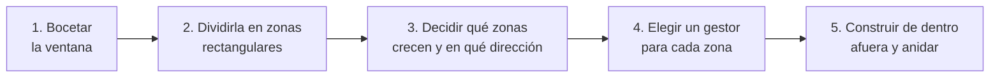
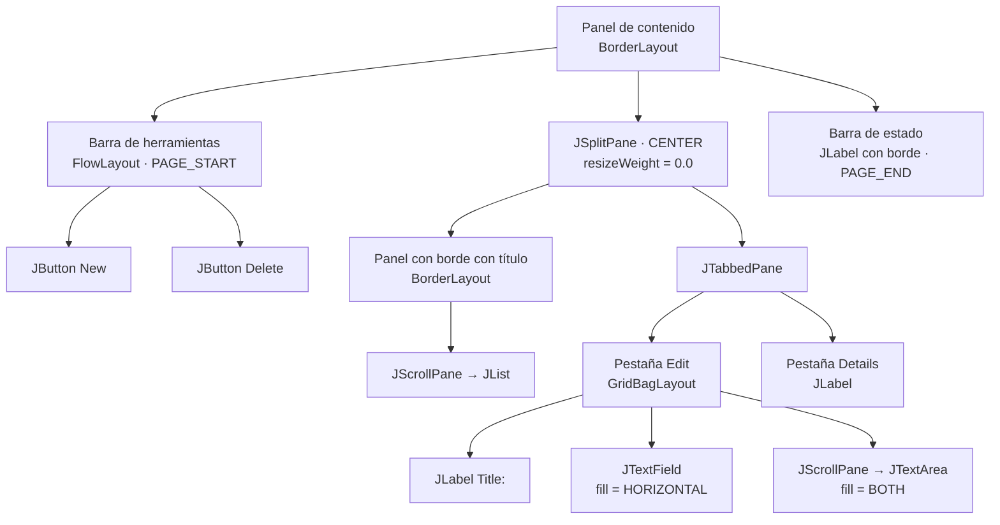

---
tags:
  - desarrollo-de-interfaces
  - DAM2
unidad: 6
tema: Anidamiento de paneles, tamaños preferidos en diseños adaptables, JSplitPane, JTabbedPane, bordes y espaciado
---

# Unidad 6. Diseño adaptable y contenedores intermedios

> [!summary] Ideas clave
> - Una ventana real se construye **anidando paneles**: se divide en zonas, se asigna a cada zona el gestor de diseño más adecuado y se colocan unos paneles dentro de otros.
> - El tamaño preferido de un panel se calcula a partir del de sus hijos, y así sucesivamente hasta la ventana; `pack()` aprovecha esa cadena.
> - Fijar a mano el tamaño preferido de un contenedor rompe esa cadena y puede dejar componentes fuera de la vista. Se prefieren las indicaciones de tamaño de los propios componentes (columnas, filas, filas visibles).
> - Un diseño adaptable decide **qué crece y qué no**: solo deben crecer las zonas que muestran contenido variable.
> - `JSplitPane` divide un área en dos partes con una barra que el usuario puede arrastrar; `setResizeWeight()` decide cuál de ellas absorbe los cambios de tamaño.
> - `JTabbedPane` muestra varios paneles en el mismo espacio, seleccionables mediante pestañas.
> - Los **bordes** dibujan el contorno de un componente o añaden espacio a su alrededor; se crean con `BorderFactory` y reducen el área disponible para el contenido.
> - Se recomienda poner los bordes en `JPanel` o `JLabel`; en otros componentes sustituyen el borde propio del aspecto visual.
> - Colocar un formulario dentro de un `JScrollPane` evita que se comprima cuando la ventana es pequeña: en su lugar aparecen barras de desplazamiento.

---

## 1. Introducción

Las unidades [[04-gestor-diseño|4]] y [[05-gridbaglayout|5]] estudiaron los gestores de diseño de forma aislada, cada uno en un único contenedor. Una ventana de aplicación, sin embargo, tiene varias zonas con necesidades distintas: una barra de herramientas que no debe crecer en altura, un panel lateral de anchura fija, un área principal que ocupa el resto y una barra de estado en la parte inferior. Ningún gestor resuelve todo eso por sí solo.

Esta unidad reúne lo visto hasta ahora en una técnica de trabajo: anidar contenedores, controlar qué zonas crecen y separar visualmente los grupos de componentes. También presenta dos contenedores intermedios que permiten al usuario reorganizar el espacio: `JSplitPane` y `JTabbedPane`.

> [!info] Alcance de la unidad
> El contenedor intermedio `JScrollPane` se estudió en la [[03-componentes-basicos|Unidad 3]], y `CardLayout`, en la [[04-gestor-diseño|Unidad 4]]. La organización del código en clases se trata en la [[10 - Acabado de la interfaz y organización del código|Unidad 10]].

---

## 2. Anidamiento de paneles

### 2.1. Dividir la ventana en zonas

> [!note] Definición: diseño compuesto
> Un **diseño compuesto** (*nested layout*) es una interfaz construida con varios paneles anidados, cada uno con su propio gestor de diseño. El gestor de un panel trata a cada panel hijo como un único componente, sin conocer su contenido.

El proceso de diseño sigue siempre los mismos pasos:



La estructura más habitual de una ventana de aplicación usa `BorderLayout` en el panel de contenido, con un panel en cada zona:

```text
┌──────────────────────────────────────────────────┐
│ Barra de herramientas (FlowLayout)               │  PAGE_START: no crece en altura
├────────────┬─────────────────────────────────────┤
│            │                                     │
│ Panel      │   Contenido principal               │  CENTER: recibe todo
│ lateral    │   (GridBagLayout, JScrollPane...)   │  el espacio sobrante
│ (BoxLayout)│                                     │
│            │                                     │  LINE_START: no crece en anchura
├────────────┴─────────────────────────────────────┤
│ Barra de estado (JLabel o FlowLayout)            │  PAGE_END: no crece en altura
└──────────────────────────────────────────────────┘
```

### 2.2. Propagación del tamaño preferido

Cada gestor calcula el tamaño preferido de su contenedor a partir de los de sus hijos. Al anidar paneles, el cálculo se encadena desde los componentes más internos hasta la ventana:

```java
JPanel toolbar = new JPanel(new FlowLayout(FlowLayout.LEFT, 5, 5));
toolbar.add(block("B1", 60, 25));
toolbar.add(block("B2", 60, 25));
JPanel side = block("Side", 120, 200);
JPanel main = block("Main", 300, 150);

JPanel window = new JPanel(new BorderLayout());
window.add(toolbar, BorderLayout.PAGE_START);
window.add(side, BorderLayout.LINE_START);
window.add(main, BorderLayout.CENTER);

System.out.println("toolbar preferred: " + toolbar.getPreferredSize());
System.out.println("window preferred: " + window.getPreferredSize());
```

```text
toolbar preferred: java.awt.Dimension[width=135,height=35]
window preferred: java.awt.Dimension[width=420,height=235]
```

- La barra de herramientas mide 60 + 60 más tres separaciones de 5 píxeles (135) de ancho, y 25 + 5 + 5 (35) de alto.
- La ventana mide de ancho el mayor entre la barra (135) y la fila central (120 + 300 = 420), y de alto la barra más la fila central (35 + 200 = 235).

Con la ventana a 500 × 300, `BorderLayout` reparte el espacio sobrante solo a la zona central:

```text
  Toolbar  x=0   y=0   w=500 h=35
  Side     x=0   y=35  w=120 h=265
  Main     x=120 y=35  w=380 h=265
```

> [!info] Cómo leer los ejemplos
> Los ejemplos usan los métodos auxiliares de la [[04-gestor-diseño|Unidad 4]] (`block()`, `layoutAt()`, `describe()`). En esta unidad, `layoutAt()` coloca el contenedor dentro de una ventana real antes de distribuirlo, porque los paneles anidados y los contenedores intermedios necesitan validarse como en pantalla.

### 2.3. Organización del código

> [!tip] Un método por zona
> Cuando la ventana tiene varias zonas, conviene crear cada panel en un método propio que lo devuelva construido. El constructor de la ventana solo ensambla las piezas y se lee como un esquema de la interfaz:
>
> ```java
> JPanel content = new JPanel(new BorderLayout());
> content.add(createToolbar(), BorderLayout.PAGE_START);
> content.add(createSidePanel(), BorderLayout.LINE_START);
> content.add(createMainArea(), BorderLayout.CENTER);
> content.add(createStatusBar(), BorderLayout.PAGE_END);
> ```
>
> Si un panel crece en complejidad, puede pasar a ser una clase independiente.

---

## 3. Tamaños preferidos y diseño adaptable

### 3.1. Qué tamaño respeta cada gestor

| Gestor | Tamaño preferido | Tamaño máximo | Qué crece al ampliar el contenedor |
|---|---|---|---|
| `FlowLayout` | Siempre | No | Nada; el sobrante queda alrededor |
| `BorderLayout` | En una dirección, según la zona | No | La zona central; las laterales, solo en su longitud |
| `GridLayout` | No | No | Todas las celdas por igual |
| `BoxLayout` | Sí | Sí | Los componentes cuyo máximo lo permite y el pegamento |
| `GridBagLayout` | Sí (o el mínimo si no cabe) | No | Las columnas y filas con peso |
| `CardLayout` | El de la tarjeta mayor | No | La tarjeta visible ocupa todo |

### 3.2. No fijar el tamaño de los contenedores

> [!danger] `setPreferredSize()` en un contenedor
> El tamaño preferido de un panel lo calcula su gestor a partir de sus hijos. Si se fija a mano, ese cálculo se ignora: el panel no crece cuando cambia su contenido y puede dejar componentes fuera de su área visible.

```java
JPanel row = new JPanel();   // FlowLayout
row.add(block("A", 100, 30));
row.add(block("B", 100, 30));
row.add(block("C", 100, 30));
System.out.println("computed preferred: " + row.getPreferredSize());
row.setPreferredSize(new Dimension(150, 40));      // fixed by hand

JPanel holder = new JPanel(new BorderLayout());
holder.add(row, BorderLayout.LINE_START);          // uses the preferred width
holder.add(block("Rest", 10, 10), BorderLayout.CENTER);
```

```text
computed preferred: java.awt.Dimension[width=320,height=40]
row: 150x40
  A   x=25  y=5   inside=true
  B   x=25  y=40  inside=false
  C   x=25  y=75  inside=false
```

El panel necesitaba 320 × 40, pero solo dispone de 150 × 40: `FlowLayout` pasa B y C a filas inferiores que quedan fuera del panel, y no se ven.

En lugar de fijar tamaños en píxeles, se usan las **indicaciones de tamaño** de los propios componentes, que se adaptan a la fuente y al aspecto visual:

| Componente | Indicación de tamaño |
|---|---|
| `JTextField` | Número de columnas: `new JTextField(20)` |
| `JTextArea` | Filas y columnas: `new JTextArea(5, 30)` |
| `JList` | Filas visibles: `setVisibleRowCount(8)` |
| `JTable` | `setPreferredScrollableViewportSize(Dimension)` |
| `JLabel`, `JButton` | Su texto; no necesitan indicación |

> [!tip] Cuándo sí es razonable `setPreferredSize()`
> Es aceptable en componentes que no tienen un contenido del que deducir su tamaño, como un panel de dibujo, o en un `JScrollPane` para limitar el área visible inicial, como hace el propio tutorial de Oracle. En ningún caso debe usarse en un panel cuyo tamaño dependa de los componentes que contiene.

### 3.3. Ventanas pequeñas

Cuando el usuario reduce la ventana por debajo del tamaño preferido del contenido, cada gestor reacciona de forma distinta: `FlowLayout` pasa componentes a filas que pueden quedar ocultas, `BorderLayout` recorta las zonas y `GridBagLayout` salta a los tamaños mínimos ([[05-gridbaglayout|Unidad 5]]). Existen dos soluciones complementarias:

| Técnica | Código | Efecto |
|---|---|---|
| Tamaño mínimo de la ventana | `frame.pack(); frame.setMinimumSize(frame.getSize());` | La ventana no puede reducirse por debajo de su tamaño preferido |
| Formulario en un `JScrollPane` | `new JScrollPane(form)` | Si no cabe, el formulario conserva su tamaño y aparecen barras de desplazamiento |

Dentro de un `JScrollPane`, el contenido recibe siempre al menos su tamaño preferido:

```java
JPanel form = new JPanel(new GridBagLayout());
// field: preferred width 300, minimum width 10, fill = HORIZONTAL, weightx = 1
JScrollPane scroll = new JScrollPane(form);
layoutAt(scroll, 200, 100);
```

```text
viewport: 197x82
form size: 300x82, field width: 300
horizontal bar visible: true
```

Sin el panel de desplazamiento, el mismo formulario en un contenedor de 200 píxeles reduce el campo a 200 píxeles de ancho.

### 3.4. Reglas de un diseño adaptable

> [!important] Lista de comprobación
> - **Decidir qué crece.** Solo deben crecer las zonas con contenido variable: áreas de texto, listas, tablas y zonas de dibujo. Etiquetas, botones y barras conservan su tamaño.
> - **Crecer en la dirección adecuada.** Un campo de una línea crece en anchura, nunca en altura.
> - **No usar coordenadas ni tamaños fijos** en contenedores; dejar que los gestores calculen.
> - **Usar `pack()`** para dar a la ventana su tamaño inicial.
> - **Proteger el tamaño mínimo**, con `setMinimumSize()` en la ventana o con un `JScrollPane`.
> - **Comprobar el resultado** redimensionando la ventana a tamaños extremos.

---

## 4. `JSplitPane`

### 4.1. Funcionamiento

> [!note] Definición: `JSplitPane`
> `JSplitPane` es un contenedor intermedio que muestra exactamente **dos componentes**, uno junto al otro o uno encima del otro, separados por una **barra divisoria** (*divider*) que el usuario puede arrastrar para cambiar el espacio de cada uno.

```java
JSplitPane split = new JSplitPane(JSplitPane.HORIZONTAL_SPLIT, leftComponent, rightComponent);
```

| Constante | Disposición | Métodos de acceso |
|---|---|---|
| `HORIZONTAL_SPLIT` (por defecto) | Izquierda y derecha | `setLeftComponent()`, `setRightComponent()` |
| `VERTICAL_SPLIT` | Arriba y abajo | `setTopComponent()`, `setBottomComponent()` |

> [!tip] Componentes en `JScrollPane`
> Lo habitual es colocar cada componente del `JSplitPane` dentro de un `JScrollPane`, de modo que el usuario pueda reducir una parte sin perder el acceso a su contenido.

> [!info] Tres o más zonas
> Un `JSplitPane` solo admite dos componentes. Para dividir en tres zonas se anida un `JSplitPane` dentro de otro.

### 4.2. Reparto del espacio al redimensionar

> [!note] Definición: peso de redimensionado
> El **peso de redimensionado** (*resize weight*) de un `JSplitPane` es un valor entre 0.0 y 1.0 que indica qué fracción del espacio ganado o perdido al redimensionar el contenedor se asigna al componente izquierdo (o superior). Se fija con `setResizeWeight()` y no influye cuando el usuario arrastra la barra.

Con un componente izquierdo de 100 píxeles y uno derecho de 200, al ampliar el `JSplitPane` 200 píxeles:

```java
JSplitPane split = new JSplitPane(JSplitPane.HORIZONTAL_SPLIT,
        block("Left", 100, 50), block("Right", 200, 50));
split.setResizeWeight(weight);
```

```text
weight 0.0: left 100 -> 100, right 200 -> 400
weight 0.5: left 100 -> 200, right 200 -> 300
weight 1.0: left 100 -> 300, right 200 -> 200
```

| Peso | Comportamiento | Uso típico |
|---|---|---|
| `0.0` (por defecto) | El componente izquierdo conserva su tamaño; el derecho absorbe el cambio | Panel lateral fijo y contenido principal |
| `0.5` | El cambio se reparte a partes iguales | Dos paneles equivalentes, como una comparación |
| `1.0` | El componente derecho conserva su tamaño; el izquierdo absorbe el cambio | Panel de propiedades a la derecha |

### 4.3. Posición de la barra

| Método | Efecto |
|---|---|
| `setDividerLocation(int)` | Coloca la barra en una posición en píxeles |
| `setDividerLocation(double)` | Coloca la barra en una proporción del espacio disponible (0.0 a 1.0) |
| `setOneTouchExpandable(true)` | Añade flechas a la barra para plegar un lado con un clic |
| `setContinuousLayout(true)` | Redibuja los componentes mientras se arrastra la barra, no solo al soltarla |
| `setDividerSize(int)` | Grosor de la barra (10 píxeles por defecto en el aspecto Metal) |

> [!danger] La posición proporcional antes de mostrar la ventana
> `setDividerLocation(double)` calcula la posición a partir del tamaño **actual** del `JSplitPane`. Si se llama antes de que la ventana sea visible, el componente aún no tiene tamaño y la llamada no tiene efecto:
>
> ```text
> divider after setDividerLocation(0.3) on unsized pane: -3
> after sizing to 500: -3
> setDividerLocation(0.3) on sized pane: 147 (divider size 10)
> ```
>
> Con el componente ya dimensionado a 500 píxeles, la barra se coloca en (500 − 10) × 0.3 = 147. Para fijar la posición inicial antes de mostrar la ventana, se usa la versión en píxeles o se controla el reparto con los tamaños preferidos de los componentes.

> [!warning] Los tamaños mínimos solo limitan al usuario
> El usuario no puede arrastrar la barra de forma que un componente quede por debajo de su tamaño mínimo. Sin embargo, `setDividerLocation()` llamado desde el código no respeta ese límite: en la prueba, con un mínimo de 120 píxeles en el componente izquierdo, `setDividerLocation(50)` deja la barra en 50.

---

## 5. `JTabbedPane`

> [!note] Definición: `JTabbedPane`
> `JTabbedPane` es un contenedor intermedio que muestra varios componentes en el mismo espacio, de los que solo uno es visible a la vez. El usuario elige cuál mediante una fila de **pestañas** (*tabs*).

Cada pestaña se añade con su título y el componente que muestra; opcionalmente, con un icono y un texto de ayuda:

```java
JTabbedPane tabs = new JTabbedPane();
tabs.addTab("General", generalPanel);
tabs.addTab("Advanced", null, advancedPanel, "Expert options");  // title, icon, component, tooltip
tabs.addTab("About", aboutPanel);

System.out.println("tabs: " + tabs.getTabCount() + ", selected: " + tabs.getSelectedIndex()
        + " (" + tabs.getTitleAt(tabs.getSelectedIndex()) + ")");
tabs.setSelectedIndex(1);
System.out.println("selected: " + tabs.getTitleAt(tabs.getSelectedIndex()));
System.out.println("index of About: " + tabs.indexOfTab("About"));
tabs.removeTabAt(2);
System.out.println("after remove: " + tabs.getTabCount());
```

```text
tabs: 3, selected: 0 (General)
selected: Advanced
index of About: 2
after remove: 2
```

| Método | Función |
|---|---|
| `addTab(String, Component)` | Añade una pestaña al final |
| `insertTab(String, Icon, Component, String, int)` | Inserta una pestaña en una posición |
| `removeTabAt(int)` | Elimina una pestaña |
| `getSelectedIndex()` / `setSelectedIndex(int)` | Consulta o cambia la pestaña seleccionada |
| `getSelectedComponent()` | Devuelve el componente de la pestaña seleccionada |
| `indexOfTab(String)` | Devuelve la posición de una pestaña por su título, o -1 |
| `setTitleAt(int, String)`, `setEnabledAt(int, boolean)` | Cambian el título o desactivan una pestaña |
| `setMnemonicAt(int, int)` | Asocia un atajo de teclado (Alt + tecla) a una pestaña |
| `setTabPlacement(int)` | Coloca las pestañas arriba (`TOP`, por defecto), abajo, a la izquierda o a la derecha |
| `setTabLayoutPolicy(int)` | `WRAP_TAB_LAYOUT` (por defecto) reparte las pestañas en varias filas; `SCROLL_TAB_LAYOUT` las mantiene en una fila con flechas de desplazamiento |

Todos los componentes reciben el mismo espacio, esté o no visible su pestaña, y el tamaño preferido del `JTabbedPane` es el necesario para el componente más ancho y el más alto.

> [!tip] `JTabbedPane` o `CardLayout`
> Ambos muestran un componente de entre varios en el mismo espacio. `JTabbedPane` incluye las pestañas para que el usuario elija; `CardLayout` no muestra ningún control y el programa decide qué tarjeta se ve, por ejemplo en un asistente paso a paso.

---

## 6. Bordes y espaciado

### 6.1. Bordes

> [!note] Definición: borde
> Un **borde** (*border*) es un objeto que dibuja el contorno de un componente Swing o reserva espacio a su alrededor. No es un componente: se asigna con `setBorder()` a cualquier `JComponent` y se crea, normalmente, con los métodos estáticos de `BorderFactory`.

| Borde | Método de `BorderFactory` | Aspecto | Márgenes medidos |
|---|---|---|---|
| Vacío | `createEmptyBorder(10, 20, 10, 20)` | Invisible; solo añade espacio | 10, 20, 10, 20 |
| Línea | `createLineBorder(Color.GRAY)` | Línea continua de 1 píxel | 1, 1, 1, 1 |
| Línea gruesa | `createLineBorder(Color.GRAY, 3)` | Línea del grosor indicado | 3, 3, 3, 3 |
| Mate | `createMatteBorder(1, 0, 0, 0, Color.GRAY)` | Línea de grosor distinto en cada lado (aquí, solo arriba) | 1, 0, 0, 0 |
| Grabado | `createEtchedBorder()` | Surco hundido o en relieve | 2, 2, 2, 2 |
| Bisel | `createRaisedBevelBorder()`, `createLoweredBevelBorder()` | Efecto de relieve o de hundimiento | Según el aspecto |
| Con título | `createTitledBorder("Options")` | Contorno con un título en la parte superior | Mayor arriba que abajo |
| Compuesto | `createCompoundBorder(exterior, interior)` | Combina dos bordes | Suma de ambos |

Los márgenes indican el espacio que ocupa cada borde (arriba, izquierda, abajo, derecha). Un borde compuesto suma los de sus partes: una línea de 1 píxel con un borde vacío de 10 y 20 ocupa 11, 21, 11, 21.

### 6.2. El borde reduce el área del contenido

El espacio que ocupa el borde pasa a formar parte de los **márgenes interiores** (*insets*) del componente: el gestor de diseño coloca los hijos dentro de ese margen y lo suma al tamaño preferido.

```java
JPanel bordered = new JPanel(new BorderLayout());
bordered.setBorder(BorderFactory.createEmptyBorder(10, 20, 10, 20));
bordered.add(block("Content", 100, 50));
System.out.println("preferred: " + bordered.getPreferredSize());
layoutAt(bordered, 300, 100);
describe(bordered);
```

```text
preferred: java.awt.Dimension[width=140,height=70]
  Content  x=20  y=10  w=260 h=80
```

### 6.3. Recomendaciones de uso

> [!warning] Bordes en componentes con aspecto propio
> Botones, campos de texto o paneles de desplazamiento ya tienen un borde definido por el aspecto visual; por ejemplo, el de un `JTextField` en el aspecto Metal es un `CompoundBorderUIResource`. Si se sustituye con `setBorder()`, el componente pierde su apariencia estándar. Oracle recomienda poner los bordes solo en `JPanel` o `JLabel` y, para enmarcar otro componente, envolverlo en un panel con el borde.

> [!tip] Agrupar con bordes con título
> Un panel con borde con título es la forma habitual de agrupar visualmente opciones relacionadas, como un grupo de `JRadioButton` o un apartado de un formulario de configuración.

> [!tip] Reutilizar bordes
> Un mismo objeto `Border` puede asignarse a varios componentes. Si muchos paneles comparten borde, se guarda en una variable y se reutiliza.

### 6.4. Estrategia de espaciado

| Espacio entre… | Técnica recomendada |
|---|---|
| El contenido y el borde de la ventana | Borde vacío en el panel de contenido |
| Grupos de componentes | Borde vacío o con título en cada panel de grupo |
| Componentes de un `GridBagLayout` | `insets` iguales en todas las restricciones |
| Componentes de `FlowLayout`, `BorderLayout` o `GridLayout` | Separaciones del gestor (*gaps*) |
| Componentes de `BoxLayout` | Áreas rígidas |

---

## 7. Errores típicos

> [!danger] Fijar el tamaño preferido de un panel con componentes
> El gestor deja de calcular su tamaño y los componentes que no caben quedan ocultos.

> [!danger] `setDividerLocation(double)` antes de mostrar la ventana
> No tiene efecto, porque el `JSplitPane` aún no tiene tamaño.

> [!warning] Intentar construir toda la ventana con un único gestor
> El código se vuelve frágil y difícil de mantener. Se divide en zonas y se anidan paneles.

> [!warning] Dejar que todas las zonas crezcan
> Una barra de herramientas o de estado que crece en altura desperdicia espacio. Solo debe crecer el contenido principal.

> [!warning] Sustituir el borde de un `JTextField` o un `JButton`
> El componente pierde el aspecto del sistema. El borde se pone en un panel que lo envuelva.

> [!warning] Olvidar `setResizeWeight()` en un `JSplitPane`
> Con el valor por defecto, 0.0, todo el espacio ganado va al componente derecho. Si el panel principal está a la izquierda, debe usarse 1.0.

> [!warning] Confiar en que los mínimos limitan `setDividerLocation()`
> Solo limitan el arrastre del usuario; desde el código, la barra puede dejar un componente por debajo de su mínimo.

---

## 8. Ejemplo integrador

La siguiente ventana de notas aplica todas las técnicas de la unidad:

- El panel de contenido usa `BorderLayout` con una barra de herramientas arriba, un `JSplitPane` en el centro y una barra de estado abajo.
- El `JSplitPane` tiene `resizeWeight = 0.0`, de modo que la lista de la izquierda conserva su anchura y solo crece la parte derecha.
- La lista está dentro de un panel con borde con título, siguiendo la recomendación de no poner bordes en el `JScrollPane`.
- La parte derecha es un `JTabbedPane` cuya pestaña *Edit* contiene un formulario con `GridBagLayout`.
- La barra de estado combina un borde mate (línea superior) y un borde vacío (margen interior).
- La ventana usa `pack()` y no puede reducirse por debajo de su tamaño preferido.



```java
public class NotesWindow {
    private final JFrame frame = new JFrame("Notes");
    private final JPanel listPanel = new JPanel(new BorderLayout());
    private final JTabbedPane tabs = new JTabbedPane();
    private final JTextField titleField = new JTextField(20);
    private final JScrollPane bodyScroll = new JScrollPane(new JTextArea(8, 20));
    private final JLabel status = new JLabel("3 notes");

    public NotesWindow() {
        // Toolbar: FlowLayout row of buttons
        JPanel toolbar = new JPanel(new FlowLayout(FlowLayout.LEADING));
        toolbar.add(new JButton("New"));
        toolbar.add(new JButton("Delete"));

        // Left side: list in a panel with a titled border
        JList<String> notes = new JList<>(new String[] {"Shopping", "Ideas", "Meeting"});
        listPanel.setBorder(BorderFactory.createTitledBorder("All notes"));
        listPanel.add(new JScrollPane(notes));

        // Right side: tabs; the "Edit" tab is a GridBagLayout form
        JPanel editor = new JPanel(new GridBagLayout());
        editor.setBorder(BorderFactory.createEmptyBorder(8, 8, 8, 8));
        GridBagConstraints c = new GridBagConstraints();
        c.gridx = 0; c.gridy = 0; c.insets = new Insets(4, 4, 4, 4);
        editor.add(new JLabel("Title:"), c);
        c = new GridBagConstraints();
        c.gridx = 1; c.gridy = 0; c.insets = new Insets(4, 4, 4, 4);
        c.fill = GridBagConstraints.HORIZONTAL; c.weightx = 1.0;
        editor.add(titleField, c);
        c = new GridBagConstraints();
        c.gridx = 0; c.gridy = 1; c.gridwidth = 2; c.insets = new Insets(4, 4, 4, 4);
        c.fill = GridBagConstraints.BOTH; c.weightx = 1.0; c.weighty = 1.0;
        editor.add(bodyScroll, c);
        tabs.addTab("Edit", editor);
        tabs.addTab("Details", new JLabel("Created today", SwingConstants.CENTER));

        // Center: split pane; only the right side grows
        JSplitPane split = new JSplitPane(JSplitPane.HORIZONTAL_SPLIT, listPanel, tabs);
        split.setResizeWeight(0.0);

        // Status bar: line on top plus inner margin
        status.setBorder(BorderFactory.createCompoundBorder(
                BorderFactory.createMatteBorder(1, 0, 0, 0, Color.GRAY),
                BorderFactory.createEmptyBorder(4, 8, 4, 8)));

        JPanel content = new JPanel(new BorderLayout());
        content.add(toolbar, BorderLayout.PAGE_START);
        content.add(split, BorderLayout.CENTER);
        content.add(status, BorderLayout.PAGE_END);

        frame.setContentPane(content);
        frame.setDefaultCloseOperation(JFrame.EXIT_ON_CLOSE);
        frame.pack();
        frame.setMinimumSize(frame.getSize());
        frame.setLocationRelativeTo(null);
    }

    public void show() {
        frame.setVisible(true);
    }

    public void growAndReport(int extraWidth, int extraHeight) {
        Dimension list = listPanel.getSize();
        Dimension tab = tabs.getSize();
        Dimension title = titleField.getSize();
        Dimension body = bodyScroll.getSize();
        Dimension bar = status.getSize();

        frame.setSize(frame.getWidth() + extraWidth, frame.getHeight() + extraHeight);
        frame.validate();

        report("List", list, listPanel.getSize());
        report("Tabs", tab, tabs.getSize());
        report("Title field", title, titleField.getSize());
        report("Note body", body, bodyScroll.getSize());
        report("Status bar", bar, status.getSize());
    }

    private static void report(String name, Dimension before, Dimension after) {
        System.out.printf("%-12s width +%-4d height +%d%n", name + ":",
                after.width - before.width, after.height - before.height);
    }

    public static void main(String[] args) {
        SwingUtilities.invokeLater(() -> {
            NotesWindow window = new NotesWindow();
            window.show();
            window.growAndReport(200, 90);
        });
    }
}
```

```text
List:        width +0    height +90
Tabs:        width +200  height +90
Title field: width +200  height +0
Note body:   width +200  height +90
Status bar:  width +200  height +0
```

Al ampliar la ventana 200 × 90 píxeles, cada zona reacciona según lo diseñado: la lista gana altura pero no anchura (peso de redimensionado 0.0); las pestañas y el cuerpo de la nota reciben el espacio en ambas direcciones; el campo del título solo crece en anchura, y la barra de estado se alarga sin ganar altura.

---

## Bibliografía

- [How to Use Panels](https://docs.oracle.com/javase/tutorial/uiswing/components/panel.html) (tutorial oficial de Oracle)
- [Using Layout Managers](https://docs.oracle.com/javase/tutorial/uiswing/layout/using.html) (tutorial oficial de Oracle)
- [Solving Common Layout Problems](https://docs.oracle.com/javase/tutorial/uiswing/layout/problems.html) (tutorial oficial de Oracle)
- [How to Use Split Panes](https://docs.oracle.com/javase/tutorial/uiswing/components/splitpane.html) (tutorial oficial de Oracle)
- [How to Use Tabbed Panes](https://docs.oracle.com/javase/tutorial/uiswing/components/tabbedpane.html) (tutorial oficial de Oracle)
- [How to Use Borders](https://docs.oracle.com/javase/tutorial/uiswing/components/border.html) (tutorial oficial de Oracle)
- [How to Use Scroll Panes](https://docs.oracle.com/javase/tutorial/uiswing/components/scrollpane.html) (tutorial oficial de Oracle)
