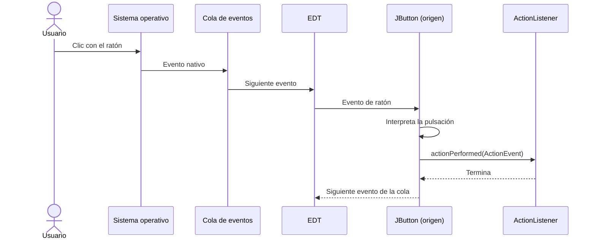
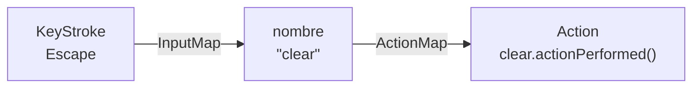
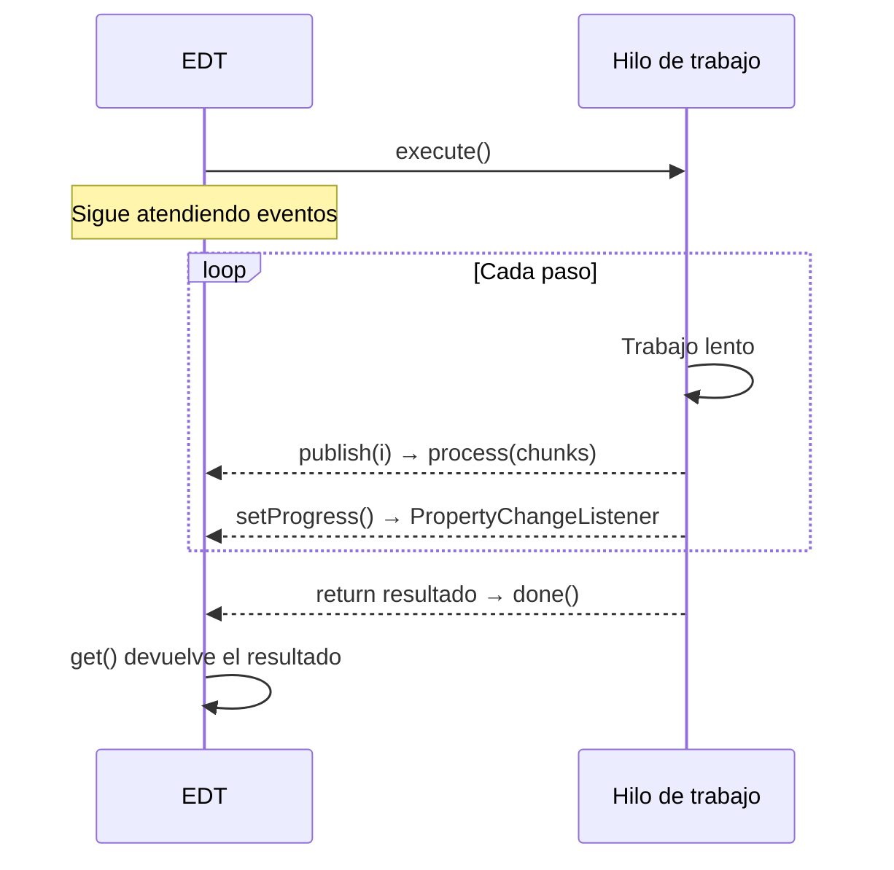

---
tags:
  - desarrollo-de-interfaces
  - DAM2
unidad: 7
tema: Modelo de eventos de delegación, listeners semánticos y de bajo nivel, atajos de teclado, SwingWorker y Timer
---

# Unidad 7. Gestión de eventos

> [!summary] Ideas clave
> - Swing sigue el **modelo de eventos de delegación**: un **origen** (un componente) genera un **evento** y lo entrega a los **listeners** que se han registrado en él con un método `addXxxListener()`.
> - Todos los listeners se ejecutan en el **hilo de despacho de eventos** (EDT), uno detrás de otro; por eso deben terminar rápido.
> - Un listener puede escribirse como clase con nombre, clase anónima, expresión lambda o referencia a método. La lambda solo es posible si la interfaz tiene un único método abstracto.
> - Las interfaces con varios métodos (`MouseListener`, `KeyListener`, `WindowListener`) tienen **clases adaptadoras** que permiten implementar solo los métodos necesarios.
> - Se prefieren los **eventos semánticos** (`ActionEvent`, `ItemEvent`, `ChangeEvent`…), que representan lo que el usuario quiere hacer, a los de **bajo nivel** (ratón y teclado).
> - Los cambios hechos desde el código también generan eventos: `setText()` notifica a los `DocumentListener` y `setSelected()` a los `ItemListener`.
> - Para responder a teclas se recomiendan los **atajos de teclado** (*key bindings*) con `InputMap` y `ActionMap`, en lugar de `KeyListener`.
> - Un objeto `Action` reúne el código de una acción y su estado activado, y puede compartirse entre botones, menús y atajos.
> - Las tareas largas se ejecutan con `SwingWorker`: `doInBackground()` corre en otro hilo, y `process()` y `done()`, en el EDT.
> - `javax.swing.Timer` ejecuta una acción breve de forma periódica en el EDT, sin necesidad de crear hilos.

---

## 1. Introducción

La [[01 - Fundamentos de Swing|Unidad 1]] definió la **programación dirigida por eventos**: una vez construida la ventana, el programa espera y reacciona a lo que hace el usuario. Las unidades 2 a 6 se han ocupado de construir la ventana; esta unidad trata la otra mitad, cómo conectar las acciones del usuario con el código que debe ejecutarse.

Hasta ahora, los ejemplos leían el estado de los componentes en un momento concreto (por ejemplo, el método `summary()` del formulario de la [[03-componentes-basicos|Unidad 3]]). Con los eventos, el programa recibe un aviso **en el momento** en que el usuario pulsa un botón, escribe una letra o mueve un deslizador.

> [!info] Alcance de la unidad
> Los eventos de los menús se estudian en la [[09 - Diálogos y menús|Unidad 9]], y el uso del ratón para dibujar, en la [[08 - Dibujo personalizado|Unidad 8]].

---

## 2. El modelo de eventos

### 2.1. Origen, evento y listener

> [!note] Definición: evento
> Un **evento** (*event*) es un objeto que representa algo que ha ocurrido en la interfaz, como un clic o una pulsación de tecla. Contiene información sobre lo ocurrido y una referencia al componente que lo originó. Todas las clases de eventos heredan de `java.util.EventObject`.

> [!note] Definición: origen del evento
> El **origen** (*event source*) es el objeto que genera el evento, normalmente un componente o su modelo de datos.

> [!note] Definición: listener
> Un **listener** (oyente u observador) es un objeto que implementa una interfaz de escucha, como `ActionListener`, y que se registra en un origen para que este le notifique los eventos de ese tipo llamando a sus métodos.

Este esquema recibe el nombre de **modelo de eventos de delegación** (*delegation event model*): el componente no decide qué hacer cuando ocurre algo, sino que delega esa decisión en los listeners registrados.

```java
JButton save = new JButton("Save");
save.addActionListener(e -> System.out.println("Clicked: " + e.getActionCommand()
        + " on " + Thread.currentThread().getName()));
save.doClick();   // simulates a user click
```

```text
Clicked: Save on AWT-EventQueue-0
```

`doClick()` simula una pulsación desde el código y se utiliza en los ejemplos para reproducir lo que haría un usuario.



### 2.2. Registro de listeners

Cada tipo de listener tiene sus métodos de registro en el componente:

| Método | Función |
|---|---|
| `addXxxListener(XxxListener)` | Registra un listener |
| `removeXxxListener(XxxListener)` | Lo elimina; deja de recibir eventos |
| `getXxxListeners()` | Devuelve los listeners registrados |

```java
ActionListener once = e -> System.out.println("this prints once");
JButton r = new JButton("R");
r.addActionListener(once);
r.doClick();
r.removeActionListener(once);
r.doClick();
System.out.println("after remove: " + r.getActionListeners().length);
```

```text
this prints once
after remove: 0
```

> [!tip] Guardar la referencia para poder eliminarlo
> Para eliminar un listener hay que pasar el mismo objeto que se registró. Si se registra con una lambda escrita directamente en `addActionListener()`, no se conserva ninguna referencia y no puede eliminarse.

### 2.3. Información del evento

| Método | Clase | Devuelve |
|---|---|---|
| `getSource()` | `EventObject` (todos) | El objeto que generó el evento |
| `getActionCommand()` | `ActionEvent` | El **comando de acción**: por defecto, el texto del botón |
| `getModifiers()` / `isControlDown()`… | `ActionEvent`, `InputEvent` | Las teclas modificadoras pulsadas (Ctrl, Mayús, Alt) |
| `getWhen()` | `ActionEvent`, `InputEvent` | El instante en que ocurrió, en milisegundos |

### 2.4. Varios listeners y varios orígenes

Un origen admite varios listeners del mismo tipo, y un mismo listener puede registrarse en varios orígenes. En ese caso, `getSource()` permite saber qué componente generó el evento:

```java
JButton plus = new JButton("+");
JButton minus = new JButton("-");
int[] counter = {0};
ActionListener step = e -> {
    if (e.getSource() == plus) counter[0]++;
    else counter[0]--;
    System.out.println(e.getActionCommand() + " -> " + counter[0]);
};
plus.addActionListener(step);
minus.addActionListener(step);
plus.doClick();
plus.doClick();
minus.doClick();
```

```text
+ -> 1
+ -> 2
- -> 1
```

El comando de acción puede cambiarse con `setActionCommand()`, lo que permite identificar el botón aunque su texto cambie o esté traducido:

```java
JButton cmd = new JButton("Guardar");
cmd.setActionCommand("save");
cmd.addActionListener(e -> System.out.println("command: " + e.getActionCommand()));
cmd.doClick();
```

```text
command: save
```

> [!warning] El orden de notificación no está garantizado
> La documentación no especifica en qué orden se avisa a varios listeners de un mismo componente. En la ejecución de prueba, Swing los notificó en orden **inverso** al de registro. El código no debe depender de ese orden; si dos acciones deben ejecutarse en secuencia, se colocan en el mismo listener.

### 2.5. Los listeners se ejecutan en el EDT

> [!important] Un listener lento congela la interfaz
> Todos los listeners se ejecutan en el EDT, el mismo hilo que dibuja la interfaz ([[01 - Fundamentos de Swing|Unidad 1]]). Mientras un listener se ejecuta, la ventana no se repinta ni atiende otros eventos. Un listener debe limitarse a leer y actualizar componentes; el trabajo largo se traslada a otro hilo (apartado 7).

---

## 3. Formas de escribir un listener

### 3.1. Las cuatro formas

```java
// 1. Named class
class SaveListener implements ActionListener {
    @Override
    public void actionPerformed(ActionEvent e) {
        System.out.println("named class: " + e.getActionCommand());
    }
}
b.addActionListener(new SaveListener());

// 2. Anonymous class
b.addActionListener(new ActionListener() {
    @Override
    public void actionPerformed(ActionEvent e) {
        System.out.println("anonymous class: " + e.getActionCommand());
    }
});

// 3. Lambda expression
b.addActionListener(e -> System.out.println("lambda: " + e.getActionCommand()));

// 4. Method reference to a method with the same signature
b.addActionListener(this::onSave);
```

| Forma | Ventajas | Uso recomendado |
|---|---|---|
| Clase con nombre | Reutilizable; puede tener atributos propios | Lógica compleja o compartida por varias ventanas |
| Clase anónima | Junto al componente; puede implementar varios métodos | Interfaces con varios métodos o adaptadores |
| Expresión lambda | La más breve | Interfaces de un solo método con poco código |
| Referencia a método | Separa el código del registro; el método tiene nombre | Lógica de varias líneas en un método privado de la ventana |

> [!note] Definición: interfaz funcional
> Una **interfaz funcional** (*functional interface*) es una interfaz con un único método abstracto. Solo las interfaces funcionales pueden implementarse con una expresión lambda o una referencia a método.

| Interfaz | Métodos abstractos | ¿Admite lambda? |
|---|---|---|
| `ActionListener` | 1 | Sí |
| `ItemListener` | 1 | Sí |
| `ChangeListener` | 1 | Sí |
| `ListSelectionListener` | 1 | Sí |
| `MouseMotionListener` | 2 | No |
| `FocusListener` | 2 | No |
| `DocumentListener` | 3 | No |
| `KeyListener` | 3 | No |
| `MouseListener` | 5 | No |
| `WindowListener` | 7 | No |

> [!warning] La ventana como listener
> En muchos ejemplos antiguos la propia ventana implementa `ActionListener` y se registra con `addActionListener(this)`. Con varios botones, el método `actionPerformed()` se llena de comprobaciones de `getSource()` y la clase expone un método público que no forma parte de su función. Se prefieren las lambdas o las referencias a métodos privados.

### 3.2. Clases adaptadoras

> [!note] Definición: clase adaptadora
> Una **clase adaptadora** (*adapter*) es una clase que implementa una interfaz de escucha con todos sus métodos vacíos. Al extenderla, solo se redefinen los métodos que interesan.

```java
canvas.addMouseListener(new MouseAdapter() {
    @Override
    public void mousePressed(MouseEvent e) {
        System.out.println("pressed at (" + e.getX() + ", " + e.getY() + ")");
    }
});
```

Sin el adaptador, habría que escribir los cinco métodos de `MouseListener`, cuatro de ellos vacíos.

| Interfaz | Adaptador |
|---|---|
| `MouseListener`, `MouseMotionListener`, `MouseWheelListener` | `MouseAdapter` (implementa las tres) |
| `MouseMotionListener` | `MouseMotionAdapter` |
| `KeyListener` | `KeyAdapter` |
| `WindowListener` | `WindowAdapter` |
| `FocusListener` | `FocusAdapter` |

> [!warning] `DocumentListener` no tiene adaptador
> Swing no incluye una clase adaptadora para `DocumentListener`, por lo que hay que implementar sus tres métodos, aunque alguno quede vacío.

---

## 4. Eventos semánticos

### 4.1. Semánticos y de bajo nivel

| Tipo | Representa | Ejemplos |
|---|---|---|
| Evento de bajo nivel | Una acción física del usuario o del sistema de ventanas | `MouseEvent`, `KeyEvent`, `FocusEvent`, `WindowEvent` |
| Evento semántico | El significado de la acción para el componente | `ActionEvent`, `ItemEvent`, `ChangeEvent`, `DocumentEvent`, `ListSelectionEvent` |

> [!tip] Preferir eventos semánticos
> Un `ActionListener` en un botón responde igual si el usuario hace clic, pulsa la barra espaciadora con el botón enfocado o usa el atajo de teclado. Un `MouseListener` solo detectaría el clic. Oracle recomienda escuchar los eventos semánticos siempre que existan.

### 4.2. Resumen de listeners por componente

| Listener | Método | Evento | Componentes |
|---|---|---|---|
| `ActionListener` | `actionPerformed(ActionEvent)` | Acción completada | `JButton`, `JCheckBox`, `JRadioButton`, `JComboBox`, `JTextField` (Intro), menús, `Timer` |
| `ItemListener` | `itemStateChanged(ItemEvent)` | Elemento seleccionado o deseleccionado | `JCheckBox`, `JRadioButton`, `JComboBox` |
| `ChangeListener` | `stateChanged(ChangeEvent)` | Cambio de valor | `JSlider`, `JSpinner`, `JTabbedPane`, `JProgressBar` |
| `DocumentListener` | `insertUpdate`, `removeUpdate`, `changedUpdate` | Cambio del texto | Documento de `JTextField`, `JTextArea` |
| `ListSelectionListener` | `valueChanged(ListSelectionEvent)` | Cambio de selección | `JList`, modelo de selección de `JTable` |
| `WindowListener` | `windowClosing`, `windowClosed`… | Cambios de estado de la ventana | `JFrame`, `JDialog` |

### 4.3. `ActionListener`

Es el listener más habitual. Además de los botones, lo generan:

- `JTextField`, cuando el usuario pulsa Intro dentro del campo.
- `JComboBox`, al cambiar la selección.
- `javax.swing.Timer`, en cada intervalo (apartado 7.4).

```java
JTextField tf = new JTextField(10);
tf.addActionListener(e -> System.out.println("Enter pressed with: " + tf.getText()));
tf.setText("hello");
tf.postActionEvent();  // what happens when the user presses Enter
```

```text
Enter pressed with: hello
```

### 4.4. `ItemListener`

`ItemListener` notifica cuando un elemento pasa a estar seleccionado o deja de estarlo. `getStateChange()` indica cuál de los dos casos se ha producido y `getItem()`, sobre qué elemento.

```java
JCheckBox box = new JCheckBox("Subscribe");
box.addItemListener(e -> System.out.println("item: " +
        (e.getStateChange() == ItemEvent.SELECTED ? "SELECTED" : "DESELECTED")));
box.addActionListener(e -> System.out.println("action on check box"));

box.setSelected(true);      // from code
box.doClick();              // as the user
```

```text
item: SELECTED
item: DESELECTED
action on check box
```

> [!important] `setSelected()` no genera `ActionEvent`
> Cambiar el estado desde el código con `setSelected()` notifica a los `ItemListener`, pero no a los `ActionListener`, que solo reciben las acciones del usuario (o de `doClick()`). Si el código debe reaccionar a cualquier cambio de estado, venga del usuario o del programa, se usa `ItemListener`.

En un grupo de botones de opción y en un `JComboBox`, un cambio de selección genera **dos** `ItemEvent`: uno para el elemento que se deselecciona y otro para el que se selecciona.

```java
combo.addItemListener(e -> System.out.println("combo item " +
        (e.getStateChange() == ItemEvent.SELECTED ? "SELECTED " : "DESELECTED ") + e.getItem()));
combo.addActionListener(e -> System.out.println("combo action: " + combo.getSelectedItem()));
combo.setSelectedItem("Blue");
```

```text
combo item DESELECTED Red
combo item SELECTED Blue
combo action: Blue
```

> [!warning] Filtrar el evento de deselección
> Si el código de un `ItemListener` debe ejecutarse una sola vez por cambio, hay que comprobar `e.getStateChange() == ItemEvent.SELECTED`; si no, se ejecuta dos veces.

### 4.5. `ChangeListener`

`ChangeListener` notifica cualquier cambio de valor de un `JSlider`, un `JSpinner` o la pestaña seleccionada de un `JTabbedPane`. El evento no contiene el nuevo valor: se consulta en el componente.

```java
JSlider slider = new JSlider(0, 100, 50);
slider.addChangeListener(e -> System.out.println("slider: " + slider.getValue()
        + (slider.getValueIsAdjusting() ? " (adjusting)" : "")));
slider.setValue(70);
slider.setValue(70);   // same value: no event
```

```text
slider: 70
```

> [!tip] `getValueIsAdjusting()`
> Mientras el usuario arrastra el deslizador, se generan eventos continuamente con `getValueIsAdjusting()` a `true`. Si la acción es costosa, como recalcular un gráfico, puede esperarse al evento final, en el que vale `false`.

### 4.6. `DocumentListener`

Para saber cuándo cambia el texto de un campo, se escucha su **documento** (el modelo de texto, [[03-componentes-basicos|Unidad 3]]), no el campo:

```java
JTextField name = new JTextField(10);
name.getDocument().addDocumentListener(new DocumentListener() {
    @Override public void insertUpdate(DocumentEvent e) { System.out.println("insert -> \"" + name.getText() + "\""); }
    @Override public void removeUpdate(DocumentEvent e) { System.out.println("remove -> \"" + name.getText() + "\""); }
    @Override public void changedUpdate(DocumentEvent e) { System.out.println("attributes changed"); }
});
name.setText("Ada");
name.setText("Alan");     // replace: remove + insert
name.setText("");
```

```text
insert -> "Ada"
remove -> ""
insert -> "Alan"
remove -> ""
```

| Método | Cuándo se llama |
|---|---|
| `insertUpdate()` | Se ha añadido texto |
| `removeUpdate()` | Se ha eliminado texto |
| `changedUpdate()` | Han cambiado atributos de estilo; nunca ocurre en `JTextField` ni en `JTextArea` |

> [!warning] Reemplazar texto genera dos eventos
> `setText()` sobre un campo con contenido elimina primero el texto anterior y después inserta el nuevo. Entre ambos eventos, `getText()` devuelve una cadena vacía, lo que debe tenerse en cuenta al validar.

> [!danger] No modificar el documento desde su propio listener
> Cuando se notifica a un `DocumentListener`, el cambio ya se ha producido y el documento está bloqueado. Llamar a `setText()` dentro del listener del mismo campo lanza una excepción:
>
> ```text
> IllegalStateException: Attempt to mutate in notification
> ```
>
> Oracle indica que los `DocumentListener` no deben modificar el documento. Para transformar o filtrar el texto mientras se escribe se usa un `DocumentFilter` o un documento propio que redefina `insertString()` y `remove()`.

### 4.7. `ListSelectionListener`

```java
JList<String> list = new JList<>(new String[] {"A", "B", "C"});
list.addListSelectionListener(e -> {
    if (!e.getValueIsAdjusting()) {
        System.out.println("list selected: " + list.getSelectedValue());
    }
});
list.setSelectedIndex(1);
list.setSelectedIndex(2);
```

```text
list selected: B
list selected: C
```

Igual que en el deslizador, al seleccionar con el ratón se generan eventos intermedios con `getValueIsAdjusting()` a `true`, que normalmente se ignoran.

> [!warning] Los cambios desde el código también generan eventos
> `setText()`, `setValue()`, `setSelected()` o `setSelectedIndex()` notifican a los listeners igual que una acción del usuario. Si dos componentes se actualizan mutuamente (un deslizador que escribe en un campo y un campo que mueve el deslizador), hay que evitar bucles, por ejemplo comprobando si el valor realmente ha cambiado antes de asignarlo.

---

## 5. Eventos de bajo nivel

### 5.1. Ratón

| Interfaz | Métodos | Cuándo |
|---|---|---|
| `MouseListener` | `mousePressed`, `mouseReleased`, `mouseClicked`, `mouseEntered`, `mouseExited` | Botones del ratón y entrada o salida del componente |
| `MouseMotionListener` | `mouseMoved`, `mouseDragged` | Movimiento, con o sin botón pulsado |
| `MouseWheelListener` | `mouseWheelMoved` | Rueda del ratón |

```java
canvas.addMouseListener(new MouseAdapter() {
    @Override
    public void mousePressed(MouseEvent e) {
        System.out.println("pressed at (" + e.getX() + ", " + e.getY() + "), button " + e.getButton()
                + ", clicks " + e.getClickCount());
    }
    @Override
    public void mouseClicked(MouseEvent e) {
        System.out.println("clicked, count " + e.getClickCount());
    }
});
canvas.addMouseMotionListener(new MouseMotionAdapter() {
    @Override
    public void mouseDragged(MouseEvent e) {
        System.out.println("dragged to (" + e.getX() + ", " + e.getY() + ")");
    }
});
canvas.addMouseWheelListener(e -> System.out.println("wheel rotation " + e.getWheelRotation()));
```

```text
pressed at (40, 25), button 1, clicks 1
clicked, count 1
dragged to (60, 30)
wheel rotation 1
```

| Método de `MouseEvent` | Devuelve |
|---|---|
| `getX()`, `getY()` | Posición relativa al componente |
| `getButton()` | Botón pulsado (`BUTTON1` izquierdo, `BUTTON2` central, `BUTTON3` derecho) |
| `getClickCount()` | Número de clics seguidos (2 para un doble clic) |
| `isShiftDown()`, `isControlDown()` | Teclas modificadoras |

> [!warning] Tres interfaces, tres registros
> El movimiento y el arrastre no llegan a un `MouseListener`: se registran con `addMouseMotionListener()`. Aunque un `MouseAdapter` implemente las tres interfaces, debe registrarse con cada método `add` que corresponda.

> [!tip] `mouseClicked` frente a `mousePressed`
> `mouseClicked` solo se genera si el botón se suelta en el mismo punto en que se pulsó. Para responder de inmediato o permitir pequeños movimientos, se usa `mousePressed`.

### 5.2. Teclado

| Método de `KeyListener` | Cuándo se llama | Información útil |
|---|---|---|
| `keyPressed(KeyEvent)` | Al pulsar cualquier tecla, incluidas Ctrl, flechas o F1 | `getKeyCode()` (`KeyEvent.VK_A`, `VK_ENTER`…) |
| `keyReleased(KeyEvent)` | Al soltarla | `getKeyCode()` |
| `keyTyped(KeyEvent)` | Cuando la pulsación produce un carácter | `getKeyChar()` |

```java
field.addKeyListener(new KeyAdapter() {
    @Override
    public void keyPressed(KeyEvent e) {
        System.out.println("keyPressed: " + KeyEvent.getKeyText(e.getKeyCode())
                + (e.isControlDown() ? " + Ctrl" : ""));
    }
    @Override
    public void keyTyped(KeyEvent e) {
        System.out.println("keyTyped: '" + e.getKeyChar() + "'");
    }
});
```

Al pulsar A y después Ctrl + S:

```text
keyPressed: A
keyTyped: 'a'
keyPressed: S + Ctrl
```

Ctrl + S no produce `keyTyped`, porque no genera ningún carácter.

> [!warning] `KeyListener` requiere el foco
> Un componente solo recibe eventos de teclado cuando tiene el **foco** (*focus*), es decir, cuando es el destinatario actual del teclado. Un atajo que debe funcionar en toda la ventana no puede implementarse con un `KeyListener` en un componente concreto. Para eso existen los atajos de teclado del apartado 6.

> [!tip] No validar texto con `KeyListener`
> Para reaccionar a lo que se escribe en un campo se usa `DocumentListener`, que también detecta el texto pegado o asignado desde el código; un `KeyListener` solo detecta las pulsaciones.

### 5.3. Ventana

`WindowListener` notifica los cambios de estado de una ventana. El caso más habitual es pedir confirmación antes de cerrar, combinando `DO_NOTHING_ON_CLOSE` ([[01 - Fundamentos de Swing|Unidad 1]]) con un `WindowAdapter`:

```java
frame.setDefaultCloseOperation(JFrame.DO_NOTHING_ON_CLOSE);
frame.addWindowListener(new WindowAdapter() {
    @Override
    public void windowClosing(WindowEvent e) {
        System.out.println("windowClosing: ask before closing");
        frame.dispose();      // close only if the user confirms
    }
    @Override
    public void windowClosed(WindowEvent e) {
        System.out.println("windowClosed");
    }
});
```

```text
windowClosing: ask before closing
windowClosed
```

| Método | Cuándo |
|---|---|
| `windowOpened` | La ventana se muestra por primera vez |
| `windowClosing` | El usuario pulsa el botón de cerrar |
| `windowClosed` | La ventana se ha destruido con `dispose()` |
| `windowActivated` / `windowDeactivated` | La ventana gana o pierde el foco |
| `windowIconified` / `windowDeiconified` | Se minimiza o se restaura |

> [!info] Alcance
> El cuadro de diálogo de confirmación (`JOptionPane`) se estudia en la [[09 - Diálogos y menús|Unidad 9]].

---

## 6. Atajos de teclado y acciones

### 6.1. `Action`

> [!note] Definición: `Action`
> `Action` es una interfaz que extiende `ActionListener` y añade propiedades a la acción: su nombre, su icono, su texto de ayuda y su **estado activado**. Normalmente se implementa extendiendo la clase `AbstractAction`.

Un mismo objeto `Action` puede asignarse a varios componentes. Todos toman de él su texto y su estado, de modo que desactivar la acción desactiva a la vez todos los botones, menús y atajos que la usan:

```java
Action saveAction = new AbstractAction("Save") {
    @Override
    public void actionPerformed(ActionEvent e) {
        System.out.println("saving from " + ((JButton) e.getSource()).getText());
    }
};
JButton b1 = new JButton(saveAction);
JButton b2 = new JButton(saveAction);
System.out.println("b1 text: " + b1.getText() + ", b2 text: " + b2.getText());
b2.doClick();
saveAction.setEnabled(false);
System.out.println("after disabling action: b1 enabled=" + b1.isEnabled() + ", b2 enabled=" + b2.isEnabled());
```

```text
b1 text: Save, b2 text: Save
saving from Save
after disabling action: b1 enabled=false, b2 enabled=false
```

### 6.2. Atajos de teclado

> [!note] Definición: atajo de teclado (*key binding*)
> Un **atajo de teclado** asocia una combinación de teclas a una acción mediante dos tablas de cada `JComponent`: el **mapa de entrada** (`InputMap`), que asocia la combinación de teclas a un nombre, y el **mapa de acciones** (`ActionMap`), que asocia ese nombre a un objeto `Action`.



```java
JRootPane root = frame.getRootPane();
Action clear = new AbstractAction("Clear") {
    @Override
    public void actionPerformed(ActionEvent e) {
        field.setText("");
        System.out.println("Escape binding: field cleared");
    }
};
root.getInputMap(JComponent.WHEN_IN_FOCUSED_WINDOW)
    .put(KeyStroke.getKeyStroke(KeyEvent.VK_ESCAPE, 0), "clear");
root.getActionMap().put("clear", clear);
```

```text
Escape binding: field cleared
field text after Escape: ""
```

Cada componente tiene tres mapas de entrada, según cuándo debe activarse el atajo:

| Condición | El atajo funciona cuando… | Uso típico |
|---|---|---|
| `WHEN_FOCUSED` (por defecto) | El componente tiene el foco | Teclas propias de un componente |
| `WHEN_ANCESTOR_OF_FOCUSED_COMPONENT` | El foco está en el componente o en uno de sus descendientes | Atajos de un panel concreto |
| `WHEN_IN_FOCUSED_WINDOW` | El foco está en cualquier parte de la ventana | Atajos globales de la ventana |

Las combinaciones de teclas se crean con `KeyStroke.getKeyStroke()`, a partir de un código de tecla y unos modificadores o de una cadena descriptiva:

```java
KeyStroke.getKeyStroke(KeyEvent.VK_ESCAPE, 0);                     // Escape
KeyStroke.getKeyStroke(KeyEvent.VK_S, InputEvent.CTRL_DOWN_MASK);  // Ctrl + S
KeyStroke.getKeyStroke("control S");                               // the same, as text
KeyStroke.getKeyStroke("F2");
```

> [!tip] Atajos de teclado frente a `KeyListener`
> Oracle recomienda los atajos de teclado para responder a teclas concretas: no dependen del foco de un componente, la tecla puede cambiarse sin tocar la acción, y una misma `Action` puede compartirse con botones y menús. `KeyListener` queda para casos de bajo nivel, como un juego que necesita saber cuándo se suelta cada tecla.

> [!warning] Atajos duplicados en `WHEN_IN_FOCUSED_WINDOW`
> Si dos componentes de la misma ventana asignan la misma tecla en este mapa, el orden en que Swing los consulta es impredecible. Cada atajo global debe registrarse una sola vez, preferiblemente en el panel raíz.

> [!info] Otros atajos ya vistos
> Los **mnemónicos** (`setMnemonic()`, Alt + letra, [[03-componentes-basicos|Unidad 3]]) y el **botón por defecto** (`setDefaultButton()`, Intro) son atajos que Swing registra automáticamente en estos mapas.

---

## 7. Tareas largas y tareas periódicas

### 7.1. El problema

Mientras un listener se ejecuta, el EDT no atiende ningún otro evento. El siguiente botón ejecuta una tarea de un segundo en el EDT; un evento encolado al comenzar (como lo estaría un repintado o un clic del usuario) tiene que esperar a que termine:

```java
slow.addActionListener(e -> {
    long queuedAt = System.currentTimeMillis();
    SwingUtilities.invokeLater(() -> {
        long waited = System.currentTimeMillis() - queuedAt;
        System.out.println("queued event waited >= 1000 ms: " + (waited >= 1000));
    });
    try {
        Thread.sleep(1000);          // long task on the EDT: the UI is frozen
    } catch (InterruptedException ex) {
        Thread.currentThread().interrupt();
    }
    System.out.println("slow task finished");
});
```

```text
slow task finished
queued event waited >= 1000 ms: true
```

Durante ese segundo, la ventana no responde ni se redibuja. La solución es ejecutar la tarea en otro hilo, sin olvidar que **solo el EDT puede modificar los componentes**.

### 7.2. `SwingWorker`

> [!note] Definición: `SwingWorker`
> `SwingWorker<T, V>` es una clase abstracta de Swing que ejecuta una tarea en un **hilo de trabajo** (*worker thread*) y comunica sus resultados al EDT. `T` es el tipo del resultado final y `V`, el de los resultados intermedios.

| Método | Hilo | Función |
|---|---|---|
| `doInBackground()` | Hilo de trabajo | Realiza la tarea larga y devuelve el resultado (`T`); **no debe tocar componentes** |
| `publish(V...)` | Hilo de trabajo | Envía resultados intermedios |
| `process(List<V>)` | EDT | Recibe los resultados intermedios y actualiza la interfaz |
| `setProgress(int)` | Hilo de trabajo | Actualiza la propiedad `progress` (0-100), que notifica a los `PropertyChangeListener` en el EDT |
| `done()` | EDT | Se ejecuta al terminar; aquí se obtiene el resultado con `get()` |
| `execute()` | EDT | Inicia la tarea y vuelve inmediatamente |
| `cancel(boolean)` | Cualquiera | Solicita la cancelación; `doInBackground()` debe comprobar `isCancelled()` |

```java
SwingWorker<Integer, Integer> worker = new SwingWorker<>() {
    @Override
    protected Integer doInBackground() throws Exception {
        System.out.println("doInBackground on: " + Thread.currentThread().getName());
        int sum = 0;
        for (int i = 1; i <= 5; i++) {
            Thread.sleep(100);         // simulated slow work
            sum += i;
            publish(i);                // intermediate result
            setProgress(i * 20);       // 20, 40, ... 100
        }
        return sum;
    }

    @Override
    protected void process(List<Integer> chunks) {   // on the EDT
        received.addAll(chunks);
        status.setText("Step " + chunks.get(chunks.size() - 1));
    }

    @Override
    protected void done() {                          // on the EDT
        try {
            System.out.println("done on: " + Thread.currentThread().getName());
            System.out.println("result: " + get());
            System.out.println("published values received: " + received);
            System.out.println("progress bar: " + bar.getValue());
        } catch (Exception ex) {
            System.out.println("failed: " + ex.getCause());
        }
    }
};
worker.addPropertyChangeListener(evt -> {
    if ("progress".equals(evt.getPropertyName())) {
        bar.setValue((Integer) evt.getNewValue());   // listeners run on the EDT
    }
});
worker.execute();
System.out.println("execute() returned immediately on: " + Thread.currentThread().getName());
```

```text
execute() returned immediately on: AWT-EventQueue-0
doInBackground on: SwingWorker-pool-1-thread-1
done on: AWT-EventQueue-0
result: 15
published values received: [1, 2, 3, 4, 5]
progress bar: 100
```



> [!warning] `process()` puede agrupar resultados
> Si `publish()` se llama varias veces seguidas, Swing puede entregar varios valores en una sola llamada a `process()`. Por eso recibe una `List` y debe procesarla entera; en el ejemplo, se usa el último valor para el texto de estado.

> [!danger] `get()` bloquea
> `get()` espera a que termine la tarea. Llamado en el EDT antes de que `doInBackground()` acabe, congela la interfaz, que es justo lo que se quería evitar. Debe llamarse dentro de `done()`, cuando el resultado ya está disponible.

> [!danger] No tocar componentes en `doInBackground()`
> `doInBackground()` no se ejecuta en el EDT. Modificar desde ahí un componente incumple la regla del hilo único de Swing. Los cambios en la interfaz se hacen en `process()`, en `done()` o en un `PropertyChangeListener`.

Las excepciones lanzadas en `doInBackground()` no se muestran en la consola: quedan guardadas y `get()` las relanza envueltas en una `ExecutionException`.

```java
protected String doInBackground() {
    throw new IllegalStateException("file not found");
}
protected void done() {
    try {
        get();
    } catch (Exception ex) {
        System.out.println(ex.getClass().getSimpleName() + " caused by " + ex.getCause());
    }
}
```

```text
ExecutionException caused by java.lang.IllegalStateException: file not found
```

> [!warning] Un `SwingWorker` solo se ejecuta una vez
> Llamar de nuevo a `execute()` sobre un objeto ya ejecutado no repite la tarea. Para cada ejecución se crea un objeto nuevo.

### 7.3. Excepciones silenciosas

> [!danger] Errores que desaparecen
> Si `done()` no llama a `get()`, cualquier excepción de `doInBackground()` se pierde sin dejar rastro. Conviene llamar siempre a `get()` en `done()`, aunque la tarea no devuelva ningún resultado útil.

### 7.4. `javax.swing.Timer`

> [!note] Definición: `javax.swing.Timer`
> `javax.swing.Timer` es un temporizador que genera un `ActionEvent` en el EDT cada cierto número de milisegundos, o una sola vez tras un retardo. Se usa para tareas **breves y periódicas** que actualizan la interfaz, como animaciones, relojes o comprobaciones de estado.

```java
int[] count = {0};
Timer timer = new Timer(200, null);          // every 200 ms
timer.addActionListener(e -> {
    count[0]++;
    System.out.println("tick " + count[0] + " on " + Thread.currentThread().getName());
    if (count[0] == 3) {
        timer.stop();
    }
});
timer.start();
```

```text
tick 1 on AWT-EventQueue-0
tick 2 on AWT-EventQueue-0
tick 3 on AWT-EventQueue-0
```

| Método | Función |
|---|---|
| `Timer(int delay, ActionListener)` | Crea el temporizador con el intervalo en milisegundos |
| `start()` / `stop()` / `restart()` | Inicia, detiene o reinicia |
| `setRepeats(false)` | Se ejecuta una sola vez |
| `setInitialDelay(int)` | Retardo antes del primer evento |

> [!warning] `javax.swing.Timer` no es `java.util.Timer`
> `java.util.Timer` ejecuta sus tareas en un hilo propio, no en el EDT, por lo que no puede modificar componentes directamente. Para tareas de la interfaz se usa `javax.swing.Timer`. Al importar ambos paquetes, conviene escribir el nombre completo para evitar la ambigüedad.

| Situación | Herramienta |
|---|---|
| Acción breve en respuesta al usuario | Listener normal |
| Tarea larga (fichero, red, cálculo) con resultado | `SwingWorker` |
| Acción breve que se repite o se aplaza | `javax.swing.Timer` |
| Actualizar la interfaz desde un hilo propio | `SwingUtilities.invokeLater()` |

---

## 8. Errores típicos

> [!danger] Ejecutar tareas largas en un listener
> La interfaz se congela hasta que terminan. Se trasladan a un `SwingWorker`.

> [!danger] Modificar componentes desde `doInBackground()` o desde un hilo propio
> Incumple la regla del EDT y produce errores impredecibles.

> [!danger] Llamar a `get()` de un `SwingWorker` en el EDT antes de que termine
> Bloquea la interfaz.

> [!danger] Llamar a `setText()` dentro del `DocumentListener` del mismo campo
> Lanza `IllegalStateException`.

> [!warning] Usar `ActionListener` para detectar cambios hechos desde el código
> `setSelected()` no genera `ActionEvent`. Se usa `ItemListener`.

> [!warning] No filtrar `ItemEvent.SELECTED`
> El código se ejecuta dos veces por cada cambio en un `JComboBox` o en un grupo de botones de opción.

> [!warning] Usar `KeyListener` para atajos globales
> Solo funciona si el componente tiene el foco. Se usan atajos de teclado con `WHEN_IN_FOCUSED_WINDOW`.

> [!warning] Registrar un `MouseAdapter` solo con `addMouseListener()`
> No recibe el movimiento ni el arrastre, que requieren `addMouseMotionListener()`.

> [!warning] Depender del orden de los listeners
> No está garantizado.

> [!warning] Confundir `javax.swing.Timer` con `java.util.Timer`
> El segundo no ejecuta sus tareas en el EDT.

---

## 9. Ejemplo integrador

El siguiente conversor de temperaturas conecta cuatro tipos de eventos:

- Un `DocumentListener` valida el texto mientras se escribe y activa el botón solo si es un número.
- Un `ActionListener` en el botón realiza la conversión. El botón es el botón por defecto, de modo que Intro también convierte.
- Un `ChangeListener` en el deslizador escribe su valor en el campo, lo que a su vez dispara el `DocumentListener`.
- Un atajo de teclado global (Escape) vacía el campo.

La construcción de la interfaz y el registro de los listeners están en métodos separados. El método `simulate()` reproduce las acciones de un usuario y muestra el estado tras cada una.

```java
public class Converter {
    private final JFrame frame = new JFrame("Converter");
    private final JTextField celsiusField = new JTextField(8);
    private final JSlider celsiusSlider = new JSlider(-50, 50, 0);
    private final JButton convertButton = new JButton("Convert");
    private final JLabel resultLabel = new JLabel("Enter a temperature");

    public Converter() {
        buildLayout();
        registerListeners();
        frame.setDefaultCloseOperation(JFrame.EXIT_ON_CLOSE);
        frame.pack();
        frame.setLocationRelativeTo(null);
    }

    private void buildLayout() {
        JPanel content = new JPanel(new GridBagLayout());
        content.setBorder(BorderFactory.createEmptyBorder(10, 10, 10, 10));
        content.add(new JLabel("Celsius:"), at(0, 0));
        content.add(celsiusField, at(1, 0));
        content.add(convertButton, at(2, 0));
        GridBagConstraints c = at(0, 1);
        c.gridwidth = 3;
        c.fill = GridBagConstraints.HORIZONTAL;
        content.add(celsiusSlider, c);
        c = at(0, 2);
        c.gridwidth = 3;
        content.add(resultLabel, c);
        frame.setContentPane(content);
        frame.getRootPane().setDefaultButton(convertButton);   // Enter presses Convert
    }

    private void registerListeners() {
        convertButton.setEnabled(false);   // nothing to convert yet

        // ActionListener: the button (or Enter) converts
        convertButton.addActionListener(e -> convert());

        // DocumentListener: enable the button only when the text is a number
        celsiusField.getDocument().addDocumentListener(new DocumentListener() {
            @Override public void insertUpdate(DocumentEvent e) { validateInput(); }
            @Override public void removeUpdate(DocumentEvent e) { validateInput(); }
            @Override public void changedUpdate(DocumentEvent e) { }
        });

        // ChangeListener: moving the slider writes its value into the field
        celsiusSlider.addChangeListener(e -> celsiusField.setText(String.valueOf(celsiusSlider.getValue())));

        // Key binding: Escape clears the form from anywhere in the window
        JRootPane root = frame.getRootPane();
        root.getInputMap(JComponent.WHEN_IN_FOCUSED_WINDOW)
            .put(KeyStroke.getKeyStroke(KeyEvent.VK_ESCAPE, 0), "clear");
        root.getActionMap().put("clear", new AbstractAction() {
            @Override
            public void actionPerformed(ActionEvent e) {
                celsiusField.setText("");   // the DocumentListener updates the rest
            }
        });
    }

    private void validateInput() {
        boolean valid = celsiusField.getText().trim().matches("-?\\d+(\\.\\d+)?");
        convertButton.setEnabled(valid);
        if (celsiusField.getText().isEmpty()) {
            resultLabel.setText("Enter a temperature");
        } else {
            resultLabel.setText(valid ? "Press Convert" : "Not a number");
        }
    }

    private void convert() {
        double celsius = Double.parseDouble(celsiusField.getText().trim());
        resultLabel.setText(String.format("%.1f °C = %.1f °F", celsius, celsius * 9 / 5 + 32));
    }

    private static GridBagConstraints at(int x, int y) {
        GridBagConstraints c = new GridBagConstraints();
        c.gridx = x;
        c.gridy = y;
        c.anchor = GridBagConstraints.LINE_START;
        c.insets = new Insets(4, 4, 4, 4);
        return c;
    }

    // Simulates what a user would do and prints the state after each step
    private void simulate() {
        frame.setVisible(true);
        printState("start");
        celsiusField.setText("abc");
        printState("typed \"abc\"");
        celsiusField.setText("100");
        printState("typed \"100\"");
        convertButton.doClick();
        printState("clicked Convert");
        celsiusSlider.setValue(-40);
        printState("slider to -40");
        convertButton.doClick();
        printState("clicked Convert");
        celsiusField.dispatchEvent(new KeyEvent(celsiusField, KeyEvent.KEY_PRESSED,
                System.currentTimeMillis(), 0, KeyEvent.VK_ESCAPE, KeyEvent.CHAR_UNDEFINED));
        printState("pressed Escape");
    }

    private void printState(String step) {
        System.out.printf("%-17s field=\"%s\" button=%s result=\"%s\"%n", step + ":",
                celsiusField.getText(), convertButton.isEnabled() ? "on" : "off", resultLabel.getText());
    }

    public static void main(String[] args) {
        SwingUtilities.invokeLater(() -> new Converter().simulate());
    }
}
```

```text
start:            field="" button=off result="Enter a temperature"
typed "abc":      field="abc" button=off result="Not a number"
typed "100":      field="100" button=on result="Press Convert"
clicked Convert:  field="100" button=on result="100.0 °C = 212.0 °F"
slider to -40:    field="-40" button=on result="Press Convert"
clicked Convert:  field="-40" button=on result="-40.0 °C = -40.0 °F"
pressed Escape:   field="" button=off result="Enter a temperature"
```

La traza muestra la cadena de eventos: mover el deslizador ejecuta `setText()`, que dispara el `DocumentListener`, que valida el texto y activa el botón; pulsar Escape vacía el campo, y el mismo `DocumentListener` desactiva el botón y restablece el mensaje sin que el atajo tenga que hacerlo.

---

## Bibliografía

- [Writing Event Listeners](https://docs.oracle.com/javase/tutorial/uiswing/events/index.html) (tutorial oficial de Oracle)
- [Introduction to Event Listeners](https://docs.oracle.com/javase/tutorial/uiswing/events/intro.html) (tutorial oficial de Oracle)
- [General Information about Writing Event Listeners](https://docs.oracle.com/javase/tutorial/uiswing/events/generalrules.html) (tutorial oficial de Oracle)
- [Listeners Supported by Swing Components](https://docs.oracle.com/javase/tutorial/uiswing/events/eventsandcomponents.html) (tutorial oficial de Oracle)
- [How to Write a Document Listener](https://docs.oracle.com/javase/tutorial/uiswing/events/documentlistener.html) (tutorial oficial de Oracle)
- [How to Use Key Bindings](https://docs.oracle.com/javase/tutorial/uiswing/misc/keybinding.html) (tutorial oficial de Oracle)
- [Worker Threads and SwingWorker](https://docs.oracle.com/javase/tutorial/uiswing/concurrency/worker.html) (tutorial oficial de Oracle)
- [Class SwingWorker, Java SE 17](https://docs.oracle.com/en/java/javase/17/docs/api/java.desktop/javax/swing/SwingWorker.html) (documentación oficial de la API)
- [How to Use Swing Timers](https://docs.oracle.com/javase/tutorial/uiswing/misc/timer.html) (tutorial oficial de Oracle)
- [AWT Threading Issues](https://docs.oracle.com/en/java/javase/17/docs/api/java.desktop/java/awt/doc-files/AWTThreadIssues.html) (documentación oficial de la API)
