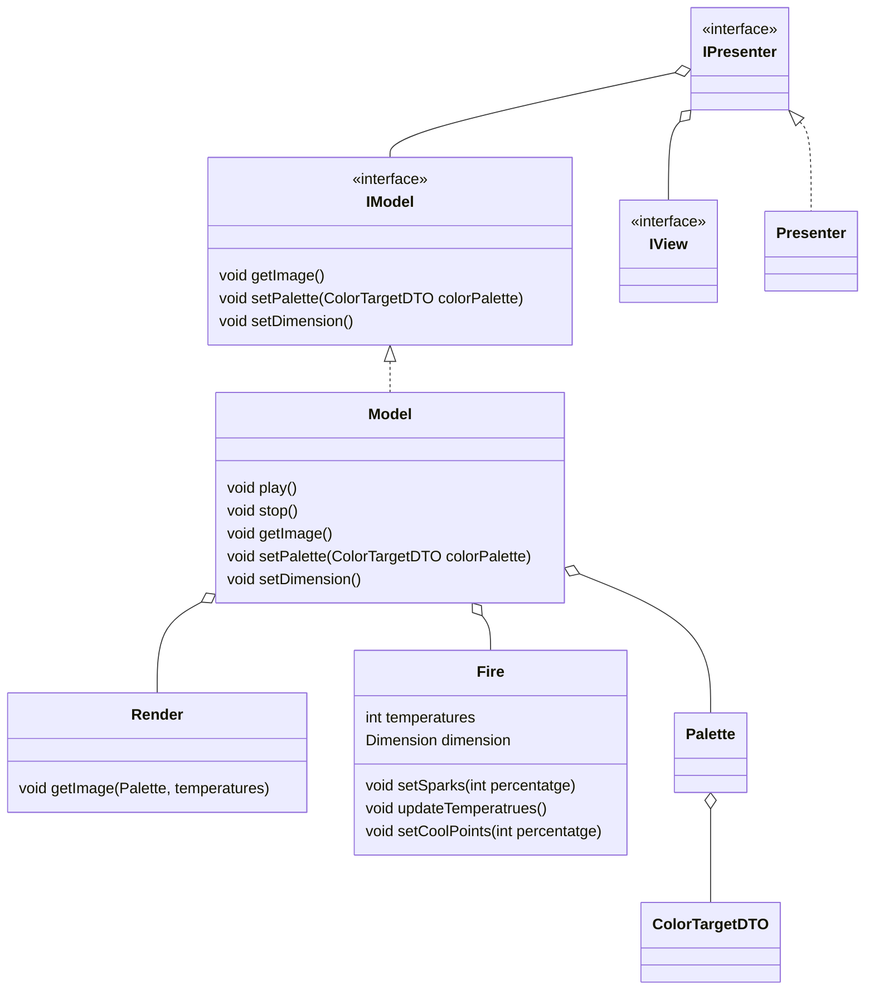

---
tags:
  - desarrollo-de-videojuegos
  - DAM2
unidad: 1
tema: Algoritmo Animación Fuego
---
# Algoritmo Animación Fuego
- Arquitectura MVP
- Programación de un fuego animación
- Matriz de temperatura bidimensional por cada pixel
	- 200x200 (por ej)
	- Las temperaturas se recalculan en cada frame
	- Se usa la información del frame anterior para realizar el calculo y hacer que sea progresivo
	- Evoluciona 
- La temperatura se comprueba con qué paleta corresponde y termina en la imagen (pixel) 
	- BufferedImage
- Especificar color con RGB o HEX con un generador de paletas
- Es necesario saber hacer paneles con JPanel para una interfaz
	- Elementos de la interfaz pertenecen a esa librería

**Algoritmo de paleta de colores**
 - Array de 255
 - Diferentes colores "objetivo" -> color targets
 - Utilizar los diferentes canales para crear una progresión lógica entre un número y otro
 - El truco está en dividir los pasos de un color a otro, entonces el problema son los decimales
 - Color inicial multiplicado por el número de pasos + el incremento
 - Siempre se parte de del inicial, si sumo de 1 en 1 y parto de 100, en el 104 no utilizo 103 uso el 100 para calcular el 105 (supongo que paso 5, 100+5)

**Limpieza de canvas**
- Se debe limpiar los pixeles progresivamente para que un fuego no quede encima de otro
- Técnica de doble buffer, todos los cálculos se realizarán sobre una imagen que no se visualiza
	- Implementado en Java "CreateBufferStrategy"
	- Soporte en la tarjeta gráfica

Ejercicio práctico: Imagen desaturar con Java. Se debe ver a la izquierda el antes y a la derecha el después
	- Pista: la imagen se descomprime dentro de BufferetImage, usarlo, no Image


---

Se seguirá el modelo MVP visto en [[01-hilos-java]] para dibujar ventanas:




- El modelo representa la lógica
- Partes, renderizar imagen, paleta de color (crear, usar), recalcuar temperatura, DTO temperaturas (Data Type Object), DTO color targets, 
- Interpolación lineal por canal con createPalette
- El fuego evoluciona seteando puntos frios, luego seteando puntos calientes y finalmente recalculando para que crezca
- Recalculo de temperatura:
	- O fila de arriba o penúltima (la última es la de los sets)
```
for penultima fila to primera fila
	for primera columna to ultima columna
		temperatura fila actual, columna actual = calcularTemp(x, y); // Calculara la temperatura
```
- La simulación tendra su propio ritmo, el thread estará en la clase fire
- nota: Jumi diferencia variables con propiedades pero parecen exactamente lo mismo